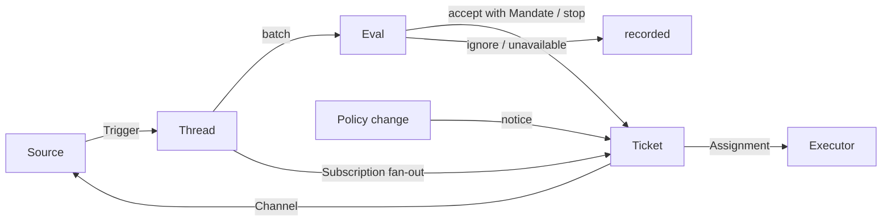

# 02 领域模型：十个概念

::: info 本章
**前置：** [01 设计哲学](./01-philosophy)
**对应上游：** <Doc page="001-domain">001 领域模型</Doc>（112 行，概念表建议对照原文读）
:::

::: tip 带着这些问题读
1. `alice` 在同一个 Issue 里又提了一个和原来无关的需求。系统怎样让它成为第二件事，而不是混进第一件？
2. 同一条评论被轮询读到十次，为什么只产生一个 Trigger，最多一个 Ticket？
3. Ticket 做到一半，有人说"顺便把购物车也重构了"。为什么不能把授权范围直接改大？
4. `alice` 在 GitHub 和飞书各有一个账号，系统为什么不把它们合并成一个"人"？
:::


如果你写过一个"收到 GitHub 评论就调用模型"的小机器人，大概会从一张表开始：`comments`，存评论；再加一张 `tasks`，存要做的事。

用一阵子就会遇到麻烦。同一条评论被读到两次，开了两个任务。一个 Issue 里有两个需求，不知道该挂到哪个任务下。任务做完了有人回复"又复现了"，不知道该新开还是接着做。

SuperAgent 用十个概念来回答这些问题：Source、Trigger、Thread、Correlation、Channel、Policy、Eval、Mandate、Ticket、Assignment，再加上连接 Ticket 和 Thread 的 Subscription。

这一章逐个看它们。每个概念回答三件事：它是什么，它守什么规则，去掉它会坏在哪。

场景沿用 [03](./03-request-lifecycle) 的例子：仓库 `acme/shop`，agent 账号 `acme-bot`，`alice` 在允许名单里，她在 Issue #42 下请 agent 修一个浮点金额显示的 bug。

正文里的源码摘自 commit `8c32a9d`，行号与上游一致。**英文注释是上游原有的，中文注释是本教程加的。** `// …` 表示省略了与本节无关的行。

## 一张图看全部概念 {#map}

> **问题：** 十个概念放在一起，谁指向谁？哪些东西必须一起修改？

上游 <Doc page="001-domain" anchor="flow">001 · Flow</Doc> 用一张流程图画出了概念之间的关系。这里原样搬过来，因为它表达的是确切的关系：



可以从左往右分三段读。

左边是"进来"：Source 产生 Trigger，Trigger 落到 Thread 上。

中间是"判断"：Thread 上排队的 Trigger 成批交给 Eval，Eval 给出一个 Decision。accept 会带着 Mandate 创建 Ticket。

右边是"执行与回写"：Ticket 通过 Assignment 交给 Executor，结果通过 Channel 写回 Source。

图里还有一条容易漏看的边：`Subscription fan-out`。它从 Thread 直接连到 Ticket，**绕过了 Eval**。已有工作的跟进消息走这条边，后面 [Subscription](#subscription) 一节会细讲。

另一个维度是"哪些东西必须一起修改"，上游叫聚合（aggregate）：

| 聚合根 | 持有 | 意味着 |
| --- | --- | --- |
| Source | 自己的读位置 | 重启后从哪里接着读，由 Source 自己负责 |
| Thread | Subscription、正在运行的 Eval、Decision 历史 | Eval 的一致性边界是 Thread |
| Ticket | Assignment、Channel、Input；按 id 引用 Decision | 执行的一切状态都挂在 Ticket 上 |

读后面各节时，可以留意每个字段落在哪个聚合里。很多规则其实就是"这个字段放在哪"的直接结果。

## 逐个概念 {#concepts}

> **问题：** 每个概念守什么规则？这些规则在代码里落在哪？

上游 <Doc page="001-domain" anchor="concepts">001 · Concepts</Doc> 用一张四列表格定义了全部概念。下面不重复那张表，而是看每条规则在类型定义里长什么样。

### Source 与 Trigger {#source-trigger}

> **问题：** 同一条评论，GitHub 通知读到一次，轮询订阅的 Issue 又读到一次。系统怎么知道这是同一件事？

先说 Source。

你在 `src/core/model.ts` 里找不到一个叫 `Source` 的类型。核心代码只认识一个字符串 `source: 'github'`。Source 的实现（怎么轮询、怎么翻译事件）在 `src/sources/` 里，通过 `SourceKind` 接口接入，见 [10 扩展](./10-extending#source-kind)。

这说明 Source 在领域里只承担一件事：**把外部事件翻译成 Trigger**。它守的规则是"重启不能重放事件"。实现方法上游 Cookbook 写得很直接："An interrupted round leaves the cursor unchanged; stable ids make replay safe."（<Doc page="008-cookbook" anchor="_9-the-plugin-entry-and-its-loop">008 · 9</Doc>）

也就是说，读位置可以保守一点，宁可重读；重读的结果靠稳定的 id 去重。

Trigger 的定义如下：

```ts:no-line-numbers
// src/core/model.ts
/** Actor identity in the source's own vocabulary; Policy decides which actors may originate work on that Source. */
// 发送者只是"某个 Source 里的一个 id"，例如 { source: 'github', id: 'alice' }
export interface ActorRef { source: string; id: string }
/** Thread identity; the rule that derives `id` from a native event belongs to the source. */
// 哪些 Trigger 属于同一个 Thread，由 Source 决定。GitHub 用 Issue / PR 编号
export interface ThreadRef { source: string; id: string }
/** Write-only address on a thread; the address format belongs to the source. */
// Channel 的地址格式也归 Source。核心只存下它，回复时原样交回
export interface ChannelRef { source: string; thread: string; address: Record<string, string> }
// …
/** One immutable event produced by a source. `text` and `meta` are untrusted external data. */
export interface Trigger {
  // 由 Source 根据事件内容算出：同一事件永远得到同一个 id。去重和审计都靠它
  id: string
  source: string
  /** Every thread the trigger belongs to; the first (`threads[0]`) is the primary thread that hosts its evaluation. */
  // 规则"属于一个或多个 Thread"写成了数组。多于一个时，这些 Thread 之间就有了 Correlation
  threads: ThreadRef[]
  actor: ActorRef
  /** Source-declared: the event was written by a person rather than a bot, CI, or this agent. */
  human: boolean
  /** Source-declared: the sender addressed the agent, by mentioning it or in a direct message to it. */
  addressed?: 'mention' | 'direct'
  at: string
  // 正文是不可信数据。Gate 从不读它，见 03 第 3 步
  text: string
  channel?: ChannelRef
  url?: string
  /** Source-native details for adapters; the core never interprets them. */
  meta: Record<string, unknown>
}
```

<Src path="src/core/model.ts" lines="4-39" label="model.ts · Trigger" />

`id` 怎么算？GitHub 评论的 id 来自 `key('github-comment', url, 评论 id, 版本)`，构造过程在 [03 第 1 步](./03-request-lifecycle#step-1-trigger) 已经逐行讲过。`key()` 本身只有一行：

`createHash('sha256').update(JSON.stringify(values)).digest('hex').slice(0, 32)`（<Src path="src/core/ids.ts" lines="3-5" label="ids.ts · key()" />）

输入相同，输出就相同。这个函数在核心里到处出现：Ticket 的 id 是 `key('ticket', evaluation.id)`，Input 的 id 也由内容派生。整个系统的幂等性都建立在它上面。

再看"不可变"。`alice` 编辑了她的评论会怎样？评论的 `updated_at` 变了，版本变了，于是得到一个**新的** Trigger。旧的那条原样留着。

这就是 Trigger 作为"审计单元"的意思：任何时候回头看，你都能看到系统当时看到的那条消息，而不是它后来被改成的样子。

如果去掉这两条规则：id 不稳定，重复轮询就会开出重复的 Ticket；Trigger 可变，面板上"为什么接了这单"的依据会在事后悄悄变掉。

### Thread {#thread}

> **问题：** `alice` 一分钟内连发三条评论，agent 应该判断三次还是一次？

Thread 是按时间排列的一串 Trigger。哪些 Trigger 算一串，由 Source 决定：GitHub 上一个 Issue 或一个 PR 是一个 Thread，飞书上一个话题是一个 Thread。

它的定义里藏着两条规则：

```ts:no-line-numbers
// src/core/model.ts:135
/** Active trigger evaluation on a thread; at most one exists per thread. */
export interface Evaluation {
  id: string
  threadKey: string
  triggerIds: string[]
  // …
  strength: Strength
  // …
  policyVersion: string
  // …
}

/** Thread aggregate: consistency boundary of eval, holder of subscriptions and decision history. */
export interface Thread {
  key: string
  ref: ThreadRef
  // …
  /** Tickets subscribed to this thread; live ones receive every trigger as context through fan-out. */
  // 规则"可以有多个 Ticket"：这是一个数组。Subscription 存在 Thread 这一侧，Ticket 上没有对应字段
  subscriptions: string[]
  /**
   * The subscribed tickets whose Executor follows the thread for read-only context, such as an Issue or another pull request
   * it found: its messages reach them, but grant nothing, and a person's message there resumes none of them that ended.
   */
  context?: string[]
  /** Keys of threads that shared a trigger with this one; context only. */
  correlated: string[]
  /** Triggers waiting for the next eval (debounce buffer). */
  // Eval 运行期间到达的 Trigger 在这里排队，下一轮合成一批
  pending: string[]
  // 规则"同时最多一个 Eval"：单个可选字段而不是数组，类型本身就排除了第二个
  evaluating?: Evaluation
  // …
  meta: Record<string, unknown>
}
```

<Src path="src/core/model.ts" lines="135-182" label="model.ts · Evaluation, Thread" />

回到问题。三条评论到达时，如果第一条已经在评估，后两条进 `pending`。等第一轮结束，它们合成一批再判断一次。[03 第 3 步](./03-request-lifecycle#step-3-gate) 里 `evaluateDue` 的 `!thread.evaluating` 检查就是在守这条规则。

为什么要这样？Eval 要读 Thread 的现状：上面有哪些 Ticket、之前做过哪些 Decision。如果同一个 Thread 上同时跑两个 Eval，两边看到的现状可能互相矛盾，比如都认为"这里还没有 Ticket"，于是各开一个。

Decision 历史也属于 Thread。每个 Decision 记着自己的 `threadKey`，存储层按 Thread 查询（`decisions.byThread`，<Src path="src/core/ports.ts" lines="129-133" />）。

`subscriptions` 是数组这一点，留到 [被拒绝的概念](#rejected) 再说。上游专门拒绝过"一个 Thread 只能有一个 Ticket"。

### Correlation {#correlation}

> **问题：** 一条消息同时属于两个 Thread 时，后续消息该送到哪边？

一个 Trigger 可以属于多个 Thread（`threads` 是数组）。这些 Thread 之间的关系叫 Correlation，记在 `Thread.correlated` 里。

上游给它的规则只有一句："Adds context; never routes"

代码里这条规则守得很彻底。`correlated` 只在一个地方写入（`Intake.receive`，<Src path="src/core/intake.ts" lines="37" />），只在一个地方读出：面板的 Thread 详情视图（<Src path="src/app/views/threads.ts" lines="46" />）。扇出、Gate、Eval 都不读它。

所以 Correlation 只帮人"看到相关的东西"，从不决定"消息送给谁"。送给谁由 Subscription 决定。

上游说它的用途是 "Lets Eval follow related evidence"。不过在锁定版本里，研判上下文（`src/app/assessment.ts`、`src/app/cards.ts`）并没有读 `correlated`，模型目前看不到它。这一点以代码为准。

为什么要分开？如果 Correlation 也能路由，A 和 B 关联、B 和 C 关联，一条 C 上的消息就可能沿着关联链送到 A 的 Ticket。路由范围会随着关联不断扩大，谁也说不清一条消息最后会到哪。

顺带一提：在锁定版本里，GitHub 和飞书 Source 构造的 Trigger 都只有一个 Thread（例如 <Src path="src/sources/github-trigger.ts" lines="69" />、<Src path="src/sources/feishu-trigger.ts" lines="37" />），所以 `correlated` 实际上总是空的。这个概念是为将来的 Source 预留的。

### Channel {#channel}

> **问题：** agent 要说话时，往哪里写？

Channel 是 Thread 的写入端。上面 `ChannelRef` 的 `address` 由 Source 定义，核心不解读。

一个 Thread 可以有多个 Channel。在 GitHub 上，PR 的普通评论和某条 review 线程里的回复是两个不同的写入地址，上游在 <Doc page="001-domain" anchor="what-is-reusable">001 · What is reusable</Doc> 里把 Channel 的实现列为 "GitHub comments and review thread replies"。

Ticket 持有一组 Channel。接单时，`Tickets.create` 从这批 Trigger 里收集它们，去掉重复（[03 第 5 步](./03-request-lifecycle#step-5-accept)）。以后的回复都发回请求出现的地方。

上游说 Channel 存在的理由是："Acknowledgements, replies, pull requests and resolved reviews are all writes"。把这些都归为"写入"，就能用同一套机制处理它们：先存进 Outbox，再按顺序发出，失败了重试。这套机制在 [06 可靠性](./06-reliability#outbox) 讲。

### Eval 与 Policy {#eval-policy}

> **问题：** 判断"要不要接这单"的东西，需要记住什么？

上游对 Eval 的规则里有一句容易让人困惑："Holds no state"。

可 `Thread.evaluating` 明明就是一条 Eval 记录。这怎么算没有状态？

看端口定义就明白了。Eval 需要的一切都作为参数传进来，它的结果作为 Decision 传出去：

```ts:no-line-numbers
// src/core/ports.ts:16
/** Versioned rules; `gate` decides who may originate work. Source scope is not part of Policy. */
export interface Policy {
  // 规则、接单模式、各 Source 部分的哈希。见 no-person 一节的 policyVersion()
  version: string
  paused: boolean
  // 第一层：纯函数，输入是 Trigger、Thread 快照和 Thread 上的全部 Ticket
  gate(trigger: Trigger, thread: Thread, tickets: Ticket[]): GateResult
  /** Re-check a mandate's gate-layer basis under this policy, such as before an ended ticket resumes. */
  revalidate(mandate: Mandate): boolean
  /** Whether an inferred candidate may be accepted on the rules its assessment matched: assessments accept, and each rule is enabled. */
  admitsInferred(rules: readonly string[]): boolean
  /** How long an assessor may take before an eval is recorded as unavailable. */
  evalTimeoutMs: number
}

/** What the assessor receives: bounded facts, never authority. */
// 第二层（模型）拿到的全部输入。它看得到事实，拿不到权限
export interface Candidate {
  evalId: string
  thread: Thread
  triggers: Trigger[]
  strength: Strength
  policyVersion: string
  /** Every ticket on the thread, including ended ones, for duplicate judgement. */
  // 包括已结束的 Ticket：模型据此判断"这是不是已经做过的事"
  tickets: Ticket[]
}
// …
/**
 * Executes assignments; concurrency and workspace management are its own concern. The Engine calls it inside its
 * commands, so each method only queues work, which reports back through the Engine's callbacks.
 */
// Executor 在领域之外，只通过 Assignment 和这三个方法接入
export interface Executor {
  /** Queue a pending assignment for launch; reports back through `Engine.assignmentStarted` or a `failed` report. */
  start(ticket: Ticket, assignment: Assignment): void
  // …
  deliver(ticket: Ticket, assignment: Assignment): void
  /** End an assignment's work, such as cancelling its Session's turn; called after the ticket or assignment has already ended in the domain. */
  stop(ticket: Ticket, assignment: Assignment, reason: string): void
}
```

<Src path="src/core/ports.ts" lines="16-69" label="ports.ts · Policy, Candidate, Executor" />

对照 001 里 Eval 的输入："the Trigger batch, a Thread snapshot, every Ticket on the Thread including ended ones, and the current Policy"。`gate()` 的三个参数加上 `Policy` 自己，正好是这四样。`Candidate` 是同样的四样交给模型。

所以"没有状态"指的是：Eval 不保存任何只属于它自己的东西。`Thread.evaluating` 是 Thread 聚合的一部分，记录"这个 Thread 上正在进行一次判断"；判断要用的事实每次从 Thread 和 Ticket 现读。

这样做的好处在 Policy 变化时最明显。Policy 版本一变，正在运行的 Eval 直接作废，Trigger 重新排队（<Doc page="002-authorization" anchor="policy-version">002 · Policy version</Doc>）。因为 Eval 没有私有状态，作废时没有东西需要迁移或清理。[04 授权](./04-authorization#policy-version) 会走一遍这个过程。

Policy 本身也是无状态的：上游 007 说 `settingsPolicy(settings, scope)` "returns a fresh, stateless `Policy` on each use"（<Doc page="007-architecture" anchor="policy">007 · Policy</Doc>）。每次用都从当前设置重新生成。

Eval 的两层（Gate 和 Assessment）怎样分工，是 [04 授权](./04-authorization#two-layers) 的主题。这里只需记住：Eval 的结果是一个 Decision，取值是 accept、stop、ignore、unavailable 之一。

### Mandate {#mandate}

> **问题：** 接单那一刻，系统要记下什么，才能在三周后还说得清"agent 凭什么做这件事"？

Mandate 是 accept 授予的东西。001 列出了它的组成：Policy 版本、范围、强度、命中的规则、发送者在那个 Source 上的身份、Source 是怎样收到这条 Trigger 的。

逐一对照类型定义：

```ts:no-line-numbers
// src/core/model.ts:96
export type Strength = 'explicit' | 'inferred'
// …
/** Where a Mandate's Trigger was received: its Source, its receiving scope as the Source recorded it, and its admission row. */
// 对应 001 的"Source 是怎样收到这条 Trigger 的"
interface Received { source?: string; scope?: Record<string, unknown>; row?: string }
// …
// rules 对应"命中的规则"；sender 是接单时允许名单里的名字
export type MandateBasis = Received & { sender?: string; rules?: string[] } & (
  // via：Gate 走的是哪条分支。恢复前的重新校验按这个字段选检查方式
  | { via: 'addressed'; addressed: 'mention' | 'direct' }
  | { via: 'followup'; authority?: string }
  | { via: 'admission'; cell: AdmissionCell; addressed?: 'mention' | 'direct'; observation?: { mode: AcceptMode } }
  | { via: 'listed'; addressed?: 'mention' | 'direct'; observation?: { mode?: AcceptMode }; authority?: string }
  /** A message of a bot on its Source's bot list: an inferred candidate at most, never an explicit request or a stop. */
  | { via: 'bot'; addressed?: 'mention' | 'direct'; observation: { mode: AcceptMode } }
)

/** Immutable authorization produced by an accept decision; execution is bounded by it and it never changes. */
export interface Mandate {
  // 强度：来自 Gate（代码），模型改不了
  strength: Strength
  // 接单时的 Policy 版本：以后 Policy 变了，还能知道它当初依据的是哪一版
  policyVersion: string
  /** How the gate admitted it, for re-validation and audit. */
  basis: MandateBasis
  // 发送者在那个 Source 上的身份，例如 { source: 'github', id: 'alice' }
  actor: ActorRef
  // 范围：唯一由模型写的字段，一句话描述"可以做什么"
  scope: string
}
```

<Src path="src/core/model.ts" lines="96-133" label="model.ts · MandateBasis, Mandate" />

注释说 "it never changes"。但你会发现字段上并没有 `readonly`。不可变靠的是另一件事：在 `src/core` 里，Mandate 只在 `Evals.accept` 里构造一次（[03 第 5 步](./03-request-lifecycle#step-5-accept)），之后没有任何代码给 `ticket.mandate` 赋值。唯一的例外是升级迁移把旧记录的 `basis` 转成新格式（<Src path="src/app/migration.ts" lines="52" />），改的是存储格式，授权内容不变。

为什么必须不可变？回到开头的问题 3。

`alice` 请 agent 修浮点 bug，`scope` 是"修复结算页金额的浮点显示"。做到一半，reviewer `bob` 说"顺便把购物车也重构了"。

如果 Mandate 可以改，执行器自己就能把 `scope` 改大。授权就从"`alice` 批准了什么"变成了"执行器认为自己可以做什么"。

上游的规则是："wider scope means a new Ticket"。执行器把 `bob` 的消息交回主 Session，作为新候选重新过 Gate（[03 第 9 步](./03-request-lifecycle#step-9-followup)）。`bob` 不在允许名单里，这次就过不去了。

Mandate 的生命周期也和 Ticket 分开。Ticket 结束了，Mandate 还在，所以一周后 `alice` 说"又复现了"，同一个 Ticket 能直接恢复。能改变 Mandate 的只有三件事：accept 创建它，人的 stop 撤回它，重新校验失败吊销它。详见 [04 · Mandate](./04-authorization#mandate)。

### Ticket 与 Assignment {#ticket-assignment}

> **问题：** 执行器 Session 崩了、重试了、换了一个，"这件事"还是同一件事吗？

Ticket 是一个获授权的工作单元。Assignment 是 Ticket 和某一个 Executor 实例的绑定。两者分开，是这一节的重点：

```ts:no-line-numbers
// src/core/model.ts:211
export type AssignmentState = 'pending' | 'running' | 'ended'
// …
export type ReportState = 'progress' | 'waiting' | 'ready' | 'blocked' | 'failed' | 'dropped'
/** Binding between a ticket and one executor instance. */
export interface Assignment {
  id: string
  // 自己的三态，独立于 Ticket：一个 Assignment 结束了，Ticket 可以还开着
  state: AssignmentState
  // …
  // 执行器的报告是结构化的枚举，不是自由文本
  report?: { state: ReportState; summary: string; at: string }
  // …
}
// …
// Ticket 只有两种结束者：执行器一侧，或者人
export type TicketEndBy = 'executor' | 'human'
/** How a ticket ended: with its result, with its pull request merged or closed unmerged, with nothing to do, or stopped by a person. */
export type TicketOutcome = 'completed' | 'merged' | 'closed' | 'dropped' | 'stopped'
// …
/** Ticket aggregate: an authorized work item with its assignments, channels, thread bindings, and inputs. */
export interface Ticket {
  id: string
  title: string
  // 按 id 引用 Decision，不持有它：Decision 属于 Thread 聚合
  decisionId: string
  mandate: Mandate
  /** The Channels of the messages it was accepted from, which its replies go to. */
  channels: ChannelRef[]
  /** When, by whom, and how the ticket ended, with a person's or the host's reason beyond the outcome; an open ticket has none. */
  // open → ended 就是这个字段的有无。恢复时删掉它，Ticket 回到 open
  ended?: { at: string; by: TicketEndBy; outcome: TicketOutcome; reason?: string }
  // …
  // 随时间推移可以有多个：重试、重启都会开新的 Assignment
  assignments: Assignment[]
  inputs: TicketInput[]
  // …
  follows?: Follow[]
  // …
  origin: { triggerId: string; triggerIds: string[] }
  /** What its Executor chose: its short name, directory and assignment text. */
  execution?: Execution
  // …
}
// …
/** Whether a ticket is open: it has not ended. */
export const liveTicket = (ticket: Pick<Ticket, 'ended'>): boolean => !ticket.ended
```

<Src path="src/core/model.ts" lines="211-318" label="model.ts · Assignment, Ticket" />

先看 Ticket 上**没有**的东西。

没有 DSH Session 的 id，没有 Session 的状态。Session 名由 Ticket id 派生（`worker-<ticket id>`），面板上的阶段由 `ticketStage()` 从 Ticket 自己的字段算出来（[03 第 8 步](./03-request-lifecycle#step-8-report)）。这就是上游说的 "Defines its own state instead of following the Executor's"。

也没有 `subscriptions`。Ticket 订阅了哪些 Thread，要去 Thread 那边查。下一节讲为什么。

再看规则 "Only Eval creates one"。整个仓库里调用 `tickets.create` 的只有一处：`Evals.accept`（<Src path="src/core/evals.ts" lines="314" />）。面板、工具、Source 都没有创建 Ticket 的入口。所以每个 Ticket 都能追溯到一个 Decision，进而追溯到一次 Gate 判断。

最后是 Assignment 为什么必须存在。上游的理由是："The Executor is outside the domain, but who executes must be inside it"。

执行器可能失败、被重试、在重启后换一个新实例。如果 Ticket 直接指向"那个 Session"，每次换人都要改 Ticket 的身份。有了 Assignment，Ticket 不变，只是 `assignments` 里多了一条。

谁能结束 Ticket 也写进了类型：`TicketEndBy` 只有 `executor` 和 `human`。执行器一侧的结束来自它的最终报告，或者它跟踪的 PR 关闭（[05 · 结束](./05-execution#ending)）；人的结束只能来自 Eval 的 stop 或面板上的停止按钮。

### Subscription {#subscription}

> **问题：** reviewer 在 PR 上留言，为什么不用 @ agent，执行器也能收到？

Subscription 是 Ticket 和 Thread 之间的多对多关系，存在 Thread 一侧（上面的 `Thread.subscriptions`）。

添加订阅在代码里只有一个入口（取消订阅走 `dropSubscriptions`）：

```ts:no-line-numbers
// src/core/tickets.ts:402
  /**
   * Subscribe an open ticket to a Thread its Executor found related, for context: see `Thread.context`.
   * @returns false when the ticket follows the Thread already.
   * @throws UserError when the ticket is unknown or has ended.
   */
  followForContext(ticketId: string, ref: ThreadRef): boolean {
    if (!liveTicket(this.require(ticketId))) throw new UserError('ticketEnded')
    if (this.thread(ref).subscriptions.includes(ticketId)) return false
    this.subscribe(ticketId, ref)
    const thread = this.thread(ref)
    // 订阅之后再标记为"只读上下文"：消息照样送到，但不授予跟进强度，也不唤醒已结束的 Ticket
    thread.context = [...thread.context ?? [], ticketId]
    this.repo.threads.save(thread)
    return true
  }
  /** Subscribe a ticket to a Thread; later Triggers on it reach the ticket as Inputs, as the ticket's own once it was for context. */
  private subscribe(ticketId: string, ref: ThreadRef): void {
    // 写的是 Thread，不是 Ticket：Subscription 归 Thread 聚合
    const thread = this.thread(ref)
    if (!thread.subscriptions.includes(ticketId)) { thread.subscriptions.push(ticketId); this.emit('thread.subscribed', { threadKey: thread.key, ticketId }) }
    // 正式订阅会把"只读上下文"升级为 Ticket 自己的 Thread
    if (thread.context?.includes(ticketId)) thread.context = thread.context.filter(id => id !== ticketId)
    this.repo.threads.save(thread)
  }
```

<Src path="src/core/tickets.ts" lines="402-422" label="tickets.ts · followForContext(), subscribe()" />

为什么存在 Thread 一侧？想想消息到达时要做什么：Intake 拿到一个 Trigger，要找出所有该收到它的 Ticket。存在 Thread 上，就是读一个数组（[03 第 2 步](./03-request-lifecycle#step-2-intake) 的扇出循环）。存在 Ticket 上，就得扫一遍所有 Ticket。

更重要的是一致性。Thread 是 Eval 的一致性边界。Eval 判断"这条消息是不是已有工作的跟进"，读的正是 `subscriptions`。Subscription 和 Eval 在同一个聚合里，Eval 看到的订阅关系就不会和它同时发生的变化打架。

Subscription 最值得注意的规则是：**扇出时不检查发送者是谁**。

reviewer `bob` 不在允许名单里，他在 PR 上的评论照样送给 Ticket。这不危险，因为 Subscription 只传递上下文，不授予权限。执行器仍然受 Mandate 范围约束。上游原话："the Mandate separates authorization from context"。

谁能取消 Subscription 也有限制：执行器只能取消自己 Ticket 到某个它认为无关的 Thread 的订阅，并且不能取消 Ticket 起源的那个 Thread，也不能取消 Source 让它跟踪的 Thread（比如它自己的 PR）。`markUnrelated` 开头的两个 `throw` 就是这条规则（<Src path="src/core/tickets.ts" lines="185-190" label="tickets.ts · markUnrelated()" />）。

跟进消息归谁决定、什么时候交回，是 [05 · 跟进](./05-execution#followups) 的主题。

## 人不是领域概念 {#no-person}

> **问题：** 几乎每个协作系统都有"用户"表。这里为什么没有？

`alice` 在 GitHub 上是 `alice`，在飞书上是 `ou_5f3a9c2e`（飞书的 open_id，这里是虚构的示例）。你可能觉得系统应该知道这是同一个人。

上游明确拒绝了这件事："A person is not a domain concept."

看 Trigger 的 `actor` 字段：`{ source: 'github', id: 'alice' }`。它只是"这个 Source 里的一个 id"。允许名单也按 Source 分开存：

```ts:no-line-numbers
// src/policy.ts:116
export function policyVersion(settings: Settings): string {
  // 各 Source 的 Policy 部分（含允许名单）参与 Policy 版本的哈希
  return key(POLICY_REVISION, JSON.stringify({ rules: settings.policy.rules, mode: settings.eval.mode, sources: settings.policy.sources }))
}
export function allowedSender(settings: Settings, actor: ActorRef): z.infer<typeof AllowedSchema> | undefined {
  // 先按 actor.source 找到那个 Source 的名单，再在名单里按 id 找。跨 Source 永远查不到
  return settings.policy.sources[actor.source]?.allowed.find(entry => sameName(entry.id, actor.id))
}
```

<Src path="src/policy.ts" lines="116-121" label="policy.ts · policyVersion(), allowedSender()" />

`alice` 在 GitHub 名单里，不代表她的飞书账号也在。要让她在两边都能发起工作，就在两边的名单里各加一次。

那"这两个账号是同一个人"这个事实放在哪？上游的答案是 prompt。团队可以写一个 `identities` skill，告诉 agent 哪个飞书用户对应哪个 GitHub 账号（<Doc page="004-prompts" anchor="what-a-team-writes">004 · 团队可写的内容</Doc>）。agent 需要时去读，比如在飞书上回复时想 @ 对应的 PR 作者。

这个选择省掉了什么？

- **身份合并。** 不用处理"两个账号被误合并""一个账号被冒领"。
- **权限继承。** 不会出现"她在 GitHub 有权限，所以飞书上也有"这种隐含推导。每个 Source 上的权限都写在那个 Source 的名单里，一眼看得清。
- **同步问题。** 不用维护一张跨系统的映射表，也不用担心它和各平台的真实账号不一致。

代价是什么？

- 同一个人要在多个名单里各登记一次。
- 映射写在 prompt 里，属于模型读的参考信息，**不参与任何权限判断**。这其实正是想要的效果：映射出错，最多是 agent @ 错了人，不会让谁多拿到权限。

注意 `policyVersion()` 把 `sources` 整个放进了哈希。改了任何一个 Source 的名单，Policy 版本就变了，正在运行的 Eval 会作废重排。名单是权限的一部分，这样处理是一致的。

## 被拒绝的概念 {#rejected}

> **问题：** 一个设计拒绝了什么，能说明它在想什么？

<Doc page="001-domain" anchor="rejected-concepts">001 · Rejected concepts</Doc> 列了 12 条被拒绝的做法。很多条第一眼看上去都很合理，甚至是常见系统的默认做法。

下表是全部 12 条的一句话版本，每条链接到附录里的完整讨论：

| 被拒绝的做法 | 改用了什么 |
| --- | --- |
| [把人或成员身份做成实体，或跨 Source 映射身份](/appendix/rejected-designs#principal-entity) | 人是 Trigger 元数据，名单是各 Source 的 Policy 部分，映射写在 prompt 里 |
| [Eval 自己安排延时 Trigger](/appendix/rejected-designs#eval-schedules-waits) | 需要等待的条件做成普通 Source |
| [Eval 有"等待中""已撤销"状态](/appendix/rejected-designs#eval-waiting-states) | 超时就重排或记 `unavailable` |
| [每个 Thread 最多一个活跃 Ticket](/appendix/rejected-designs#one-ticket-per-thread) | 一个 Thread 多个 Ticket，由研判避免重复 |
| ["追加到 Ticket"作为一种 Decision](/appendix/rejected-designs#append-decision) | Subscription 扇出，不经过 Eval |
| [Subscription 上做准入检查](/appendix/rejected-designs#admission-on-subscriptions) | Mandate 管授权，Subscription 只管上下文 |
| [会路由的 Correlation](/appendix/rejected-designs#routing-correlation) | 路由只走 Subscription |
| [Ticket 状态跟随 DSH Session](/appendix/rejected-designs#ticket-follows-session) | Ticket 定义自己的状态 |
| [执行器声明"人要求我停"](/appendix/rejected-designs#executor-declares-stop) | 只有 Eval 决定结束的强度 |
| [Policy 变化时取消运行中的 Ticket](/appendix/rejected-designs#cancel-on-policy-change) | 记录变化并作为 Input 送达 |
| [执行器失败时锁住它的全部工具](/appendix/rejected-designs#lock-tools-on-failure) | 只暂停自动输入 |
| [从报告的自由文本推断"在等人"](/appendix/rejected-designs#infer-waiting-from-text) | 执行器通过结构化字段提问 |

这里挑四条细说。它们和本章的类型定义关系最紧。

**每个 Thread 最多一个活跃 Ticket。** 这条规则很诱人：有了它，"这条消息该给谁"永远只有一个答案。

但想想开头的问题 1。`alice` 在 #42 里先请 agent 修浮点 bug，过了一会儿又写"@acme-bot 另外，导出 CSV 时日期格式也不对"。这是两件独立的事。如果一个 Thread 只能有一个 Ticket，第二件事要么被拒绝，要么塞进第一个 Ticket，让一个 Mandate 覆盖两件事。

上游的做法：`Thread.subscriptions` 是数组，同一个 Thread 可以有多个 Ticket。重复怎么避免？交给研判。`Candidate.tickets` 里有 Thread 上的全部 Ticket，包括已结束的，注释写着 "for duplicate judgement"。模型看到已有一个"修浮点 bug"的 Ticket，就能判断新消息是不是同一件事。

**"追加到 Ticket"作为一种 Decision。** 看 `DecisionKind`，取值是 `'ignore' | 'accept' | 'reopen' | 'stop' | 'unavailable'`（<Src path="src/core/model.ts" lines="190" />），没有 append。（`reopen` 是旧版本留下的，见 `TicketInput` 里 "written before ended tickets resumed on their own" 的注释。）

跟进消息不需要 Decision，因为它不需要判断：消息到了一个已订阅的 Thread，就送给订阅它的 Ticket。如果做成 Decision，每条跟进都要排队等 Eval、叫一次模型，`alice` 在 PR 里说一句"谢谢"也要判断一回。

**执行器声明"人要求我停"。** 执行器能报告 `dropped`（没什么可做的），但没有办法以"人"的名义结束 Ticket。人的 stop 只能走 Eval，而且要求强度是 explicit：

```ts:no-line-numbers
// src/core/evals.ts:293
    if (outcome.kind === 'stop') {
      const ticket = this.repo.tickets.get(outcome.ticketId)
      if (!ticket || !liveTicket(ticket)) return this.finish(thread, evaluation, { kind: 'ignore', reason: [{ code: 'stopUnknown' }],
        ...audit })
      // 发 stop 的这条消息必须是 explicit：名单外的人、bot 都叫不停别人的工作
      if (evaluation.strength !== 'explicit') return this.finish(thread, evaluation, { kind: 'ignore',
        reason: [{ code: 'stopNotExplicit' }], ...audit })
      const decision = this.finish(thread, evaluation, { kind: 'stop', reason: reasonOf(outcome.reason), ticketId: ticket.id, ...audit })
      // 以 'human' 结束：这个 Ticket 从此收不到任何消息，Mandate 被撤回
      this.tickets.end(ticket.id, 'human', 'stopped', this.now(), typeof outcome.reason === 'string' ? outcome.reason : undefined)
      return decision
    }
```

<Src path="src/core/evals.ts" lines="293-302" label="evals.ts · Evals.decideEval() 的 stop 分支" />

为什么这么严？`ended.by === 'human'` 的后果很重：Ticket 再也不会被唤醒（[03 第 10 步](./03-request-lifecycle#step-10-end) 里 `resumes` 那一行）。如果执行器能声明"人叫我停"，它读到一条 bot 消息或名单外的人说"别做了"，就可能永久关掉一个本该继续的 Ticket。Gate 本来挡住的那些人，就从这条路绕了进来。

**从报告的自由文本推断"在等人"。** 面板要把"等人回答"的 Ticket 排在最前面。最省事的办法是看执行器的报告里有没有问号，或者让模型判断"这段话是不是在提问"。

上游拒绝了，理由是 "The classification needs structured facts"。执行器提问要填 `orchestrator_report` 的 `human_action` 字段（<Src path="src/app/tools/executor.ts" lines="80" />），报告状态是 `ReportState` 枚举。`ticketStage()` 和 `waitsForPerson()` 都只读这些结构化字段。

面板的计数要等于它链接的列表长度（[08 · 原则](./08-panel#principles)）。分类靠猜，这一点就做不到。

其余八条见 [被拒绝的设计](/appendix/rejected-designs)，附录还收录了上游其他文档里的同类决定。

## 什么是可复用的 {#reusable}

> **问题：** 想给自己的团队做一个类似的 agent，哪些部分能直接拿走？

上游 <Doc page="001-domain" anchor="what-is-reusable">001 · What is reusable</Doc> 的回答是：概念和规则可复用；Source、Policy 内容、Executor、Channel 的实现属于具体部署。

这条分界在目录结构上看得见。上游的依赖规则写着："`src/core` imports nothing outside itself apart from Node's hashing, and does no I/O."（<Doc page="007-architecture" anchor="dependency-rules">007 · Dependency rules</Doc>）

本章贴的类型定义全部来自 `src/core`。它们不知道 GitHub 是什么，也不知道 DSH Session 怎么创建。

| 部分 | 可复用的 | 属于部署的 |
| --- | --- | --- |
| Source | `Trigger`、`ThreadRef`、`ChannelRef` 的形状；"id 稳定、读位置保守"的规则 | GitHub 怎么轮询通知、飞书怎么收事件 |
| Policy | `Policy` 端口：`gate`、`revalidate`、`admitsInferred` | 允许名单、准入表、规则内容 |
| Executor | `Executor` 端口：`start`、`deliver`、`stop` | 一个 DSH Session 加一个目录 |
| Channel | "回复回到请求出现的地方"、"写入先存再发" | GitHub 评论、review 线程回复、飞书话题回复 |

每个 Source 内部可以继续用自己的词：GitHub 说 notification，飞书说 message。翻译成 Trigger 之后，核心只认 Trigger。

如果你想自己接一个新 Source，比如 GitLab 或 Slack，[10 扩展](./10-extending#map-first) 会按上游 Cookbook 走一遍。第一步就是本章做的事：把那个平台的事件对应到这十个概念上。

## 回顾 {#recap}

| 概念 | 守的规则 | 在代码里 | 去掉会怎样 |
| --- | --- | --- | --- |
| Source | 重启不重放事件 | 读位置保守 + 稳定 id | 重启后重复处理 |
| Trigger | 不可变；接受两次只建一个 Ticket | `key()` 派生 id；`Intake` 去重 | 重复 Ticket；审计依据会变 |
| Thread | 同时最多一个 Eval；可有多个 Ticket | `evaluating?` 单字段；`subscriptions[]` | 并发 Eval 看到矛盾的现状 |
| Correlation | 只加上下文，不路由 | 只有面板读 `correlated` | 路由范围沿关联链扩大 |
| Channel | 回复回到请求出现的地方 | `Ticket.channels` | 回复发错地方 |
| Policy | 有版本；变化时作废运行中的 Eval | `policyVersion()` 哈希 | 按旧规则做出新决定 |
| Eval | 无私有状态；输出一个 Decision | `gate()` 与 `Candidate` 的参数 | 作废时要清理残留状态 |
| Mandate | 不可变；扩大范围要开新 Ticket | 只在 `Evals.accept` 构造 | 执行器自己扩大授权 |
| Ticket / Assignment | 只有 Eval 创建；状态不跟随执行器 | `tickets.create` 只有一个调用点 | 换执行器就丢了"这件事" |
| Subscription | 存在 Thread 侧；扇出不查发送者 | `subscribe()` 写 Thread | 跟进每次都要重新 @ |

回到开头的四个问题：

1. 第二个需求是同一个 Thread 上的新 Trigger，经过 Eval 成为第二个 Ticket。Thread 允许多个 Ticket，研判用 Thread 上已有的 Ticket 列表避免重复。
2. Trigger 的 id 由内容决定，十次读取得到同一个 id，Intake 丢掉后九次。Ticket 的 id 又由 Eval 的 id 决定，同一个 Eval 只对应一个 Ticket。
3. Mandate 不可变。范围之外的请求被交回主 Session，作为新候选重新过 Gate。
4. 人不是领域概念。权限按 Source 分开登记，跨 Source 的对应关系是 prompt 里的参考信息，不参与权限判断。

## 思考题 {#exercises}

1. 如果允许"每个 Thread 最多一个活跃 Ticket"，`alice` 在 #42 里同时提出两个不相关的需求时，第二个需求会怎样？第一个 Ticket 的 Mandate 会变成什么样？
2. Subscription 为什么挂在 Thread 上而不是 Ticket 上？提示：想想 Eval 判断"这是不是跟进"时要读什么，以及它们是否在同一个聚合里。
3. 把 `Thread.evaluating` 从可选字段改成数组 `evaluating: Evaluation[]`，哪些上游规则会被打破？举一个会出错的时间线。
4. 某个 Source 让一条 Trigger 同时属于 Issue #42 和 PR #57 两个 Thread。#57 上有一个 Ticket 订阅着，#42 上没有。一条只属于 #42 的后续评论，会送到 #57 的 Ticket 吗？为什么？
