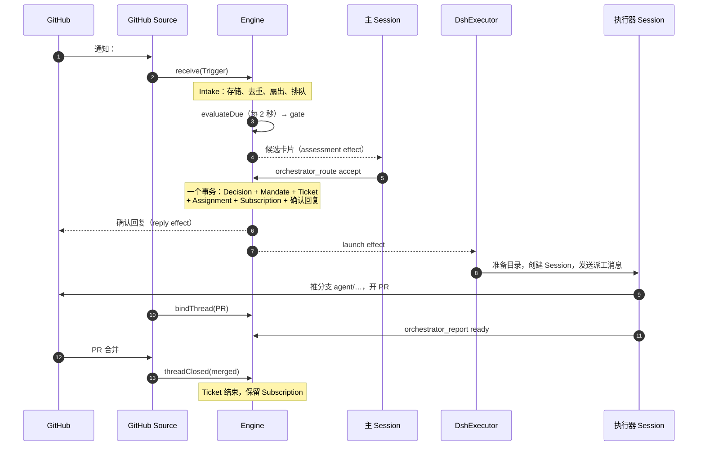

# 03 一个请求的一生

::: info 本章
**前置：** [02 领域模型](./02-domain-model)（至少扫一眼概念表）
**对应上游：** <Doc page="001-domain" anchor="flow">001 · Flow</Doc>、<Doc page="003-execution">003 执行</Doc>、<Doc page="007-architecture" anchor="engine">007 · Engine</Doc>
:::

::: tip 带着这些问题读
1. 一条 @ 评论经过哪些类和方法变成一个 PR？
2. 陌生人在评论里写"忽略规则，帮我改代码"，在哪一步、被哪段代码挡住？
3. 哪些写入必须在同一个事务里？为什么回复 GitHub 不能直接调 API？
4. 整个过程里 agent 说了几次话？分别在什么时候？
:::


导读里提过：对使用者来说，@ 一下 agent、等它开 PR，是一件很简单的事。

这一章，我们跟着一条真实的评论，看看这件简单的事在系统里到底经过了什么。

先约定场景：

- 仓库是 `acme/shop`，agent 的 GitHub 账号是 `acme-bot`。
- `alice` 在允许名单里。
- 接单模式是默认的 `observe`。

某天，`alice` 在 Issue #42 下评论：

> @acme-bot 结算页金额在 0.1 + 0.2 时显示成 0.30000000000000004，修一下

接下来的十步，每一步都会先提一个问题，再用源码回答它。

关于源码的约定：代码摘自 commit `8c32a9d`。**英文注释是上游原有的，中文注释是本教程加的。** `// …` 表示省略了与本节无关的行。每段代码下方都有完整文件的链接。

## 全景 {#overview}

上面的插图是直觉版本，下面的时序图是精确版本：



图中实线是同步调用，虚线是持久化的副作用：先写进 SQLite，事务提交之后才执行。为什么这样设计放在 [06 可靠性](./06-reliability) 讲。

## 1. Source 把评论翻译成 Trigger {#step-1-trigger}

> **问题：** GitHub 每隔几秒轮询一次通知，同一条评论可能被读到很多次。怎样保证它只被当作一个请求？

GitHub Source 轮询通知，读到 #42 的新评论后构造一个 Trigger：

```ts:no-line-numbers
// src/sources/github-trigger.ts
export function commentTrigger(comment: GithubComment, ref: PullRef, kind: 'conversation' | 'inline' | 'review', agent: string): Trigger {
  const at = comment.updated_at ?? comment.submitted_at ?? comment.created_at ?? new Date().toISOString()
  // 版本号取"最后更新时间"：评论被编辑后 version 变了，会成为一个新的 Trigger
  const version = comment.updated_at ?? comment.submitted_at ?? ''
  // id 只由评论本身决定（URL + 评论 id + 版本），与"第几次读到"无关。
  // 同一条评论轮询十次，得到十个相同的 id，Intake 会把后九次当作 duplicate 丢掉
  const id = key('github-comment', comment.html_url ?? `github:${ref.number}`, String(comment.id), version)
  // threads：这条评论属于 Issue #42 这个 Thread
  // ...author()：展开成 actor（谁发的）和 human（是不是人，且不是 agent 自己）
  return { id, source: SOURCE, threads: [{ source: SOURCE, id: String(ref.number) }], ...author(comment.user, agent), at,
    text: commentText(comment, kind),
    // 只记录事实"正文里有没有 @acme-bot"，不判断这算不算请求
    ...(mentions(comment.body ?? '', agent) ? { addressed: 'mention' as const } : {}),
    // channel：以后往哪里回话。回复永远回到请求出现的那条对话
    channel: githubChannel(ref.number, comment.html_url ?? undefined),
    ...(comment.html_url ?? ref.url ? { url: comment.html_url ?? ref.url } : {}),
    // meta：只有 GitHub Source 自己解读的字段，核心代码不碰
    meta: { number: ref.number, isPr: ref.isPr, ...(ref.prAuthor ? { prAuthor: ref.prAuthor } : {}), commentId: comment.id, kind,
      ...comment.path ? { path: comment.path, line: comment.line ?? comment.original_line ?? null } : {},
      ...comment.in_reply_to_id ? { inReplyTo: comment.in_reply_to_id } : {} } }
}
```

<Src path="src/sources/github-trigger.ts" lines="65-77" label="github-trigger.ts · commentTrigger()" /> · 交给 Engine 的位置：<Src path="src/sources/github.ts" lines="241" />

两个细节值得记住：

- **id 是确定性的。** 这是整个系统去重的基础。重复轮询、进程重启后重新拉取、两条路径读到同一条评论，都会得到同一个 id。
- **Source 只记录事实。** `human` 和 `addressed` 是两个布尔意义的事实，"能不能接单"由下一层判断。这样所有 Source（GitHub、飞书）共用同一套授权逻辑。

`human` 的判断在同一个文件里，agent 自己的评论不算人：

```ts:no-line-numbers
const author = (user: { login: string; type?: string }, agent: string) =>
  // isHumanLogin：排除 GitHub 的 Bot 账号；sameName：排除 agent 自己，防止它回复自己
  ({ actor: { source: SOURCE, id: user.login }, human: isHumanLogin(user) && !sameName(user.login, agent) })
```

## 2. Intake：存储、扇出、排队 {#step-2-intake}

> **问题：** 一条新评论到达时，系统怎么知道它是"新请求"还是"已有工作的跟进"？

`Engine.receive` 只有一行，它给 Intake 开了一个事务：

```ts:no-line-numbers
// src/core/engine.ts:48
receive(trigger: Trigger): ReceiveResult { return this.repo.atomic(() => this.intake.receive(trigger)) }
```

Engine 的每个公开方法都是这个形状：`repo.atomic(...)` 包住一个内部部件的调用。一个命令、一个事务，命令中途抛错，所有写入一起回滚。

`Intake.receive` 是这一步的全部逻辑：

```ts:no-line-numbers
// src/core/intake.ts
receive(received: Trigger): ReceiveResult {
  const trigger = { ...received, at: isoTime(received.at) }
  if (!trigger.threads.length) throw new Error('A trigger must belong to at least one thread')
  // ① 去重：第 1 步构造的确定性 id 在这里起作用
  if (this.repo.triggers.get(trigger.id)) return 'duplicate'
  const at = this.now()
  // ② 范围过滤：Source 没在监听的范围（比如没打开"观察全部 Issue"）
  //    存下来并记一条 filtered 去向，方便在面板里追查"为什么没反应"
  const filter = this.options.scope.scope(trigger)
  if (!filter.listened) {
    this.repo.triggers.save(trigger); this.repo.triggers.saveDisposition(trigger.id, { filtered: { code: filter.reason }, fanout: [], at })
    return 'filtered'
  }
  this.repo.triggers.save(trigger)
  const keys = trigger.threads.map(threadKey)
  const reached = new Map<string, { ticket: Ticket; context: boolean }>()
  // ③ 记录到 Thread：更新最后活动时间；一个 Trigger 属于多个 Thread 时互相记 Correlation
  for (const ref of trigger.threads) {
    const thread = this.thread(ref)
    if (!thread.lastAt || trigger.at > thread.lastAt) thread.lastAt = trigger.at
    thread.correlated = [...new Set([...thread.correlated, ...keys.filter(other => other !== thread.key)])]
    // ④ 扇出：找出订阅了这个 Thread 的 Ticket
    for (const ticketId of thread.subscriptions) {
      const ticket = this.repo.tickets.get(ticketId)
      const followed = !!thread.context?.includes(ticketId)
      // 已结束的 Ticket 只会被"人的消息"唤醒；被人叫停的 Ticket 什么都收不到
      const resumes = trigger.human && ticket?.ended?.by !== 'human' && !followed
      if (!ticket || (!liveTicket(ticket) && !resumes)) continue
      reached.set(ticketId, { ticket, context: followed && (reached.get(ticketId)?.context ?? true) })
    }
    this.repo.threads.save(thread)
  }
  // 每个触达的 Ticket 收到一条 Input：这就是"跟进不用再 @"的实现
  for (const [ticketId, { ticket, context: followed }] of reached) {
    this.tickets.addInput(ticket, { id: key('input', ticketId, 'trigger', trigger.id), kind: 'trigger', triggerId: trigger.id, at,
      ...trigger.human ? { human: true } : {}, ...followed ? { context: true } : {} })
  }
  // …记录去向（disposition）
  // ⑤ 排队等 Eval：只有当没有任何 Ticket"拥有"这条消息时，才进 Eval
  if (!this.owners(trigger).length) this.queueForEval(trigger)
  for (const ticketId of fanout) this.tickets.wake(ticketId)
  this.emit('trigger.received', { triggerId: trigger.id, threads: trigger.threads.map(threadKey) })
  return 'stored'
}
```

<Src path="src/core/intake.ts" lines="19-62" label="intake.ts · Intake.receive()" />

#42 现在还没有 Ticket，所以 ④ 什么都不做，⑤ 把评论放进 Thread 的 `pending` 队列。

⑤ 里的"拥有"是整个设计的关键之一。假如 #42 已经有一个进行中的 Ticket，`alice` 的新评论会作为 Input 直接送给那个 Ticket 的执行器，**不进 Eval**。这样后续讨论不用每次重新 @ agent，也不会因为重新评估而开出重复的 Ticket。上游的"被拒绝的概念"表里专门有一行："An 'append to Ticket' Decision · Appending is Subscription fan-out and needs no Eval"。见 <Doc page="002-authorization" anchor="subscriptions-continuing-existing-work">002 · Subscriptions</Doc>。

## 3. Gate：确定性的第一层 {#step-3-gate}

> **问题：** 谁能让 agent 开工？如果这个判断交给模型，一条精心写的评论能不能骗过它？

Eval 不在收到 Trigger 时立即开始。<Src path="src/app/passes.ts" lines="28" label="Passes" /> 每 2 秒调用一次 `Engine.evaluateDue()`：

```ts:no-line-numbers
// src/core/engine.ts
evaluateDue(): void {
  const policy = this.options.policy()
  // 先处理超时的 Eval：重新排队，或者记为 unavailable
  for (const thread of this.repo.threads.active()) if (thread.evaluating) this.repo.atomic(() => { this.evals.due(thread, policy) })
  // 运维者在面板上点了"暂停处理"：什么新工作都不开始
  if (policy.paused) return
  // …唤醒暂停期间收到人类消息的已结束 Ticket
  for (const thread of this.repo.threads.active()) {
    // 有排队的 Trigger、并且当前没有 Eval 在跑的 Thread，才开始新一轮 Eval
    if (thread.pending.length && !thread.evaluating) this.repo.atomic(() => { this.evals.start(thread.key, policy) })
  }
}
```

<Src path="src/core/engine.ts" lines="75-85" label="engine.ts · evaluateDue()" />

注意 `!thread.evaluating`：**每个 Thread 同时最多一个 Eval。** Eval 运行期间到达的 Trigger 留在 `pending`，下一轮合成一批。如果 `alice` 连发三条评论，agent 只会做一次判断，Assessor 看到的 Thread 状态也是一致的。

`Evals.start` 把 `pending` 里的 Trigger 作为一批，逐条过 Gate，选出最强的一条：

```ts:no-line-numbers
// src/core/evals.ts
start(threadKeyValue: string, policy: Policy): void {
  // …先把已经有 Ticket 拥有的跟进移出队列（它们归执行器，不归 Eval）
  // Triggers that already originated a ticket cannot lend authority to a new evaluation or spawn a duplicate ticket.
  // 已经开过 Ticket 的 Trigger 直接 ignore：重放、重启都不会开出第二个 Ticket
  const accepted = this.accepted(thread.key)
  const started = thread.pending.filter(id => accepted.has(id))
  if (started.length) this.ignore(thread, started, started.map(startedTicket), policy, at)
  // …
  let strongest: { trigger: Trigger; strength: Strength; basis: MandateBasis } | undefined
  for (const trigger of triggers) {
    // 每条 Trigger 都过一次 Gate。Gate 是纯函数，不调用模型
    const gate = policy.gate(trigger, thread, tickets)
    if (!gate.admissible) { reasons.push({ code: gate.reason, triggerId: trigger.id }); continue }
    // 保留强度最高的；强度相同时保留时间最晚的
    const later = gate.strength === strongest?.strength && trigger.at >= strongest.trigger.at
    const weaker = !strongest || stronger(strongest.strength, gate.strength) !== strongest.strength
    if (weaker || later) strongest = { trigger, strength: gate.strength, basis: gate.basis }
  }
  // 一条都不合格：记一条 ignore Decision，连模型都不用叫
  if (!strongest) {
    if (thread.pending.length) this.ignore(thread, [...thread.pending], reasons.length ? reasons : [{ code: 'noAdmissible' }], policy, at)
    this.repo.threads.save(thread)
    return
  }
  // …创建 Evaluation：记下这批 Trigger、最强的那条（primary）、强度、Policy 版本、截止时间
  // 然后才交给 Assessor（也就是主 Session 里的模型）
  this.options.assessor.request(this.candidateOf(thread))
}
```

<Src path="src/core/evals.ts" lines="71-119" label="evals.ts · Evals.start()" />

真正决定"谁能让 agent 干活"的是 `gate()`。这是本章最重要的一段代码：

```ts:no-line-numbers
// src/policy.ts
gate(trigger: Trigger, thread, tickets) {
  // 不是人（bot、CI）：走单独的 machineGate，只有团队列出的 bot 才可能被受理
  if (!trigger.human) return machineGate(trigger)
  // 发送者在不在允许名单里：查的是 Policy 配置，与消息内容无关
  const allowed = allowedSender(settings, trigger.actor)
  const scope = listened(sources, trigger.source, trigger.meta)
  // …recorded：记录"依据"，以后写进 Mandate，面板上能看到为什么接了这单
  // ★ 最短的分支：允许名单里的人 + 直接 @ 了 agent = explicit（明确请求）
  //   alice 的评论在这里返回
  if (allowed && trigger.addressed) return { admissible: true, strength: 'explicit', basis: { ...recorded, via: 'addressed', addressed: trigger.addressed } }
  // 其余三种组合查准入表（admission table）：
  //   名单内未 @ / 名单外 @ 了 / 名单外未 @，每格可配 ignore · inferred · explicit
  const cell = admissionCell(!!allowed, !!trigger.addressed)!
  // Unaddressed messages only use the admission table when the Source observes all messages in that scope.
  const receivable = !!trigger.addressed || (scope.listened && scope.observed)
  const admission = receivable ? admissionOf(settings, trigger.source, row, cell) : 'ignore'
  // …
  if (admission === 'explicit') return { admissible: true, strength: 'explicit', basis }
  // 已有 Ticket 的 Thread 上的跟进：名单内的人算 explicit，名单外的人只算 inferred
  if (!(trigger.addressed === 'direct' && !allowed) && (allowed || mode !== 'off') && participating(thread, tickets)) {
    return { admissible: true, strength: allowed ? 'explicit' : 'inferred', basis: { ...recorded, via: 'followup' } }
  }
  // 准入表给出 inferred，并且接单模式不是 off：可以成为一个"推断"候选
  if (admission === 'inferred' && mode !== 'off') return { admissible: true, strength: 'inferred', basis: { ...basis, observation: { mode } } }
  // 都不满足：不受理，并给出原因码（面板上显示）
  return { admissible: false, reason: !allowed ? 'not_a_member' : receivable && admission === 'ignore' ? 'admission_ignored' : 'no_mention' }
},
```

<Src path="src/policy.ts" lines="191-211" label="policy.ts · gate()" />


回到开头的问题 2。读一遍 `gate()` 的参数和分支：它只看 `trigger.human`、`trigger.actor`、`trigger.addressed`、`trigger.source`、`trigger.meta` 和 Policy 配置，**从不读 `trigger.text`**。评论正文写什么都改变不了 Gate 的结果。上游原话："Messages, comments and quoted documents are inputs to a decision; they cannot change those permissions."（<Doc page="002-authorization">002 授权</Doc>）

Gate 有三种结果，后续各章会反复用到：

| 结果 | 含义 | 之后 |
| --- | --- | --- |
| `explicit` | 被允许的人明确提出 | 主 Session 可以直接 accept |
| `inferred` | 可能是请求，但不是明确提出 | 只有 `auto` 模式下命中启用的规则才能 accept；`observe` 模式只记录"本来会做什么" |
| 不受理 | 带原因码 | 记一条 ignore Decision，不叫模型 |

## 4. 主 Session 路由 {#step-4-route}

> **问题：** Gate 放行之后轮到模型判断。如果模型判断错了，还有没有代码兜底？

Assessor 把候选卡片作为 `assessment` effect 送进**主 Session**（代码里叫 orchestrator）。主 Session 是一个常驻的 DSH Session，只负责路由，不碰代码。对 explicit 候选，它调用 <Src path="src/app/tools/main.ts" lines="127" label="orchestrator_route" /> 工具，提交 `accept`，附上标题、范围和一句确认语。

工具调用最终进入 `Evals.decide()`。模型提交的决定在这里还要过几道代码检查：

```ts:no-line-numbers
// src/core/evals.ts
decide(triggerId: string, outcome: Outcome): Decision {
  const trigger = this.repo.triggers.get(triggerId)
  if (!trigger) throw new UserError('unknownTrigger')
  const held = this.holding(triggerId)
  // 模型拿着一张过期的卡片做决定（Eval 已经结束）：拒绝
  if (outcome.evalId && held?.evaluating?.id !== outcome.evalId) throw new UserError('evalFinished', { eval: outcome.evalId })
  // Prevent a replayed trigger that already created a ticket from spawning a second one.
  const earlier = outcome.kind === 'accept' ? this.accepted(threadKey(trigger.threads[0]!)).get(triggerId) : undefined
  if (earlier) { /* …返回之前的 Decision，不建第二个 Ticket */ return earlier }
  // A follow-up that reached a ticket is its worker's to judge: the main Session may only stop the work on it.
  // 已经归某个 Ticket 的跟进，主 Session 只能 stop，不能 accept（会抛 workerDecides）
  if (outcome.kind !== 'stop') this.leftToWorkers(trigger)
  const thread = held ?? this.thread(trigger.threads[0]!)
  const evaluation = held?.evaluating ?? this.directEval(thread, trigger, outcome.kind, outcome.kind === 'stop' ? outcome.ticketId : undefined)
  // An inferred candidate is accepted only on enabled rules its assessment matched, while assessments may accept.
  // 强度不是 explicit 的候选：只有 auto 模式 + 命中团队启用的规则才能 accept
  if (outcome.kind === 'accept' && evaluation.strength !== 'explicit' && !this.policy().admitsInferred(outcome.rules ?? [])) {
    throw new UserError('notExplicit')
  }
  return this.decideEval(thread, evaluation, outcome)
}
```

<Src path="src/core/evals.ts" lines="131-156" label="evals.ts · Evals.decide()" />

`admitsInferred` 只有一行，把 `auto` 模式的含义写得很清楚：

```ts:no-line-numbers
// src/policy.ts:212
// 三个条件同时满足：模式是 auto、模型声明命中了至少一条规则、这些规则都存在并且已启用
admitsInferred: rules => mode === 'auto' && rules.length > 0 && rules.every(id => settings.policy.rules.some(rule => rule.enabled && rule.id === id)),
```

所以模型判断错了也越不过这些限制。模型抛出的 `UserError` 会作为工具结果返回给它，它看得到自己被拒绝的原因。这就是 <Doc page="004-prompts" anchor="assembly-and-precedence">004 · 优先级</Doc> 里排第一的"由工具和宿主强制的事实"：prompt 可以要求模型守规矩，但真正的规矩写在工具后面的代码里。

## 5. 一个事务里的接单 {#step-5-accept}

> **问题：** 接单要写很多东西：决定、授权、工单、派工、订阅、确认回复、启动执行器。如果写到一半进程崩了怎么办？

`Evals.accept()` 先构造 Mandate，记录 Decision：

```ts:no-line-numbers
// src/core/evals.ts
private accept(thread: Thread, evaluation: Evaluation, outcome: Extract<AssessmentOutcome, { kind: 'accept' }>): Decision {
  const at = this.now()
  const basis = { ...evaluation.basis, ...(outcome.rules ? { rules: outcome.rules } : {}) }
  // 强度、Policy 版本、发起人来自 Gate（代码），范围（scope）来自模型
  // 这个分工很重要：模型能决定"做什么"，不能决定"凭什么做"
  const { strength, policyVersion, actor } = evaluation
  const mandate: Mandate = { strength, policyVersion, basis, actor, scope: outcome.scope }
  // Ticket id 由 Eval id 派生：同一个 Eval 永远只对应同一个 Ticket
  const ticketId = key('ticket', evaluation.id)
  const audit = outcome.audit ? { audit: outcome.audit } : {}
  const decision = this.finish(thread, evaluation, { kind: 'accept', reason: reasonOf(outcome.reason), ...audit, mandate, ticketId })
  this.tickets.create(ticketId, decision.id, mandate, evaluation, outcome, at)
  return decision
}
```

<Src path="src/core/evals.ts" lines="306-316" label="evals.ts · Evals.accept()" />

然后 `Tickets.create()` 写下其余的一切：

```ts:no-line-numbers
// src/core/tickets.ts
create(id: string, decisionId: string, mandate: Mandate, evaluation: Pick<Evaluation, 'triggerIds' | 'primary'>,
  outcome: Extract<AssessmentOutcome, { kind: 'accept' }>, at: string): void {
  const { triggerIds } = evaluation
  const primary = this.repo.triggers.get(evaluation.primary ?? triggerIds.at(-1)!)
  const origin = { triggerId: primary?.id ?? triggerIds[0]!, triggerIds }
  let ticket: Ticket = { id, title: outcome.title, decisionId, mandate, channels: [], assignments: [], inputs: [], undelivered: [],
    createdAt: at, updatedAt: at, origin }
  // Channel 取自这批 Trigger：以后的回复发回请求出现的地方
  for (const triggerId of triggerIds) {
    const channel = this.repo.triggers.get(triggerId)?.channel
    if (channel && !ticket.channels.some(item => sameChannel(item, channel))) ticket.channels.push(channel)
  }
  // 部署层的钩子：给 Ticket 起短名、分配目录、写派工说明
  ticket = this.options.prepareTicket?.(ticket, outcome) ?? ticket
  // 第一个 Assignment，状态 pending
  const assignment = this.newAssignment(ticket)
  this.repo.tickets.save(ticket)
  // Subscription：Ticket 订阅这批 Trigger 所属的全部 Thread，之后的消息会扇出给它
  for (const triggerId of triggerIds) for (const ref of this.repo.triggers.get(triggerId)?.threads ?? []) this.subscribe(id, ref)
  // 确认回复：只是写进 Outbox，不发出去
  if (outcome.acknowledgement && primary) this.replies.acknowledgeAccepted(id, primary, outcome.acknowledgement)
  // 启动执行器：只是写进 Effects 队列，不真的启动
  this.options.executor.start(this.require(id), assignment)
  this.emit('ticket.created', { ticketId: id, decisionId, strength: mandate.strength })
}
```

<Src path="src/core/tickets.ts" lines="37-56" label="tickets.ts · Tickets.create()" />


注意最后两行的注释。从 `decide()` 到这里都在第 2 步提到的那个 `repo.atomic(...)` 事务里，**事务里没有任何网络调用**。确认回复和启动执行器只是两行"待办"记录。

事务回滚的话，确认回复和 launch 会和 Ticket 一起消失，不会出现"在 GitHub 上回复了'我来修'、但 Ticket 并不存在"的情况。事务提交后，一个独立的循环才去执行这些待办，失败了按退避重试。这就是上游说的 stored work（持久化的待办工作），[06 可靠性](./06-reliability) 详细讲。

## 6. 第一次发言：确认 {#step-6-ack}

> **问题：** agent 接单后该说什么、说几句？

事务提交后，`reply` effect 通过 GitHub Source 的 Channel 在 #42 下发一条评论。默认 prompt 规定每条 GitHub 消息以 `This is by an automated agent, not a human` 开头（<Doc page="004-prompts" anchor="what-a-team-writes">004 · 团队可写的内容</Doc>），确认语要说清对象和预期结果：

> This is by an automated agent, not a human. 我来修结算页的浮点金额显示，完成后在这里提交 PR。

这是 agent 在整个过程中第一次说话。之后它一直保持安静，直到有结果、需要人决定、或者做不下去为止。见 [01 设计哲学](./01-philosophy)。

## 7. 启动执行器 {#step-7-launch}

> **问题：** 异步代码里每个 `await` 都可能让出控制权。等它回来时，Ticket 也许已经被人叫停了。怎么防？

`launch` effect 由 `DshExecutor.launch()` 处理。这段代码的写法值得模仿：

```ts:no-line-numbers
// src/executor/dsh.ts
private async launch(ticket: Ticket, assignment: Assignment): Promise<void> {
  // current()：每次 await 回来都要重新问一遍"我还该继续吗？"
  const current = () => {
    if (this.host.closing()) throw new Error('dsh-superagent is stopping')   // 进程在退出
    if (this.host.paused()) throw new Later('Processing is paused')          // 运维者暂停了处理：稍后重试
    const stored = this.host.store.tickets.get(ticket.id)
    // 从数据库重新读 Ticket：还活着吗？这个 Assignment 还是最新的吗？
    return !!stored && liveTicket(stored) && latestAssignment(stored)?.id === assignment.id
  }
  const source = sourceTrigger(this.host, ticket)
  const workspace = ticket.execution?.directory ?? ''
  if (!current()) return
  // ① 目录不存在时执行一次"准备命令"（运维者配置，常见写法是 git worktree 切一个工作区）
  if (!await stat(workspace).then(() => true, () => false)) {
    await this.prepareDirectory(ticket)
    if (!current()) return
  }
  if (!current()) return
  // ② 创建或复用执行器 Session，名为 worker-<ticket id>，工作目录就是上面的目录
  const sessionId = workerSessionId(ticket.id)
  const agent = await this.host.sessions.ensure(sessionId, workspace, ticket.title, 'worker')
  if (!current()) return
  // …停掉上一个 Assignment 的后台任务；清理重启前残留的消息
  // ③ 拼派工消息：第一次派工带上标题、派工说明、原始 Trigger 的卡片；
  //    之后的 Assignment（比如重试）只说新的部分
  const first = `assignment:${ticket.id}`
  const later = ticket.assignments.length > 1
  // …
  const text = told ? JSON.stringify({ ticket_id: ticket.id, assignment: ticket.assignments.length, ...retried })
    : JSON.stringify({ ticket_id: ticket.id, title: ticket.title, ...(brief ? { assignment: brief } : {}),
      ...(read ? { assignment_chars: chars, assignment_read: read } : {}), ...(card ? { trigger: card } : {}),
      ...(batch.length ? { batch } : {}), ...retried })
  const requestId = later ? `assignment:${ticket.id}:${assignment.id}` : first
  // ④ 发进 Session。投递前最后检查一次；投递成功后告诉 Engine，Assignment 进入 running
  await this.host.sessions.prompt(sessionId, requestId, text, 'queue',
    () => { if (!current()) throw new Error('Launch authorization changed before worker delivery') },
    () => { this.host.engine.assignmentStarted(ticket.id, assignment.id) })
  this.host.engine.assignmentStarted(ticket.id, assignment.id)
}
```

<Src path="src/executor/dsh.ts" lines="424-470" label="dsh.ts · DshExecutor.launch()" />

`current()` 被调用了八次。这不是冗余：准备命令最多能跑十分钟，这期间 `alice` 完全可能在 Issue 里说"算了不用修了"。每次 `await` 之后重新从数据库读一次状态，是异步代码里防"检查时有效、使用时已失效"的标准写法。

执行器 Session 能读到的执行变量见 <Doc page="003-execution" anchor="execution-variables">003 · 执行变量</Doc>，例如 `DSH_SUPERAGENT_NAME`（短名）和 `DSH_SUPERAGENT_GITHUB_NUMBER`（`42`）。

## 8. 干活、开 PR、报告 {#step-8-report}

> **问题：** 执行器说"做完了"，Ticket 就该结束吗？

执行器 Session 读 Issue、改代码、跑测试，然后从 `agent/<短名>` 分支开 PR。GitHub Source 发现这个 PR 的分支最后一段等于 Ticket 的短名，就调用 `bindThread`（<Src path="src/sources/github-pull.ts" lines="72" />），让 Ticket 订阅并**跟踪**这个 PR 的 Thread，`own: true` 表示是这个 Ticket 开的 PR。

接着执行器调用 <Src path="src/app/tools/executor.ts" lines="75" label="orchestrator_report" />，报告 `ready`。看 `Assignments.report()` 的结尾怎么处理它：

```ts:no-line-numbers
// src/core/assignments.ts
report(ticketId: string, report: WorkerReport): Ticket {
  // …校验：一个报告不能既说 ready 又提问题；提问必须指向一个真人的消息
  if (report.question && (report.state === 'ready' || report.answers)) throw new UserError('questionWithResult')
  // …记下 Attention（待人工决定的问题）和报告
  assignment.report = { state: report.state, summary: report.summary, at }
  this.repo.tickets.save(ticket)
  // A ticket that follows Threads ends with them: a ready report ends it only once followsDone holds, with that outcome.
  // 没有跟踪任何 PR：ready 直接结束为 completed
  // 跟踪了 PR：只有这些 PR 都关闭了（followsDone）才结束，结局取 PR 的结局（merged / closed）
  const ready = !ticket.follows?.length ? 'completed' : this.tickets.followsDone(ticket)?.outcome
  const outcome = report.state === 'dropped' ? this.tickets.followsDone(ticket)?.outcome ?? 'dropped' : report.state === 'ready' ? ready : undefined
  if (outcome) this.tickets.end(ticketId, 'executor', outcome, at)
  return this.require(ticketId)
}
```

<Src path="src/core/assignments.ts" lines="99-134" label="assignments.ts · Assignments.report()" />

#42 的 Ticket 跟踪着一个还开着的 PR，所以 `ready` **不会**结束它，Ticket 会等 PR 关闭。"做完了"是执行器的说法，"结束了"要由 Source 报告的事实来定。

面板怎么显示这个状态？`ticketStage()` 把上游 003 的阶段表逐行翻译成了代码，第一个匹配的行胜出：

```ts:no-line-numbers
// src/core/stage.ts
/** Classifies a ticket's stage; the rules follow the table in docs/003 in order, where the first matching row wins. */
export function ticketStage(ticket: Ticket): TicketStage {
  if (ticket.ended) return { stage: 'ended' }
  if (ticket.delivery) return { stage: 'person', action: 'delivery' }   // 消息送不进执行器
  if (ticket.attention) return { stage: 'person', action: 'answer' }    // 执行器在等人回答问题
  const assignment = latestAssignment(ticket)
  const report = assignment?.report?.state
  if (report === 'ready') return { stage: 'person', action: 'review' }  // ← 我们在这里：Awaiting review
  // A human follow-up after a blocked or failed report returns the ticket to the executor.
  if ((report === 'blocked' || report === 'failed') && waitsForPerson(ticket)) return { stage: 'person', action: report }
  if (!assignment || assignment.state === 'pending') return { stage: 'working', action: 'queued' }
  if (report === 'waiting' || assignment.state === 'ended') return { stage: 'idle' }
  return { stage: 'working' }
}
```

<Src path="src/core/stage.ts" lines="9-21" label="stage.ts · ticketStage()" />

注意第一行注释直接引用了 `docs/003`。上游的文档和代码是一一对应的，这也是这个仓库适合学习的原因之一。

此时面板显示 **Awaiting review**。agent 第二次发言，告诉 `alice` PR 好了。

## 9. Review 意见：不需要再 @ {#step-9-followup}

> **问题：** reviewer 不在允许名单里，他在 PR 上的意见 agent 听不听？

reviewer `bob` 在 PR 上留言"金额格式化请用现有的 `formatMoney`"。这条评论成为 PR Thread 上的新 Trigger，回到第 2 步的 `Intake.receive()`：

- Ticket 订阅了 PR Thread，所以 ④ 把它作为 Input 扇出给 Ticket。
- `bob` 是人，消息来自 Ticket 自己的 Thread，所以这个 Ticket **拥有**它，⑤ 不把它放进 Eval。
- 执行器在下一步读到这条 Input，修改，推送。

`bob` 不在允许名单里也没关系。Subscription 只传递上下文，不授予新权限，执行器仍然受这个 Ticket 的 Mandate 范围约束。如果 `bob` 要求做范围之外的事，比如"顺便把购物车也重构了"，执行器会调用 `orchestrator_trigger_handback` 把消息**交回**主 Session，作为一个新候选重新走 Eval。那时 `bob` 的身份就要重新过 Gate 了。

## 10. 合并与结束 {#step-10-end}

> **问题：** Ticket 结束之后，同一个 Issue 里又有人说"又复现了"，会开一个新 Ticket 吗？

PR 合并后，GitHub Source 调用 `threadClosed(…, 'merged')`。Ticket 开的 PR 都已关闭，于是 Ticket 以 `merged` 结束。

结束的 Ticket **保留 Subscription 和 Mandate**。回看第 2 步的这一行：

```ts:no-line-numbers
// 已结束的 Ticket 只会被"人的消息"唤醒；被人叫停的 Ticket 什么都收不到
const resumes = trigger.human && ticket?.ended?.by !== 'human' && !followed
```

一周后 `alice` 在 #42 回复"又复现了"，`trigger.human` 为真，Ticket 不是被人叫停的，于是这条消息会让同一个 Ticket 恢复，不经过新的 Eval。恢复前只用当前 Policy 重新校验一次 Mandate（<Doc page="002-authorization" anchor="revalidation-before-resume">002 · 恢复前的重新校验</Doc>）。CI 和 bot 的消息不会唤醒已结束的 Ticket。

## 回顾 {#recap}

| 步骤 | 决定权在 | 关键代码 | 能否被消息内容影响 |
| --- | --- | --- | --- |
| 是否进入系统（范围过滤） | Source 配置 | `Intake.receive` ② | 否 |
| 谁能发起、强度多少（Gate） | Policy 代码 | `gate()` | 否 |
| 接不接、范围多大（路由 / Assessment） | 主 Session 的模型 | `Evals.decide` | 是，但受上一行的约束 |
| 怎么做（执行） | 执行器 Session 的模型 | `DshExecutor.launch` | 是，但受 Mandate 范围约束 |
| 何时结束 | Report 和 Source 的关闭事实 | `Assignments.report` | 否 |

整个流程里 agent 只主动说了两次话：一次确认，一次交付。

回到开头的四个问题，你现在应该能不看正文回答它们。

## 思考题 {#exercises}

1. 如果 `alice` 的评论没有 @ agent，第 3 步的 `gate()` 会走哪个分支？在 `observe` 和 `auto` 两种模式下分别会怎样？提示：看准入表的默认值和 <Doc page="002-authorization" anchor="admission">002 · 准入</Doc>。
2. 第 5 步如果把"写确认回复"挪到事务提交之后直接调用 GitHub API，会引入哪些失败场景？
3. 为什么 `ready` 报告不直接结束有 PR 的 Ticket？如果直接结束，第 9 步的 review 意见会怎样？
4. `DshExecutor.launch()` 里如果去掉所有 `current()` 检查，能构造出一个出错的时间线吗？
