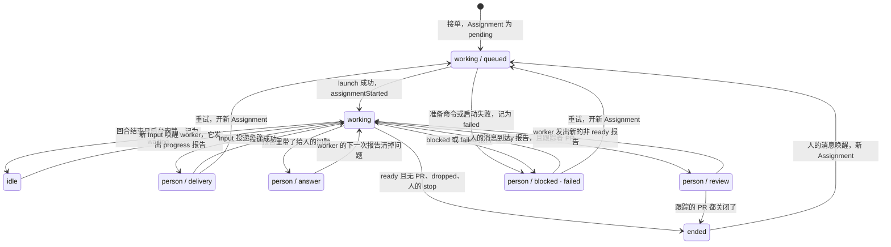

# 05 执行：Ticket 如何被做完

::: info 本章
**前置：** [03 一个请求的一生](./03-request-lifecycle)、[04 授权](./04-authorization)
**对应上游：** <Doc page="003-execution">003 执行</Doc>
**对应源码：** <Src path="src/core/stage.ts" />、<Src path="src/executor/dsh.ts" />、<Src path="src/core/tickets.ts" />、<Src path="src/core/assignments.ts" />
:::

::: tip 带着这些问题读
1. 面板上 Ticket 的阶段存在哪个字段里？为什么不直接存一个状态？
2. worker 槽位全满时，一个人的回复要不要排在新任务后面？
3. worker 在后台起的服务，什么时候会被停掉？
4. Ticket 什么时候算结束？结束那一刻还没读的消息去哪了？
:::


在 [03](./03-request-lifecycle) 里，你跟着 `alice` 的评论走完了一遍：接单、启动执行器、开 PR、合并。

那一章把执行器当成一个黑盒：派工进去，报告出来。

这一章打开这个黑盒。场景还是 `acme/shop` 的 Issue #42，但这次多了几件团队里常见的事：

- 同时还有别的 Ticket 在跑，worker 槽位不够用。
- worker 为 reviewer 起了一个预览服务。
- 修复被拆成了两个 PR，先后合并。
- Ticket 结束前一分钟，`bob` 又在 PR 上提了一个新要求。

每一节先提一个问题，再用源码回答。

正文里的源码摘自 commit `8c32a9d`，行号与上游一致。英文注释是上游原有的，中文注释是本教程加的。`// …` 表示省略的行。

## 1. Ticket 阶段 {#stages}

> **问题：** 面板上 #42 的 Ticket 显示 “Awaiting review”。这几个字存在数据库的哪个字段里？

哪个字段都没有。

Ticket 上存的是事实：每个 Assignment 的状态和最新的 Report，有没有待回答的问题（`attention`），有没有投递失败（`delivery`），收到过哪些 Input。

面板上的阶段，是 `ticketStage()` 每次从这些事实里现算出来的。这个函数 [03 · 干活、开 PR、报告](./03-request-lifecycle#step-8-report) 已经逐行读过，这里只看它用到的一个辅助函数：

```ts:no-line-numbers
// src/core/model.ts:345
/**
 * Whether a ticket waits for a person: its latest Assignment reported blocked or failed, and no person's message reached it
 * since. A later report that is neither, a person's message, or a retry, which starts a new Assignment, lifts it.
 */
export function waitsForPerson(ticket: Ticket): boolean {
  const report = latestAssignment(ticket)?.report
  if (report?.state !== 'blocked' && report?.state !== 'failed') return false
  // 只看“人写的、不是仅为上下文跟踪而来的”消息，并且必须晚于那条报告
  return !ticket.inputs.some(input => input.kind === 'trigger' && input.human && !input.context && input.at > report.at)
}
```

<Src path="src/core/model.ts" lines="345-353" label="model.ts · waitsForPerson()" />

设想 #42 的 worker 报告了 `blocked`：“测试环境缺少支付网关的密钥，需要有人配置”。

面板显示 **Blocked**。半小时后 `alice` 回复“已经配好了”。

没有任何代码去把 Ticket 的状态改回 `working`。`alice` 的消息作为 Input 写进 Ticket，`waitsForPerson()` 下一次被调用时就返回 `false`，`ticketStage()` 往下匹配，落到 `working`。

**阶段由事实推出来，所以“解除阻塞”不需要一个专门的写操作。**

这样做还有两个好处。

上游点明了第一个：这个状态“由存储的 Report 和 Input 推算出来，所以重启后依然保持”（<Doc page="003-execution" anchor="executor-blocked-or-failed">003 · Executor 阻塞或失败</Doc>）。

第二个是推测：同一个判断被多处使用。`ticketStage()` 用它决定面板标签，`Tickets.addInput()` 用它决定是否扣住 CI 消息，`canRetry()` 用它决定能否重试（<Src path="src/core/stage.ts" lines="23-26" label="stage.ts · canRetry()" />）。如果存的是一个状态字段，这几处就要各自负责把它改对；现在它们读的是同一个函数。

下面这张图画的是 `ticketStage()` 可能返回的结果之间怎样转换。**图里没有一个状态是存储的**，每条边都是“某个事实被写入之后，重新计算的结果变了”。



有一个细节容易被图掩盖：`person / answer` 之后，人回复了问题，阶段**不会**立刻变回 `working`。

原因在 <Src path="src/core/assignments.ts" lines="114-119" label="Assignments.report()" />：一条报告不带 `question` 字段时，旧问题被保留；只有 `question: null` 或 `ready` 报告才清掉它。也就是说，worker 要明确说“这个问题解决了”，面板才会离开 **Awaiting answer**。

`idle` 也有类似的情况。一条新 Input 唤醒 worker 后，最新报告仍是 `waiting`，`ticketStage()` 仍然返回 `idle`，直到 worker 发出一条新报告（例如 `progress`）。这是按代码推出的结论，上游的阶段表没有单独说明这一点。

读后面几节时，可以留意每个机制最终改的是哪个事实，再回到这张图看阶段怎么跟着变。

## 2. Executor Session 与目录 {#executor}

> **问题：** `alice` 的修复做到一半，`bob` 在 PR 上留了一条意见。worker 正在跑一条要三分钟的测试命令，它要等测试跑完才能看到这条意见吗？

先说 worker 住在哪里。

每个 Ticket 有一个自己的执行器 Session，名字固定是 `worker-<ticket id>`；还有一个自己的目录，以 Ticket 的短名命名，放在执行根目录下（默认 `<stateDir>/work`）。重试、重启、唤醒都复用同一个 Session 和目录，所以 worker 之前读过的代码、跑过的命令都还在它的历史里。

回到问题：不用等。

执行器 Session 使用 `dsh-superagent-worker` 预设，前台 shell 命令运行 5 秒后自动转成后台作业（<Doc page="003-execution" anchor="the-executor">003 · Executor</Doc>）。测试转到后台之后，worker 的这一步就结束了，下一步就能读到 `bob` 的意见。

这对你平时用编码 agent 的习惯是个小改变：在单人会话里，你会耐心等它跑完；在团队里，等待的时候别人还在说话。

目录第一次被用到之前，要先**准备**。看 `prepareDirectory()`：

```ts:no-line-numbers
// src/executor/dsh.ts:247
private async prepareDirectory(ticket: Ticket): Promise<void> {
  const directory = ticket.execution?.directory ?? ''
  await mkdir(dirname(directory), { recursive: true })
  const command = this.host.store.settings().executor.prepare.trim()
  // 准备命令拿到的环境变量，和 worker 在 prompt 里看到的是同一份（见第 5 节）
  const env = Object.fromEntries(this.host.environment(ticket).map(variable => [variable.key, variable.value]))
  // Enforce a timeout so a hung prepare command (such as on a credential prompt) fails the ticket instead of holding a worker slot indefinitely.
  const signal = AbortSignal.any([this.host.lifetime, AbortSignal.timeout(PREPARE_TIMEOUT_MS)])
  // 在执行根目录（目录的父目录）里用 sh 跑一次；PREPARE_TIMEOUT_MS 是 10 分钟
  if (command) await runAsWorker(this.host.context.subprocess, ['sh', '-c', command], dirname(directory), signal, env)
    .catch(async (error: unknown) => {
      // Remove an empty directory left by a failed prepare command so a later retry does not treat it as already prepared.
      await rmdir(directory).catch(() => { /* Absent, or holding what the command wrote, which the output explains. */ })
      throw new PrepareFailed(`The prepare command failed: ${error instanceof Error ? error.message : String(error)}`)
    })
  await mkdir(directory, { recursive: true })
  // 拒绝目录里自带 credential.* 或 http.*extraheader 的 git 配置
  await verifyDirectory(directory, this.host.context.subprocess, this.host.lifetime)
}
```

<Src path="src/executor/dsh.ts" lines="247-262" label="dsh.ts · prepareDirectory()" />

准备命令由运维者在面板里配置，典型写法是从一个本地 clone 用 `git worktree add -b "agent/$DSH_SUPERAGENT_NAME" "$DSH_SUPERAGENT_DIR" …` 切出一个工作区（<Doc page="006-deployment" anchor="settings">006 · 设置</Doc>）。分支名的最后一段等于 Ticket 短名，这正是 [03 · 第 8 步](./03-request-lifecycle#step-8-report) 里 GitHub Source 认出“这是 Ticket 自己的 PR”的依据。

`launch()` 怎样判断要不要准备？只看目录在不在：目录不存在才跑准备命令（[03 · 启动执行器](./03-request-lifecycle#step-7-launch)）。

这个简单的判断带来一个约束：**失败的准备命令不能自动重试。** `launchQueued()` 的 `catch` 里，`PrepareFailed` 被排除在暂时性重试之外，直接调用 `launchFailed()`。注释把理由写得很清楚：“A failed prepare command is not retried automatically because an existing directory counts as prepared, so retrying would treat whatever a failed prepare command left behind in the directory as a prepared workspace”（<Src path="src/executor/dsh.ts" lines="276-284" label="dsh.ts · launchQueued()" />）。

假设 `git worktree add` 检出到一半网络断了，目录里留下半个工作区。如果自动重试，第二次启动看到目录存在，会直接把这半个工作区交给 worker。

所以上游选择让 Ticket 进入 **Failed**，把命令输出记下来，等人看过之后再重试。空目录会被 `rmdir` 删掉，非空目录保留，留给人检查。

这里有一点要你自己留意（按代码推出，属于推测）：上游文档说重试或人的消息“会再次尝试准备”，但 `launch()` 只在目录不存在时才准备。准备命令失败时如果已经往目录里写了东西，重试会直接用这个目录。所以重试之前，最好先按命令输出把目录清理掉。

读下一节时，可以留意 `finally` 里那一行 `this.slots.free(ticketId)`：启动无论成败都要归还一样东西。

## 3. 并发与 worker 槽位 {#slots}

> **问题：** 默认最多 3 个 worker 同时工作。现在 3 个槽位都被别的 Ticket 占着，队列里还排着两个新接的 Ticket。这时 `alice` 回复了 #42 的 worker 提的问题，她的回复要排在两个新 Ticket 后面吗？

先说槽位是什么。

一个 Ticket 在这几种时候占着一个槽位：它的 worker 正在跑一个回合；回合结束了但后台作业或 subagent 还在跑；它正在被启动或被唤醒（<Doc page="003-execution" anchor="concurrency">003 · 并发</Doc>）。上限 `maxWorkers` 默认是 3（<Src path="src/policy.ts" lines="93" />）。

回合已经结束、后台也没有东西在跑的 Ticket 不占槽位。所以 #42 的 worker 提完问题、结束回合之后，槽位已经还回去了（下一节会讲这一步）。`alice` 的回复要把它**唤醒**，就得重新拿一个槽位。

答案是：不用排队。`WorkerSlots` 只有二十几行，却写下了这条规则：

```ts:no-line-numbers
// src/executor/dsh.ts:171
export class WorkerSlots {
  /** Tickets currently holding a startup slot, mapped to whether the start is a launch, a wake, or a wake for a person's message. */
  private readonly starting = new Map<string, 'launch' | 'wake' | 'person'>()
  // …
  constructor(private readonly running: () => string[], private readonly max: () => number) {}
  /** Number of slots currently in use across running workers and starting reservations. */
  used(): number { return new Set([...this.running(), ...this.starting.keys()]).size }
  /** How many launches may run concurrently: the slots not held by a running worker or a wake reservation. */
  launches(): number {
    // 正在启动的“launch”不算在这里：launch effect 自己的并发计数会算它们
    const wakes = [...this.starting].flatMap(([ticketId, by]) => by !== 'launch' ? [ticketId] : [])
    return this.max() - new Set([...this.running(), ...wakes]).size
  }
  // …
  reserve(ticketId: string, by: 'launch' | 'wake' | 'person'): void {
    if (this.starting.has(ticketId)) return
    // 人的消息可以用到 max + 1；launch 和普通唤醒只能用到 max
    if (this.used() >= this.max() + (by === 'person' ? 1 : 0)) throw new Later('No worker slot is free')
    this.starting.set(ticketId, by)
  }
  /** Releases `ticketId`'s starting slot once its worker session is running or the launch/wake attempt has ended. */
  free(ticketId: string): void { this.starting.delete(ticketId) }
}
```

<Src path="src/executor/dsh.ts" lines="171-199" label="dsh.ts · WorkerSlots" />

规则落在两个地方。

**第一处是 `reserve()` 的那个 `+ 1`。** 槽位满了，一个人的消息仍然可以多用一个。

谁算“人的消息”，由投递代码决定。`deliverQueued()` 唤醒一个没在跑的 worker 时，只要等待的 Input 里有一条 `fromPerson()`，就以 `'person'` 预留，否则以 `'wake'` 预留（<Src path="src/executor/dsh.ts" lines="303-310" label="dsh.ts · deliverQueued()" />）。`fromPerson()` 认的是人写的、不是仅为上下文跟踪而来的 Trigger，以及面板发出的文字 Input，例如状态请求（<Src path="src/executor/dsh.ts" lines="37-38" />）。

CI 的失败通知不属于“人的消息”，它要等普通槽位。

**第二处是 `launches()`。** launch effect 的并发上限就是这个函数（<Src path="src/executor/dsh.ts" lines="232-233" />）。它把正在唤醒的 Ticket 也算作已占用。一个槽位空出来时，正在等槽位的唤醒会先占住它，新的启动就看到 0。

上游把这两点合起来说成一句话：**新工作不会妨碍人继续推进已有的 Ticket。**

站在 `alice` 的角度想：她刚花时间回答了 agent 的问题，如果 agent 因为“别的新活儿”晾着她，她下次就不太愿意回答了。新 Ticket 晚几分钟开始，提出请求的人通常感觉不到。

还有一个细节：`reserve()` 是同步的。注释说 DshExecutor 在任何 `await` 之前先预留，“so two starts cannot take the last slot”（<Src path="src/executor/dsh.ts" lines="165-170" />）。这和 [03 · 启动执行器](./03-request-lifecycle#step-7-launch) 里 `current()` 的思路一样：在异步代码里，检查和占用之间不能有 `await`。

槽位满了也不算失败。`reserve()` 抛出的是 `Later`，effect 队列会在稍后重试，且不计入失败次数。`Later` 的细节在 [06 · Effects 队列](./06-reliability#effects)。

读下一节时，可以留意“回合结束”和“释放槽位”之间还隔着什么。

## 4. 后台任务的规则 {#background}

> **问题：** worker 在回合末尾起了一个 `npm run preview`，方便 reviewer 打开页面看效果，然后说“预览已启动，等 review”。这个服务会一直跑吗？它占着槽位吗？

这取决于 worker 的“最后一句话”是什么。

worker 的回合结束时，`workerIdle()` 先问一个问题：**它是不是已经把事情交给人了？**

```ts:no-line-numbers
// src/executor/dsh.ts:612
// A worker whose last word was its result, a question for a person, or a blocked or failed report handed off to a person;
// an Input delivered after its result or question is new work.
const handedOff = (stored: Ticket) => {
  const assignment = runningAssignment(stored), report = assignment?.report
  // since：结果或问题之后，又有 Input 送进来了，那就是新工作，不算交接
  const since = !!assignment?.deliveredAt && !!report && assignment.deliveredAt >= report.at
  return ((report?.state === 'ready' || !!stored.attention) && !since) || waitsForPerson(stored)
}
const before = live()
if (!before || this.host.closing()) return
// …人亲自在 Session 里开的回合不算交接
if (handedOff(before) && !(report && person && person > report.at)) {
  this.host.engine.turnEnded(ticket.id, idle.id)
  this.handOff(ticket.id, agent)      // 释放槽位，停掉 subagent，shell 作业留给人
  return
}
// Its turn ends once nothing runs for it in the background, which holds its slot meanwhile: at most for the limit from
// this idle, and until the worker runs again or the Assignment ends.
this.settling.get(ticket.id)?.abort()
const look = new AbortController(), limit = new AbortController()
// settling 里有这个 Ticket，running() 就返回 true，槽位继续被占着
this.settling.set(ticket.id, look)
const timer = setTimeout(() => { limit.abort() }, BACKGROUND_LIMIT_MS)   // 30 分钟
timer.unref?.()
let quiet: boolean
const left = this.left.get(ticket.id)?.jobs
try { quiet = await untilQuiet(this.host.context, agent, AbortSignal.any([this.host.lifetime, look.signal, limit.signal]), left) }
finally { clearTimeout(timer); if (this.settling.get(ticket.id) === look) this.settling.delete(ticket.id) }
```

<Src path="src/executor/dsh.ts" lines="612-639" label="dsh.ts · workerIdle()" />

于是有两条路。

**路一：交给人了。** 最后一句是 `ready` 报告，或者一个问题，或者 `blocked`/`failed`。这时 worker 在等人，没有理由占着槽位。`handOff()` 立即释放槽位，停掉 subagent，但**保留 shell 作业**，不设时间上限（<Src path="src/executor/dsh.ts" lines="583-600" label="dsh.ts · handOff()" />）。

预览服务就属于这一类：它是给 reviewer 用的，reviewer 什么时候来看说不准。

作业结束时也不会唤醒 worker。`handOff()` 把结束消息以 `inject` 的方式写进历史，worker 在下一个回合读到。

**路二：还没交给人。** 比如 worker 的最后一句是“测试在后台跑，跑完再看”。这时回合虽然结束了，工作并没有结束。Ticket 继续占着槽位，不报告 `waiting`，主 Session 也收不到任何消息。作业或 subagent 跑完，会在同一个槽位里唤醒 worker。

这里有一个 30 分钟的上限。上限到了，`workerIdle()` 的后半段这样收尾（<Src path="src/executor/dsh.ts" lines="640-672" label="dsh.ts · workerIdle()" />）：

- 还在跑的 shell 作业被 `killJobs()` 杀掉，worker 下一回合会读到一条说明。
- subagent 继续跑。注释给出的理由是“its subagents, whose stop would wake it, go on”：停掉它们会唤醒 worker。
- 如果 worker 在这段时间里已经交接给人（例如中途发了 `ready`），到此为止。
- 否则，取 worker 最后说的话，加上“哪些作业被杀了”，在一个事务里记为 `waiting` 报告，并转给主 Session。worker 什么都没说过时，主 Session 收到的是 “Worker ended without a status report”。

为什么是 30 分钟？上游没有解释这个数字。可以确定的是这个上限防的是什么：一个 worker 起了 `npm run dev` 然后说“完成”，却没有调用 `orchestrator_report`。没有上限的话，这个 Ticket 会永远占着三个槽位中的一个。

把规则放在一起看：

| 回合结束时 | 槽位 | shell 作业 | subagent | 报告 |
| --- | --- | --- | --- | --- |
| 后台没东西在跑 | 释放 | 无 | 无 | `waiting` |
| 后台在跑，未交接 | 保留，最多 30 分钟 | 30 分钟后被杀 | 继续 | 到时报告 `waiting` |
| 已交接给人 | 立即释放 | 保留，直到 Assignment 结束 | 停止 | 保留原报告 |
| Assignment 结束 | 释放 | 被杀 | 释放 | 由结束原因决定 |

所以开头的预览服务，只要 worker 先报告了 `ready` 再结束回合，它就会一直跑到 Assignment 结束，不占槽位。#42 跟踪着 PR，`ready` 不会结束 Ticket，Assignment 也就一直在；如果 Ticket 没有 PR，`ready` 会直接结束它，服务随之被杀。

如果 worker 忘了报告，它会在 30 分钟后被杀掉。读下一节时，可以留意这个服务是以谁的身份在跑。

## 5. 执行变量与安全边界 {#variables}

> **问题：** 运维者的机器上装着用自己账号登录的 `gh`。worker 调用 `gh pr create`，PR 会记在谁名下？

记在 agent 账号 `acme-bot` 名下。但这件事靠的是一组默认设置，挡不住刻意绕开它的程序。

先看 worker 知道哪些关于自己的事。准备命令和 worker 的指令收到同一组**执行变量**：执行器注册目录、短名、Ticket id 和被禁止的命令；GitHub Source 注册仓库、agent 账号、Issue 号和 PR head；飞书 Source 注册机器人和会话（完整的表见 <Doc page="003-execution" anchor="execution-variables">003 · 执行变量</Doc>）。

`environmentOf()` 先拼执行器的四个值：被禁止的命令清单，以及有 Ticket 时的目录、短名和 id；再让每个开着的 Source 追加自己的变量（<Src path="src/app/execution-environment.ts" lines="27-36" label="execution-environment.ts · environmentOf()" />）。里面只有路径、名字和清单。

文件头的注释说这些变量“never contains credentials”。变量只告诉 worker “你是谁、在哪”，不交给它任何钥匙。

那么钥匙在哪？在一组**包装器**里。启动时，`writeEnvironment()` 在 `<stateDir>/worker-bin` 下写几个小 shell 脚本，再把这个目录放到 `PATH` 最前面：

```ts:no-line-numbers
// src/infra/environment.ts:93
// 每个包装器先把自己所在的目录从 PATH 里拿掉，再 exec 真正的程序，避免递归调用自己
const withoutShims = [
  `self=${shellQuote(dir)}`, 'rest=', 'IFS=:', 'set -f',
  'for entry in $PATH; do [ "$entry" = "$self" ] || rest="${rest:+$rest:}$entry"; done',
  'set +f', 'unset IFS', 'PATH=$rest', 'export PATH',
].join('\n')
const run = (program: string): string => `${withoutShims}\nexec ${shellQuote(program)} "$@"`
const fail = (message: string): string => `echo ${shellQuote(message)} >&2\nexit 1`
// gh 指向 agent 账号的 CLI，而不是运维者 PATH 里的那个
await shim('gh', run(github.cli))
await shim('lark-cli', feishu ? run(feishu.cli) : fail('lark-cli is unavailable: this installation has no Feishu bot.'))
// 被禁止的命令：同名脚本，只打印一句话然后失败；gh、git、lark-cli 不能被禁止
for (const name of new Set(blockedCommands.filter(name => !WORKER_COMMANDS.includes(name)))) {
  await shim(name, fail(`${name} is blocked in this installation; use gh, which acts as ${github.login}.`))
}
```

<Src path="src/infra/environment.ts" lines="93-104" label="environment.ts · writeEnvironment()" />

同一个函数还写了一份 worker 专用的 gitconfig：凭据助手指向 agent CLI 的 `auth git-credential`，ssh 地址改写成 https，并且要求提交身份必须显式设置（<Src path="src/infra/environment.ts" lines="106-115" />）。`agentVariables()` 清掉环境里的 `GH_TOKEN`、`GITHUB_TOKEN` 和运维者的提交身份（<Src path="src/infra/environment.ts" lines="45-58" />）。

所以开头的问题：worker 调用 `gh`，按名字找到的是包装器，包装器转给 agent 账号的 CLI，PR 记在 `acme-bot` 名下。

**但这只对“按名字调用”成立。** 上游在三个地方说了同一件事：

- 文件头：“Provides default-path guardrails rather than an OS-level security boundary, as workers run under the operator's OS user.”（<Src path="src/infra/environment.ts" lines="1-5" />）
- 面板上禁止命令的提示：“只拦按名字的调用，用绝对路径仍能运行，所以不是安全边界。”（<Src path="src/client/locales.ts" lines="379" />）
- 文档：“这些包装器和目录建立的是默认行为，不是安全边界。worker 仍然可以通过绝对路径执行程序。”（<Doc page="003-execution" anchor="execution-variables">003 · 执行变量</Doc>）

worker 以运维者的操作系统用户运行，权限是 `danger-full-access`。它可以执行 `/usr/local/bin/gh`，可以读运维者的 home 目录。

这对部署意味着什么？上游给的建议很直接：“如需隔离，请使用一个只存放智能体凭据的专用操作系统账号。”（<Doc page="006-deployment" anchor="permissions-and-isolation">006 · 权限与隔离</Doc>）

换句话说，包装器保证的是**正常情况下**走对账号：worker 照着指令调用 `gh`，就不会误用你的个人账号。它防不住一个被 prompt 注入、有意绕路的 worker。后一种情况要靠 [04 授权](./04-authorization) 在入口处挡住，以及操作系统账号的隔离。

读下一节时，可以留意 PR 开出来之后，Ticket 是怎么“盯着”它的。

## 6. PR 跟踪与结束条件 {#ending}

> **问题：** #42 的修复被拆成了两个 PR：#51 改金额计算，#52 改显示格式。#51 先合并了。Ticket 该结束吗？

不该。#52 还开着。

你在 [03 · 合并与结束](./03-request-lifecycle#step-10-end) 里已经看到，有 PR 的 Ticket 由 PR 的关闭来结束。拆成两个 PR 时，规则要再精确一点。

worker 报告一个 PR，或者 GitHub Source 发现一个从 Ticket 分支开出的 PR，Ticket 就开始跟踪它（<Doc page="003-execution" anchor="pull-requests">003 · Pull request</Doc>）。跟踪落到 `Tickets.bind()`：Ticket 订阅这个 Thread，并在 `follows` 里记下它，`own: true` 表示是 Ticket 自己开的。同一个 PR 被重新绑定（比如重新打开）时，`closed` 被删掉，`own` 一旦为真就一直为真（<Src path="src/core/tickets.ts" lines="61-72" label="tickets.ts · Tickets.bind()" />）。

PR 关闭时，`threadClosed()` 在 `follows` 上记下关闭时间和结果，然后问 `followsDone()`：这个 Ticket 跟踪的 PR 都处理完了吗？

```ts:no-line-numbers
// src/core/tickets.ts:77
threadClosed(thread: ThreadRef, outcome: 'merged' | 'closed', at: string): void {
  const closed = threadKey(thread)
  for (const ticket of this.repo.tickets.open()) {
    const follow = ticket.follows?.find(item => item.thread === closed && !item.closed)
    if (!follow) continue
    follow.closed = { at, outcome }
    this.repo.tickets.save(ticket)
    const done = this.followsDone(ticket)
    // 没处理完，或者 worker 手上还有没收尾的工作：先记下关闭，不结束
    if (!done || this.unfinished(ticket, at)) continue
    // Work resumed after the close and finished ends now.
    const resumed = Date.parse(latestAssignment(ticket)?.createdAt ?? '') > Date.parse(at)
    this.end(ticket.id, 'executor', done.outcome, resumed ? this.now() : done.at)
  }
}
// …
followsDone(ticket: Ticket): Follow['closed'] {
  const follows = ticket.follows ?? []
  const own = follows.filter(item => item.own)
  // 开过自己的 PR：只看自己的；一个都没开过：看所有跟踪的
  const counted = own.length ? own : follows
  if (!counted.length || counted.some(item => !item.closed)) return undefined
  // 结局取最后一次关闭的结果
  return counted.map(item => item.closed!).sort((a, b) => a.at.localeCompare(b.at)).at(-1)
}
```

<Src path="src/core/tickets.ts" lines="77-101" label="tickets.ts · threadClosed() 与 followsDone()" />

套到 #42 上：

- #51 合并：`counted` 是 #51 和 #52，#52 还开着，`followsDone()` 返回 `undefined`，Ticket 继续。
- #52 合并：两个都关了，Ticket 以最后一次关闭的结果 `merged` 结束。
- 如果 #52 后来被关掉、没有合并，结局就是 `closed`。

“只看自己的 PR”这条规则针对另一种场景：`alice` 在一个别人开的 PR #60 上 @ agent，让它修一下测试。worker 报告 #60 之后，Ticket 跟踪它，但 `own` 为 `false`。如果 worker 为此另开了 #61，那么 #61 合并就够了，不必等 #60。如果 worker 直接往 #60 推提交，没开新 PR，那就等 #60 关闭。

**关闭不一定立即结束 Ticket。** `unfinished()` 挡住了两种情况（<Src path="src/core/tickets.ts" lines="364-379" label="tickets.ts · unfinished()" />）：

1. worker 已经确认或回答了一条归它负责的跟进，但在读到那条消息之后，既没有发出非 progress 的报告，也没有结束过回合。
2. 关闭之后又开了新的 Assignment（例如人唤醒了它、重试了它、或重启后恢复了它），而这份工作还没以 `ready` 收尾，或者之后又来了新 Input。

本章开头的场景属于第一种。#52 合并前一分钟，`bob` 在 PR 上说“合并后顺便把发版说明也更新一下”。worker 读到了，回了一句“好的，马上处理”，正在改。这时 #52 合并了。

如果 Ticket 在这一刻结束，worker 的工作会被 `stop()` 打断，`bob` 得到了一句承诺，却永远等不到结果。`unfinished()` 让 Ticket 等 worker 发出 `ready`，再按同样的 PR 规则结束（[03 · 干活、开 PR、报告](./03-request-lifecycle#step-8-report) 里 `Assignments.report()` 的结尾）。

把所有结束方式放在一起：

| 结束方式 | 谁触发 | `ended.by` | 结局 |
| --- | --- | --- | --- |
| `ready` 报告，没有跟踪任何 PR | worker | `executor` | `completed` |
| `dropped` 报告 | worker | `executor` | `dropped`；若跟踪的 PR 已经都处理完（关闭被推迟过），取 PR 的结局 |
| 跟踪的 PR 都处理完 | GitHub Source 的关闭事实 | `executor` | `merged` 或 `closed` |
| 人叫停 | 人，通过 Eval 的 stop 或面板 | `human` | `stopped` |

`TicketOutcome` 正好是这五个值（<Src path="src/core/model.ts" lines="272-273" />）。

结束时，Ticket 保留它的 Subscription，前三种还能被人的新消息唤醒（[03 · 合并与结束](./03-request-lifecycle#step-10-end)）。被人叫停的 Ticket 不会被唤醒：`Tickets.wake()` 开头就检查 `ticket.ended?.by === 'human'`（<Src path="src/core/tickets.ts" lines="252-260" label="tickets.ts · wake()" />）。

读下一节时，可以留意上面那个“worker 读到了”是怎么定义的。

## 7. 跟进与交回 {#followups}

> **问题：** #52 合并前几秒，`bob` 又留了一条：“另外，购物车的小计也有同样的问题。”消息已经送进了 worker 的 Session，但 worker 还没来得及看，Ticket 就结束了。这条消息会被当作“已处理”丢掉吗？

不会。要说清楚为什么，先要分清三个词：**送达**、**已读**、**处理**。

在单人会话里你不会区分它们：你发的消息，agent 下一步一定会看到。但在这里，一条 Input 送进 Session 之后，可能还排在 inbox 里；Session 的某一步可能被取消；进程可能重启。所以上游给“已读”下了一个窄的定义：Session 在某一步里接收了这条 Input，并在之后报告或结束一个回合（<Doc page="003-execution" anchor="follow-ups-and-context-threads">003 · 跟进与上下文 Thread</Doc>）。

代码里，这对应 Input 上的两个时间点：

```ts:no-line-numbers
// src/core/assignments.ts:48
delivered(ticketId: string, assignmentId: string, inputIds: string[]): void {
  const ticket = this.running(ticketId, assignmentId)
  if (!ticket) return
  ticket.undelivered = ticket.undelivered.filter(id => !inputIds.includes(id)); ticket.updatedAt = this.now()
  runningAssignment(ticket)!.deliveredAt = ticket.updatedAt
  for (const input of ticket.inputs) {
    // readAt = null：已交给 Session，还在等某一步接收它
    if (input.kind === 'trigger' && inputIds.includes(input.id)) { input.readAt ??= null; input.deliveredTo = assignmentId }
  }
  delete ticket.delivery
  this.repo.tickets.save(ticket)
}
/** Records when the worker's Session of an open ticket took `inputIds` into a step, from which its model reads them. */
read(ticketId: string, inputIds: string[]): void {
  const ticket = this.require(ticketId)
  if (!liveTicket(ticket)) return
  // 由 DshExecutor 监听 Session 的 user/message 事件后调用：消息进入了历史
  for (const input of ticket.inputs) if (input.kind === 'trigger' && inputIds.includes(input.id)) input.readAt ||= this.now()
  this.repo.tickets.save(ticket)
}
```

<Src path="src/core/assignments.ts" lines="48-65" label="assignments.ts · delivered() 与 read()" />

`read()` 由 DshExecutor 在 Session 写出 `user/message` 事件时调用（<Src path="src/executor/dsh.ts" lines="493-504" />）。这个事件发生在一步认领消息之后、调用模型之前，所以“进入历史”就等于“模型这一步能看到”。

`readAt` 只是“看到了”。“看完并有所反应”还要一个回合边界：最新的报告，或者最近一次回合结束（`idleAt`）。`readUntil()` 取这两者中较晚的那个（<Src path="src/core/model.ts" lines="337-344" label="model.ts · readUntil()" />）。`readAt` 早于这个时间点的消息，才算已读。

Ticket 结束时，`Tickets.end()` 用的就是这个判断：

```ts:no-line-numbers
// src/core/tickets.ts:345
end(ticketId: string, by: TicketEndBy, outcome: TicketOutcome, at = this.now(), reason?: string): void {
  const ticket = this.require(ticketId)
  if (!liveTicket(ticket)) return
  const stopping = ticket.assignments.filter(assignment => assignment.state !== 'ended')
  const why = reason && reason !== outcome ? { reason } : {}
  const until = readUntil(ticket)
  // waiting：还没送进 Session 的
  const waiting = this.triggersOf(ticket, ticket.undelivered)
  // left：在最后一个回合边界之前没读到的；再去掉 worker 已经确认或回答过的（untaken）
  const left = this.untaken(ticket, ticket.inputs.flatMap(input => input.kind === 'trigger'
    && (!readBefore(input, until) || ticket.undelivered.includes(input.id)) ? [input.id] : []))
  // …记下结束，清掉 attention 和 delivery，结束所有 Assignment
  this.repo.tickets.save(ticket)
  // letGo：left 中没有别的 Ticket 负责、也没被 Decision 了结的，回到它所在 Thread 的 Eval 队列
  this.letGo(ticketId, waiting, left)
  this.emit('ticket.ended', { ticketId, by, outcome, ...why })
  for (const assignment of stopping) this.options.executor.stop(ticket, assignment, reason ?? outcome)
}
```

<Src path="src/core/tickets.ts" lines="345-363" label="tickets.ts · Tickets.end()" />

回到 `bob` 的消息。它送进了 Session，但 worker 在最后一个回合边界之前没有读到它，于是进入 `left`。worker 也没有确认或回答过它。Ticket 结束后，它回到 PR Thread 的 Eval 队列，像一条没有 Ticket 负责的新消息一样，重新经过 Gate 和主 Session（<Src path="src/core/tickets.ts" lines="288-309" label="tickets.ts · letGo()" />）。

反过来，如果 worker 读到了 `bob` 说的“谢谢，辛苦了”，然后什么也没做，这条消息不会回到 Eval。读过而不行动，是 worker 的判断，上游尊重这个判断。

**交回**是 worker 主动做的同一件事。`bob` 要求修购物车小计，超出了 #42 的 Mandate 范围。worker 可以调用 `orchestrator_trigger_handback`，并写一句理由（<Src path="src/app/tools/executor.ts" lines="65-73" />）。`EnginePart.handBack()` 在 Trigger 的去向上记下交回记录；如果这条消息原本由这个 Ticket 负责，且没有别的 Ticket 还在负责它，就把它放回 Eval 队列（<Src path="src/core/part.ts" lines="36-48" label="part.ts · handBack()" />）。

交回之后，`bob` 的请求要用他自己的身份过 Gate。他不在允许名单里，所以这条请求不会因为“搭了 #42 的便车”而获得授权。这一点在 [03 · Review 意见](./03-request-lifecycle#step-9-followup) 里提过，授权的细节见 [04 · 两条路径](./04-authorization#two-paths)。

最后，“已读”的记录存在 Ticket 里，Session 的历史也被持久化，所以这一套判断在重启之后仍然成立。重启时它怎样决定哪些消息要重新投递，是 [06 · 重启恢复](./06-reliability#restart) 的内容。

## 回顾 {#recap}

| 机制 | 关键代码 | 它保证的事 |
| --- | --- | --- |
| 阶段计算 | `ticketStage()`、`waitsForPerson()` | 面板状态由事实推出，解除阻塞不需要额外的写操作，重启后仍然正确 |
| 目录准备 | `prepareDirectory()`、`launchQueued()` | 准备命令最多跑 10 分钟；失败不自动重试，半成品目录不会被当成准备好的 |
| worker 槽位 | `WorkerSlots` | 人的消息可以多用一个槽位，并先于新启动拿到空出的槽位 |
| 后台任务 | `workerIdle()`、`handOff()` | 未交接的后台工作最多占槽位 30 分钟；交接给人后槽位立即释放，作业留给人 |
| 执行环境 | `environmentOf()`、`writeEnvironment()` | 按名字调用的 `gh` 和 git 走 agent 账号；这不是安全边界 |
| 结束 | `followsDone()`、`unfinished()`、`end()` | PR 都处理完才结束；worker 答应过的事做完才结束 |
| 跟进 | `delivered()`、`read()`、`letGo()` | 没读到的人的消息在 Ticket 结束时回到 Eval，不会被默默丢掉 |

回到开头的四个问题：

1. 阶段不存在任何字段里，`ticketStage()` 每次从 Report、Attention、delivery 和 Input 推算。这样做重启后不会失真，“人回复了”这样的事实也不需要专门的状态迁移。
2. 不用排在新 Ticket 后面。人的消息可以用第 `max + 1` 个槽位，正在唤醒的 Ticket 也会让 `launches()` 变小。
3. 回合结束时，如果 worker 已经交接给人，预览服务一直跑到 Assignment 结束；如果没有交接，30 分钟后被杀。
4. 跟踪的 PR 都处理完、worker 也没有未收尾的工作时，Ticket 结束。结束那一刻没读到、也没被确认或回答的人的消息，回到 Eval。

## 思考题 {#exercises}

1. 一个 Ticket 报告了 `blocked`，之后 CI 失败的通知到了，会送给执行器吗？如果是人回复呢？提示：看 `Tickets.addInput()` 里的 `held`（<Src path="src/core/tickets.ts" lines="234-245" />），以及 `Assignments.report()` 在 `blocked` 时对 `undelivered` 做了什么。
2. 为什么 `ticketStage()` 把 `delivery` 失败排在第一位？如果把它排在 `review` 后面，一个已经 `ready`、但 `bob` 的 review 意见送不进去的 Ticket 会显示成什么？
3. `maxWorkers` 是 3，三个 Ticket 正在工作。`alice` 和 `carol` 同时回复了两个 `idle` 的 Ticket。两次唤醒都能拿到槽位吗？用 `reserve()` 的条件算一算。
4. worker 起了预览服务，然后在最后一句话里说“预览已启动”，但忘了调用 `orchestrator_report`。30 分钟后会发生什么？主 Session 会收到什么？
