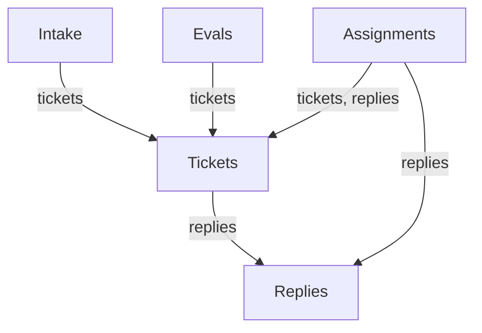

# 09 代码架构：Engine 与端口

::: info 本章
**前置：** 第一、二部分，至少读过 [03 一个请求的一生](./03-request-lifecycle)
**对应上游：** <Doc page="007-architecture">007 架构</Doc>，尤其是 <Doc page="007-architecture" anchor="engine">Engine</Doc>、<Doc page="007-architecture" anchor="dependency-rules">依赖规则</Doc>和<Doc page="007-architecture" anchor="persistence">持久化</Doc>
:::

::: tip 带着这些问题读
1. 第一次打开 `src/`，面对一百多个文件，该从哪里读起？
2. 你想改一条规则，比如"bot 的评论最多只能成为推断候选"，该去哪一层找它？
3. Engine 的命令跑在同步的 SQLite 事务里，而启动执行器要几十分钟。这两件事怎么同时成立？
4. Engine 要调用 Executor，Executor 又要回报给 Engine，Runtime 怎么把它们连起来？
:::


你可能有过这样的经历：想改一个小行为，打开仓库，发现 `src/` 下面有 111 个文件、一万五千五百多行代码。

前面几章跟着请求走，每次只看路过的几个函数。

这一章换个角度：不跟踪某一条请求，看这些文件怎么分工、彼此通过什么接口说话。

读完之后，你拿到一个改动，应该能判断它落在哪个文件，会碰到哪些接口。

正文里的源码摘自 commit `8c32a9d`，行号与上游一致。英文注释是上游原有的，中文注释是本教程加的。`// …` 表示省略的行。

## 1. 核心类与胶水代码 {#core-and-glue}

> **问题：** 111 个文件里，哪些是系统本身，哪些只是在做翻译？

先按目录数一遍。下面的数字是 commit `8c32a9d` 的实际统计，包含子目录里的文件：

| 目录 | 文件数 | 代码行数 | 放什么 |
| --- | --- | --- | --- |
| `src/core` | 15 | 约 2090 | 领域模型、Engine 和它的五个部件。不做 I/O |
| `src/app` | 38 | 约 5290 | Runtime、Store、Outbox、Effects、Sessions、Settings，以及工具、HTTP 路由和视图 |
| `src/sources` | 16 | 约 2060 | Source 的插件契约，GitHub 和飞书两个 Source |
| `src/executor` | 2 | 约 840 | `DshExecutor`：把 Assignment 变成 worker Session |
| `src/infra` | 5 | 约 350 | 命令执行、健康状态、路径和文本工具 |
| `src/client` | 27 | 约 4420 | 管理面板（React） |
| `src/*.ts` | 8 | 约 540 | `policy.ts`、`setup.ts`、`kv.ts`、`index.ts` 等 |

`src/app` 的 38 个文件里，28 个是 `.ts`，另外 10 个在 `tools/`（3 个）和 `views/`（7 个）两个子目录里。面板占了两千七百多行，比 `src/core` 还多，但它是纯前端，一行规则都不定。

目录只告诉你代码放在哪。上游给了另一种更有用的分法：<Doc page="007-architecture" anchor="core-classes-and-glue">核心类与胶水代码</Doc>。

核心类拥有一个领域概念或一条外部边界，并把它藏在一个小接口后面。Engine、Store、SourceRegistry、MasterAssessor、DshExecutor、Outbox、Effects 都是核心类。

胶水代码只做翻译：把工具参数、HTTP 请求、Source 的 payload 变成对核心类的调用，再把结果变成卡片、视图和消息。`src/app/tools/main.ts`、`src/app/views/`、`src/app/cards.ts` 都是胶水。

这个分法为什么重要：拿到一个 bug，先问它是"规则错了"还是"翻译错了"。规则只在核心类里，翻译层的代码不该有条件判断。你在 `src/app/views/` 里看到的 `if` 都是格式判断，不是业务判断——如果看到一个真正影响授权的判断，那就是 bug。

## 2. Engine：五个部件，一条依赖线 {#engine-parts}

> **问题：** 一个类管所有事，还是一个类管一件事？Engine 的公开方法为什么都长一个样？

Engine 是核心的唯一入口，也是唯一写 Trigger、Thread、Decision、Ticket 和 Assignment 的地方。它的构造只做一件事：造出五个内部部件。

```ts:no-line-numbers
// src/core/engine.ts:24
export class Engine {
  private readonly repo: Repositories
  private readonly replies: Replies
  private readonly tickets: Tickets
  private readonly assignments: Assignments
  private readonly evals: Evals
  private readonly intake: Intake
  constructor(private readonly options: EngineOptions) {
    this.repo = options.repo
    this.replies = new Replies(options)
    this.tickets = new Tickets(options, this.replies)
    this.assignments = new Assignments(options, this.tickets, this.replies)
    this.evals = new Evals(options, this.tickets)
    this.intake = new Intake(options, this.tickets)
  }
```

<Src path="src/core/engine.ts" lines="24-40" label="engine.ts · Engine 构造函数" />

五个部件，六个字段：`repo` 不是部件，是端口 `Repositories` 的直接引用，引擎自己持有它，五个部件通过基类也拿到同一份。

看构造函数最后四行的顺序：`Replies` 最先造，`Tickets` 需要它；`Evals` 和 `Intake` 都需要 `Tickets`；`Assignments` 需要 `Tickets` 和 `Replies`。这个顺序就是依赖方向，编译器和类型系统都不会帮你检查它，靠的是构造参数的写法。上游把这条线写成了表，也画成了图：



| 部件 | 管什么 | 依赖 |
| --- | --- | --- |
| `Intake` | 一条 Source 的 Trigger：存一次、记去向、记到它的 Thread 上、扇出给订阅的 Ticket，除非它是"人的消息且已到达某个 Ticket"，否则排进主 Thread 的 Eval 队列 | `Tickets` |
| `Evals` | Thread 的 Eval：分批、Gate 给出的强度和依据、候选卡片、超时重排、重放和交回，以及它结束时的 Decision | `Tickets` |
| `Tickets` | Ticket 的一生：从 accept 创建、Subscription、第一个 Assignment、跟踪的 Thread 及其关闭、Input 和备注、恢复、重试、停止和结束 | `Replies` |
| `Assignments` | 执行器报回来的事实：Assignment 开始、Input 送达或失败、重启打断，以及 worker 的 Report | `Tickets`、`Replies` |
| `Replies` | 通过 `Outbox` 的 Channel 写入：确认、回答、结果和待人工决定的消息，各按允许它的规则 | 无 |

**依赖是单向的，而且终点是 `Replies`。** 这意味着：Eval 想做一次回复，必须问 Tickets，不能直接写 Channel；反过来 Tickets 从不调 Evals。想给 Eval 加一条"评估时通知人"的行为，正确的位置不在 Evals 里，而是让 Evals 产出信息、由 Tickets 或上层去发。

每个部件都继承同一个基类：

```ts:no-line-numbers
// src/core/part.ts:24
export abstract class EnginePart {
  protected readonly repo: Repositories
  constructor(protected readonly options: EngineOptions) { this.repo = options.repo }
  protected now(): string { return this.options.now?.() ?? new Date().toISOString() }
  protected policy(): Policy { return this.options.policy() }
```

<Src path="src/core/part.ts" lines="24-28" label="part.ts · EnginePart" />

`EngineOptions` 就是端口的集合。`now` 和 `emit` 是可选注入：测试里换掉时钟，就不必为了等一个超时而 `sleep`。

Engine 的每个公开方法都是同一个形状：`repo.atomic(...)` 包住一个部件调用。

```ts:no-line-numbers
// src/core/engine.ts:48
receive(trigger: Trigger): ReceiveResult { return this.repo.atomic(() => this.intake.receive(trigger)) }
```

一个命令、一个事务，命令中途抛错，所有写入一起回滚。跨部件的方法按顺序调用几个部件，仍然在一个事务里，`attach` 和 `policyChanged` 都是这样（见 [03 第 5 步](./03-request-lifecycle#step-5-accept)）。

上游还给方法定了命名约定，代码里一眼能看出来：请求类的用祈使动词（`stopTicket`、`bindThread`），可能被拒绝；适配器报事实的用过去式（`assignmentStarted`、`deliveryFailed`），只记录发生了什么。查询用名词（`candidate`）。

## 3. 端口：Engine 不认识任何具体实现 {#ports}

> **问题：** 核心代码怎么做到一个 `fs`、一个 `fetch` 都不 import？

打开 `src/core/ports.ts`，这里定义了 Engine 依赖的一切。核心不 import `src/app`、`src/sources`，只 import `node:crypto` 里的 `createHash`（用在 `src/core/ids.ts` 算确定性 id）。所以"核心不做 I/O"不是约定俗成，是物理上做不到。

先看最像"策略"的那个端口：

```ts:no-line-numbers
// src/core/ports.ts:17
export interface Policy {
  version: string
  paused: boolean
  gate(trigger: Trigger, thread: Thread, tickets: Ticket[]): GateResult
  /** Re-check a mandate's gate-layer basis under this policy, such as before an ended ticket resumes. */
  revalidate(mandate: Mandate): boolean
  /** Whether an inferred candidate may be accepted on the rules its assessment matched: assessments accept, and each rule is enabled. */
  admitsInferred(rules: readonly string[]): boolean
  /** How long an assessor may take before an eval is recorded as unavailable. */
  evalTimeoutMs: number
}
```

<Src path="src/core/ports.ts" lines="17-26" label="ports.ts · Policy" />

回答开头的问题 2："bot 的评论最多只能成为推断候选"这条规则在哪？在 `src/policy.ts` 的 `gate()` 里，实现这个 `Policy` 接口。Engine 只看见 `gate` 这个方法，不知道它背后是设置文件、数据库还是写死的常量。改规则改 `src/policy.ts`，Engine 一行都不用动。

注意 `Policy` 里没有 `scope`。Source 的接收范围是另一个端口：

```ts:no-line-numbers
// src/core/ports.ts:12
export interface SourceScope {
  scope(input: { source: string; meta: Record<string, unknown> }): ScopeResult
}
```

<Src path="src/core/ports.ts" lines="10-14" label="ports.ts · SourceScope" />

上游在 `Policy` 接口的注释里专门写了一句 "Source scope is not part of Policy"。这个拆分有两个后果：`scope` 要读 Source 的配置，而配置只有 Source 自己懂；`scope` 的结果会被记进 Mandate 的 basis，恢复时要重新校验，它必须是"这个 Source 现在听不听"，而不是"策略允不允许"。

执行器和 Outbox 这两个端口最能说明问题：

```ts:no-line-numbers
// src/core/ports.ts:55
export interface Executor {
  /** Queue a pending assignment for launch; reports back through `Engine.assignmentStarted` or a `failed` report. */
  start(ticket: Ticket, assignment: Assignment): void
  /**
   * Queue delivery of the ticket's waiting Inputs to its running assignment; reports back through `Engine.inputsDelivered`
   * or `Engine.deliveryFailed`, and through `Engine.inputsRead` once its worker's Session takes them into a step.
   */
  deliver(ticket: Ticket, assignment: Assignment): void
  /** End an assignment's work, such as cancelling its Session's turn; called after the ticket or assignment has already ended in the domain. */
  stop(ticket: Ticket, assignment: Assignment, reason: string): void
}

/** A message for a Channel; `ticketId` names the Ticket it is for, when there is one. */
export interface OutboundMessage { id: string; channel: ChannelRef; text: string; kind: 'acknowledgement' | 'reply' | 'notice'; ticketId?: string }
/** A queued message waits (`pending`), went out (`sent`), or was dropped because its conversation can never receive it (`dropped`). */
export type ReplyStatus = 'pending' | 'sent' | 'dropped'
/** The messages queued for Channels; the Engine queues them inside its commands, and a sender delivers them later. */
export interface Outbox {
  /** Queue a message idempotently; an id queued before keeps its first message. */
  send(message: OutboundMessage): void
  /** Whether a message was queued, and what became of it. */
  status(id: string): ReplyStatus | undefined
  /** Withdraw a message that has not gone out. */
  withdraw(id: string): void
}
```

<Src path="src/core/ports.ts" lines="54-82" label="ports.ts · Executor 与 Outbox" />

`Executor` 的三个方法全是同步的，没有一个是 `Promise`。这就是开头问题 3 的答案：**Engine 从不等待外部世界**。`start` 的注释写得很直接，"queue a pending assignment for launch"——它只把活排进队列。真正跑几十分钟的准备命令、模型调用、推代码，都在事务提交之后由别的线程做。

`Outbox.send` 同理，同步、幂等、只入队。`status` 和 `withdraw` 让 Engine 能在一个事务里查一条消息发过没有、或者把还没发出去的撤回来——这两件事本身也是数据库操作，不碰网络。

`Repositories` 是最后一个端口，也是唯一"看起来该是具体实现"的：

```ts:no-line-numbers
// src/core/ports.ts:106
/** Durable state. Every method is synchronous so `atomic` can wrap a unit of work. */
export interface Repositories {
  atomic<T>(work: () => T): T
  // …triggers / threads / tickets / decisions，各有 get、save 和列表查询
}
```

<Src path="src/core/ports.ts" lines="105-140" label="ports.ts · Repositories" />

测试里 `MemoryRepositories`（`src/core/memory.ts`）用 Map 和快照回滚实现同一个接口，`Store` 用 SQLite 实现它。Engine 的测试因此不需要数据库文件，也能验证嵌套事务的语义。

## 4. 按角色 Pick 的 Engine 视图 {#engine-views}

> **问题：** 五个调用方都拿到同一个 Engine 对象，怎么保证 Source 不会误调 `stopTicket`？

Engine 有三十多个公开方法，但每个调用方只需要几个。上游的办法是在文件末尾用 `Pick` 切出五个角色类型：

```ts:no-line-numbers
// src/core/engine.ts:260
/** What Sources ask and tell the Engine. */
export type EngineForSources = Pick<Engine, 'receive' | 'bindThread' | 'threadClosed'>
/** What the main Session asks of the Engine. */
export type EngineForMainSession = Pick<Engine, 'candidate' | 'candidateDelivered' | 'decide' | 'attach' | 'reply' | 'requestStatus' | 'note'>
/** What people ask of the Engine, through the panel or the main Session. */
export type EngineForPeople = Pick<Engine, 'stopTicket' | 'retryTicket' | 'reevaluate' | 'unsubscribe' | 'dismiss'>
/** What Settings tells the Engine. */
export type EngineForSettings = Pick<Engine, 'policyChanged'>
/** What the Executor tells the Engine, and what its workers ask of it. */
export type EngineForExecutor = Pick<Engine, 'assignmentStarted' | 'inputsDelivered' | 'inputsRead' | 'turnEnded' | 'deliveryFailed'
  | 'assignmentInterrupted' | 'report' | 'markUnrelated' | 'handback' | 'followForContext' | 'reply'>
```

<Src path="src/core/engine.ts" lines="259-270" label="engine.ts · 角色视图" />

这不是运行时权限，是类型权限：`EngineForSources` 上根本没有 `stopTicket` 这个方法名，Source 插件代码写不出来。要拿到完整 Engine，只能显式改类型，那在 review 时一眼能看到。

注意两个角色共享了方法：`reply` 同时出现在 `EngineForMainSession` 和 `EngineForExecutor` 里——主 Session 和执行器都能发消息，但走的是 `Replies` 里同一套允许规则。

这也回答了问题 4 的一半。Executor 需要调回 Engine，但它只拿得到 `EngineForExecutor`；反过来 Engine 只拿得到一个三方法的 `Executor` 接口。双向依赖被两个窄接口切成两条单向的线。

## 5. Runtime：把东西接起来 {#runtime}

> **问题：** Engine 和 Executor 互相持有，构造函数怎么写？

答案是：用 getter。`Runtime` 先造 Store、Effects、SourceRegistry、Outbox，再造 DshExecutor 和 MasterAssessor，最后才造 Engine。前两者需要 Engine，所以它们拿到的是一个延迟求值的属性：

```ts:no-line-numbers
// src/app/runtime.ts:128
      this.executor = new DshExecutor({ context: ctx, get engine() { return runtime.engine }, store, effects, health: board.claim('worker'), machine,
        lifetime: this.lifetime, sessions, closing: () => this.closing(), paused: () => this.paused(), environment, sourceLink: link,
        repliedTo: trigger => repliedTo({ store, sources }, trigger) })
      this.assessor = new MasterAssessor({ get engine() { return runtime.engine }, commands, get deployment() { return setup.deployment }, effects,
        settings: () => store.settings(), paused: () => this.paused(), threadContext: trigger => sources.threadContext(trigger),
        deliver: (id, text) => sessions.prompt(masterId, id, text, 'steer'), candidateCard: candidate => candidateCard(links, candidate) })
```

<Src path="src/app/runtime.ts" lines="128-133" label="runtime.ts · Executor 与 Assessor" />

`get engine() { return runtime.engine }` 里闭包捕获的是构造函数的局部变量 `runtime`（第一行 `const runtime = this`）。第一次访问 `this.engine` 时它一定已经被赋值，因为 `executor.start()` 最早也要等到一次 accept 之后。上游原话："The Executor and Assessor call back into the Engine, so Runtime gives them getters rather than requiring construction in a circular order."

然后 Engine 用这些对象构造自己：

```ts:no-line-numbers
// src/app/runtime.ts:137
      const engine = this.engine = new Engine({ repo: store, scope: sources, policy, assessor, executor,
        outbox, prepareTicket: (ticket, outcome) => executor.prepare(ticket, outcome), emit: event => {
```

<Src path="src/app/runtime.ts" lines="137-139" label="runtime.ts · new Engine()" />

`repo: store`——Store 直接就是 `Repositories` 的实现。`scope: sources`——SourceRegistry 实现了 Engine 的 `SourceScope` 接口（见 [10](./10-extending#source-kind)）。`prepareTicket` 是可选钩子，Runtime 把 `DshExecutor.prepare` 接上来：Engine 在创建 Ticket 时调用它，拿到短名、目录和派工说明。这三个字段由执行器决定，因为只有它知道怎么建工作区。

`emit` 是另一个钩子：Engine 每改一次状态就发一个事件，Runtime 把它变成主 Session 的通知。Engine 不知道通知的存在。

`initialize()` 的顺序也值得看：先注册 HTTP 路由（这样初始化没完成时运维者也能打开面板修配置），再跑 setup，然后装 Session 和 Executor 钩子、确保主 Session 存在、同步策略、恢复被打断的 Assignment，最后 `passes.start()` 和 `effects.start()`。这两个循环一开，系统才开始自己往前跑。

## 6. Store：一张 SQLite 和一堆 JSON {#store}

> **问题：** 为什么没有 ORM，没有表结构迁移脚本，却能从一个文件里读出全部状态？

`Store` 开一个 SQLite 文件，`<stateDir>/orchestrator.sqlite`。表少得惊人：`trigger`、`disposition`、`thread`、`ticket`、`decision`、`outbox`、`effect`、`trigger_thread`，加一张通用的 `kv`。

```ts:no-line-numbers
// src/app/store.ts:71
            CREATE TABLE IF NOT EXISTS trigger (id TEXT PRIMARY KEY, value TEXT NOT NULL, at TEXT NOT NULL);
            CREATE TABLE IF NOT EXISTS disposition (id TEXT PRIMARY KEY, value TEXT NOT NULL);
            CREATE TABLE IF NOT EXISTS thread (key TEXT PRIMARY KEY, value TEXT NOT NULL);
            CREATE TABLE IF NOT EXISTS ticket (id TEXT PRIMARY KEY, value TEXT NOT NULL);
            CREATE TABLE IF NOT EXISTS decision (id TEXT PRIMARY KEY, thread TEXT NOT NULL, value TEXT NOT NULL);
            CREATE TABLE IF NOT EXISTS outbox (id TEXT PRIMARY KEY, value TEXT NOT NULL);
            CREATE TABLE IF NOT EXISTS trigger_thread (thread TEXT NOT NULL, id TEXT NOT NULL, at TEXT NOT NULL, human INTEGER NOT NULL,
              PRIMARY KEY (thread, id));
            CREATE TABLE IF NOT EXISTS effect (kind TEXT NOT NULL, key TEXT NOT NULL, value TEXT NOT NULL, seq INTEGER NOT NULL,
              generation INTEGER NOT NULL DEFAULT 0, attempts INTEGER NOT NULL DEFAULT 0, error TEXT NOT NULL DEFAULT '', due INTEGER NOT NULL,
              since TEXT NOT NULL, PRIMARY KEY (kind, key));
            // …索引
```

<Src path="src/app/store.ts" lines="71-88" label="store.ts · 建表" />

每张表都是 `(id, value)`：`value` 是整个聚合的 JSON。要改 Ticket 的字段，改 `src/core/model.ts` 里的类型就行，不用改表。

这样做的前提是**每个聚合只有 Engine 一个写者**。两个人同时 `save` 同一个 Ticket 才会出现丢失更新，而这条规则上游在 <Doc page="007-architecture" anchor="dependency-rules">依赖规则</Doc> 里写成了"One writer per state"。

那查询怎么办？靠生成列。`Store` 打开时给表补列，列的内容从同一行的 JSON 里算出来：

```ts:no-line-numbers
// src/app/store.ts:30
const SETS: Record<string, Record<string, string>> = {
  ticket: {
    open: "INTEGER AS (CASE WHEN value -> '$.ended' IS NULL THEN 1 END)",
    // Only the latest assignment can be pending or running because the Engine closes one before adding the next.
    active: `INTEGER AS (CASE WHEN json_array_length(value, '$.undelivered') > 0
      OR value ->> '$.assignments[#-1].state' IN ('pending', 'running') THEN 1 END)`,
  },
  thread: {
    active: "INTEGER AS (CASE WHEN json_array_length(value, '$.pending') > 0 OR value -> '$.evaluating' IS NOT NULL THEN 1 END)",
    subscribed: "TEXT AS (CASE WHEN json_array_length(value, '$.subscriptions') > 0 THEN value ->> '$.ref.source' END)",
  },
  // Composite key (ticketId + thread) used to preserve per-conversation reply order.
  outbox: { dropped: "TEXT AS (value ->> '$.dropped.at')", pending: `TEXT AS (CASE WHEN value ->> '$.status' = 'pending'
    AND value ->> '$.ticketId' IS NOT NULL THEN (value ->> '$.ticketId') || ' ' || (value ->> '$.channel.thread') END)` },
}
```

<Src path="src/app/store.ts" lines="29-43" label="store.ts · 生成列 SETS" />

于是 `threads.active()` 是一条 `SELECT value FROM thread WHERE active = 1`，`tickets.active()` 同理。每两秒跑一次的 `evaluateDue` 只扫有活的 Thread，不会全表遍历。这就是 [03 第 3 步](./03-request-lifecycle#step-3-gate) 里那个循环的底气。

`atomic` 是 savepoint，不是简单的事务：

```ts:no-line-numbers
// src/app/store.ts:139
  atomic<T>(operation: () => T): T {
    const level = this.depth++
    const name = `orchestrator_atomic_${level}`
    this.committed[level] = []
    this.db.exec(`SAVEPOINT ${name}`)
    let value: T
    try { value = operation(); this.db.exec(`RELEASE ${name}`) }
    catch (error) { this.db.exec(`ROLLBACK TO ${name}`); this.db.exec(`RELEASE ${name}`); throw error }
    finally { this.depth-- }
    const actions = this.committed.splice(level)[0]!
    if (level) this.committed[level - 1]!.push(...actions)
    else for (const action of actions) { try { action() } catch (error) { this.report(error) } }
    return value
  }
```

<Src path="src/app/store.ts" lines="139-152" label="store.ts · Store.atomic()" />

`evaluateDue` 会给每个 Eval 单独开一个事务，所以嵌套是常态。注意 `finally` 里的 `depth--` 在 `RELEASE` 之后：回滚时先减层再执行回调队列的搬运，外层才能收到内层已提交的回调。`afterCommit` 注册的动作在**最外层**提交后才跑，内层回滚会把它的回调一起丢掉。

剩下的记录走 `kv` 表，键的类型全在 `src/kv.ts` 里，每个键只有一个属主组件。`tests/store.spec.ts` 有一条测试专门检查键名字面量只出现在 `src/kv.ts` 和迁移代码里——这是防止 Source 随手 `store.set('github-cursor:1', …)` 的手段。

最后一行关于持久化的话，上游写得很直白：目前没有任何东西删除旧记录。Trigger、Decision、结束的 Ticket、Outbox 回执、每版设置和 prompt，都只增不减。跑得越久的库越大。

## 7. 一份源码阅读顺序 {#reading-order}

> **问题：** 如果只有两个小时，按什么顺序读能最快建立正确的心智模型？

顺序的原则：先读不依赖别人的，再读把它们接起来的；先读规则，再读翻译。每一行只回答"它负责什么"。

1. `src/core/model.ts` — 十个领域概念的类型定义，`threadKey`、`liveTicket`、`latestAssignment` 这些共享谓词。读完知道系统里有哪几种数据。
2. `src/core/ports.ts` — 本章第 3 节贴过的那些接口。读完知道核心代码能看到什么、看不到什么。
3. `src/policy.ts` — `settingsPolicy`、`gate`、`admitsInferred`。所有授权规则都在这一个文件里。
4. `src/core/part.ts` + `src/core/engine.ts` — 先看基类和构造函数，再按角色挑三五个方法读，比如 `receive`、`attach`、`policyChanged`。
5. `src/core/intake.ts` — 最短最完整的一个部件，去重、过滤、扇出、排队四步都在 `receive` 里。
6. `src/core/evals.ts` — 规则最密集的文件。重点读 `start`、`decide` 和 `due`。
7. `src/core/tickets.ts`、`src/core/assignments.ts`、`src/core/replies.ts` — Ticket 的一生、执行器的事实、消息的允许规则。
8. `src/app/store.ts` — 生成列和 `atomic`。看完再回头看第 6 节。
9. `src/app/runtime.ts` — 最后读。它是把所有上面这些接起来的地方，也是唯一需要一次性读 254 行的文件。
10. `src/sources/github.ts` + `src/sources/github-trigger.ts` — 一个真实 Source 长什么样，也是 [10 章](./10-extending) 的底稿。

想读测试而不是源码的话，`tests/core-engine.spec.ts` 覆盖领域规则，`tests/runtime.spec.ts` 在模拟的 DeepSeek Harness 宿主上跑整个应用，`tests/queue.spec.ts` 看工作怎么流过 effect 队列。

## 8. 依赖规则由什么保证 {#dependency-enforcement}

> **问题：** "src/core 不许 import src/app" 这种规则，有东西在执行吗？

我找了一圈：仓库里没有 ESLint 配置，`package.json` 的 script 只有 `build`、`typecheck`、`test`、`check`，没有 lint。也没有一个测试遍历 import 语句。

实际执行这条规则的是 `tsconfig.json` 和代码结构本身：

- `src/core/*.ts` 的 import 语句只出现 `node:crypto` 和相对路径 `./xxx.ts`。这条现在成立，靠的是人。
- 面板的边界是真有测试管的：`src/app/api.ts` 只 import 类型，所以面板能打包它；`src/sources/host.ts` 的文件头注释写着"also imported by the web panel, so it must not import Node-only modules"。
- `tests/class-docs.spec.ts` 检查每个类前面有 JSDoc，`tests/docs.spec.ts` 检查 007 的模块表和测试表与磁盘一致。这两条是机器强制的。

所以：**依赖规则目前靠 review 和自觉，不靠工具。** 对一个学习用的仓库来说这够了，但你自己复刻时，如果想让边界真正锁死，最省事的办法是给 `src/core` 单独一个 `tsconfig` 并在 CI 里对它跑一次 `tsc --noEmit`，把 `src/app`、`src/sources` 从 `include` 里去掉——那时一个越界 import 会直接编译失败。

上游 <Doc page="007-architecture" anchor="dependency-rules">依赖规则</Doc> 里还有几条与本章直接相关的：

- **窄依赖。** 每个类拿到的是一个 `Pick` 类型，不是整个对象。Runtime 传给别人的从来都是接口。
- **一个状态一个写者。** Engine 写领域记录，Source 写自己 Thread 的 `meta`，Settings 写设置，Prompts 写 prompt 版本，Effects 写 effect 行，Outbox 写回执。想改别人的状态，只能调那个写者。
- **Source 改 Ticket 只有两条路。** `SourceContext.tickets.bindThread` 和 `threadClosed`，两者都转成 Engine 命令。见 [10](./10-extending#source-kind)。
- **固定拒绝。** 人能或 agent 能造成的拒绝都是 `UserError(code, values)`，码来自 `src/core/errors.ts` 的 `USER_ERRORS`。管理 API 对 `missing` 返 404，其余返 400，面板按码出文案。加一种拒绝要同时改三处。

## 回顾 {#recap}

| 层 | 代表文件 | 能做什么 | 不能做什么 |
| --- | --- | --- | --- |
| 领域核心 | `src/core/` | 定规则、写聚合、开事务 | 不做 I/O，不认识任何具体 Source 或执行器 |
| 端口 | `src/core/ports.ts` | 描述核心需要什么 | 不含任何实现 |
| 组合根 | `src/app/runtime.ts` | 把实现接到端口上 | 不含领域规则 |
| 具体实现 | `src/app/store.ts`、`src/executor/dsh.ts`、`src/sources/*.ts` | 做真正的 I/O | 不直接写别人的状态 |
| 胶水 | `src/app/views/`、`tools/`、`cards.ts` | 翻译参数和结果 | 不做授权判断 |

回到开头的四个问题：从第 7 节的顺序读起；改规则去 `src/policy.ts`；同步事务与异步执行能共存，因为 `Executor` 和 `Outbox` 的每个方法都只入队；Runtime 用 `get engine()` 这样的 getter 打破了 Engine 与 Executor 之间的循环构造。

## 思考题 {#exercises}

1. `Intake` 依赖 `Tickets`，但 `Tickets` 不依赖 `Intake`。如果要把"已结束的 Ticket 被人的消息唤醒"这个判断从 `Intake.receive` 挪到 `Tickets` 里，依赖方向会变成什么样？挪得动吗？
2. 把 `src/core/engine.ts` 里 `receive` 的 `repo.atomic(...)` 去掉，会先炸在哪一个测试里？提示：看 `tests/core-engine.spec.ts` 里哪些断言依赖"半途抛错则什么都不留"。
3. `Store.SETS` 里 `thread.active` 的生成列没有索引会怎样？为什么加索引时用 `WHERE active IS NOT NULL` 而不是全表索引？
4. 给 `EngineForSources` 加上 `decide`，然后让 GitHub Source 在轮询里直接给自己开 Ticket，会绕过哪几层保护？从 [03 章](./03-request-lifecycle#recap) 的那张表出发回答。
