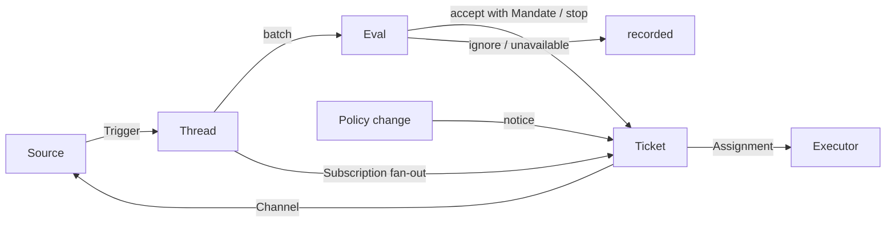

# 001 领域模型 {#_001-domain-model}

<UpstreamBanner kind="translation" />

本文为 dsh-superagent 的各个概念命名，并说明每个概念遵守的规则。代码、agent 调用的工具、面板以及其他文档都只使用这些术语。遵循 [000 设计哲学](./000-philosophy)，模型只包含工作所需的概念，一项业务需求会成为其中某个概念的属性。

## 流程 {#flow}

工作从 Trigger（触发）流向 Eval（评估），再流向执行。Source（来源）产生 Trigger。Trigger 作为上下文扇出到订阅了它所属 Thread（线程）的 Ticket（工单）。以这种方式到达某个 Ticket 的人类消息归这个 Ticket 处理；其他所有 Trigger 都进入 Eval，由 Eval 判断它是否在请求新的工作。Eval 接单时，会创建一个带有 Mandate（授权）的 Ticket。Assignment（派工）把 Ticket 交给一个 Executor（执行器），结果通过 Channel（渠道）返回 Source。

## 概念 {#concepts}

Source、Thread、Eval、Mandate 和 Subscription（订阅）构成核心领域；其余概念为它们提供支撑。

| 概念 | 定义 | 遵守的规则 | 存在的原因 |
| --- | --- | --- | --- |
| Source | 一个事件流。Source kind 是可复用的实现；Source 实例是某个 kind 的一份配置：它是否运行、监听什么 | 保存自己的读取位置和自己的机器人身份。定义什么算作一个事件，包括只有经过一段时间才成立的条件。在进入领域之前，丢弃机器人自己的消息和它监听范围之外的 Trigger。把每个 Trigger 转换成它所属的 Thread，以及用于回复的 Channel 地址 | 重启时不能重放事件 |
| Trigger | 一条不可变事件，带有 Source 自己的元数据，例如它的发起者 | 属于一个或多个 Thread。同一个 Trigger 接单两次只创建一个 Ticket | 审计与幂等的单位 |
| Thread | 按时间排列的 Trigger；由 Source 定义哪些 Trigger 构成同一个 Thread | 同一时间最多只有一个 Eval 在它上面运行。它可以有多个 Ticket。它保存自己的 Subscription、正在运行的 Eval 和 Decision（决定）历史 | 为 Eval 提供一致的视图和上下文 |
| Correlation（关联） | 同一个 Trigger 所属的多个 Thread 之间的关系 | 只补充上下文，从不路由 | 让 Eval 能追踪相关的证据 |
| Channel | Thread 的写入端；由 Source 定义它的地址 | 一个 Thread 可以有多个 Channel；一个 Ticket 持有一组 Channel | 确认、回复、pull request 和已解决的评审都是写入 |
| Policy（策略） | 有版本的研判规则，以及每个 Source 的那一部分：谁可以通过这个 Source 发起工作（用这个 Source 自己的身份表示）、名单如何同步，以及哪些机器人可以产生候选 | Policy version（策略版本）涵盖规则、accept mode（接单模式）和各 Source 的部分。影响某个在途 Ticket 的变更，例如它接单时依据的规则发生了变化，会被送达它的 Assignment；这种变更不会撤销 Mandate。不同 Source 上的身份从不相互映射 | 规则变化时，正在运行的 Eval 必须被丢弃 |
| Eval | 对一批 Trigger 的判断，分为两层：准入和研判 | 输入：Trigger 批次、Thread 快照、这个 Thread 上的每个 Ticket（包括已结束的），以及当前的 Policy。输出：一个 Decision。不保存状态 | 决定新工作是开始、继续还是停止 |
| Mandate | accept 授予的内容：Policy 版本、范围、强度、匹配的规则、发送者在该 Source 上的身份，以及该 Source 是如何收到这个 Trigger 的 | 不可变；扩大范围就意味着一个新 Ticket。Ticket 结束并不结束 Mandate：只有人的 stop 会收回它，不再支持它的 Policy 会撤销它。已结束的 Ticket 恢复之前，会根据当前 Policy 重新校验它 | 说明为什么可以做这项工作，以及可以做到什么程度 |
| Ticket | 一个获授权的工作单元 | 只有 Eval 能创建 Ticket。引用它的 Mandate；持有它的 Channel 和 Input（输入）。状态从 open 变为 ended；当人在它的某个 Thread 上发的消息恢复它时，又回到 open，除非它是被人停止的。它定义自己的状态，而不是跟随 Executor 的状态 | 拥有执行过程及其报告 |
| Assignment | Ticket 与一个 Executor 实例的绑定 | 一个 Ticket 在不同时间会有多个 Assignment。状态从 pending 到 running 再到 ended，独立于 Ticket。在 Executor 一侧，只有它的最终报告可以结束 Ticket | Executor 在领域之外，但由谁执行必须在领域之内 |
| Subscription | Ticket 与 Thread 之间的多对多关系，由 Thread 持有 | 匹配的 Trigger 会扇出到每个在途的已订阅 Ticket，不检查发送者是谁；以这种方式到达 Ticket 的人类消息不经过 Eval。Executor 为获取上下文而关注的 Thread 也以同样方式到达它的 Ticket，但不赋予它任何权限，也不会恢复它。已结束的 Ticket 保留它的 Subscription，包括对已关闭或已合并的 pull request 的 Subscription：人的消息会在同一个 Mandate 下恢复它，不经过 Eval 或 Decision；机器人和 CI 的消息不会到达它，因为它的 Executor 恢复时会重新读取它的 Thread。被人停止的 Ticket 什么也收不到。只有当消息明确指向某个现有 Ticket 时，主 Session 才会把一个 Thread 挂到这个 Ticket 上。人可以删除一个 Thread 上的所有 Subscription；Executor 只能删除自己的 Ticket 对它认为无关的 Thread 的 Subscription，但它的 Ticket 起始的 Thread，以及 Source 让它关注的 Thread（例如它的 pull request）除外 | 后续讨论无需任何人再次提及 agent 就能到达 Executor |

人不是一个领域概念。Trigger 携带 Source 给出的发起者标识。允许名单是 Source 在 Policy 中的那一部分，用这个 Source 自己的身份表示。同一个人在多个 Source 上都有账号，这件事是 prompt 文本，由 agent 在需要时读取。

Executor 连同它的 Session 和目录都在领域之外，通过 Assignment 与领域相连。

聚合：Source 保存它的读取位置。Thread 保存它的 Subscription、它正在运行的 Eval（串行运行，期间到达的 Trigger 会合并进下一批），以及它的 Decision 历史。Ticket 保存它的 Assignment、Channel 和 Input，并通过 id 引用 Decision。

## 被否决的概念 {#rejected-concepts}

| 被否决的设计 | 原因 |
| --- | --- |
| 把 Principal 或 Membership 作为实体，或者跨 Source 映射身份 | 人是 Trigger 的元数据；允许名单是 Source 在 Policy 中的那一部分；跨 Source 的映射是 prompt 文本 |
| Eval 自行安排延迟的 Trigger | 需要等待的条件是一个普通的 Source，因此 Eval 永远不会反过来依赖 Source |
| Eval 的等待中或已撤销状态 | 等待属于 Source；超时的 Eval 会把它的 Trigger 重新排队，或以 `unavailable` 结束 |
| 每个 Thread 最多一个在途 Ticket | 一个 Thread 可以承载多项相互独立的工作；研判根据 Ticket 列表避免重复 |
| “追加到 Ticket”这种 Decision | 追加就是 Subscription 扇出，不需要 Eval |
| 对 Subscription 做准入检查 | Subscription 覆盖整个 Thread；Mandate 把授权与上下文分开 |
| 会路由的 Correlation | 由 Subscription 路由；Correlation 只补充上下文 |
| 跟随 DSH Session 的 Ticket 状态 | Ticket 可以被移交、恢复，或由多个 Executor 执行，所以它定义自己的状态 |
| 由 Executor 声明某人要求它停止 | 只有 Eval 决定结束的强度 |
| Policy 变更时取消正在运行的 Ticket | 取消会留下做了一半的工作；改为记录变更并送达 |
| 执行器 Session 失败或受阻时锁住它的所有工具 | 这会拒绝直接在这个 Session 中工作的人，也会拒绝恢复之后的报告；暂停自动输入就够了 |
| 从报告的自由文本中推断“在等某个人” | 分类需要结构化的事实；Executor 通过一个结构化字段提问 |

## 可复用的部分 {#what-is-reusable}

上面的概念及其规则是可复用的。Source 的实现、Policy 的内容、Executor 和 Channel 的实现属于具体部署。每个 Source 在内部保留自己的用词，例如消息、群聊或通知，并把它们转换成 Trigger。

| 部分 | 在这个仓库中 |
| --- | --- |
| Source | 飞书：实时事件、历史恢复、对已订阅话题的轮询。GitHub：通知、已订阅的 Issue 和 pull request、CI 变化、已合并或已关闭的 pull request，以及在开启时，仓库中每个新的 Issue、pull request、评论和默认分支的 CI |
| Policy | 研判规则，以及每个 Source 的允许名单、名单同步、机器人名单和准入表 |
| Executor | 每个 Ticket 一个 DSH 执行器 Session 和一个目录，运行在一个执行环境中，其变量由 Executor 和各 Source 注册 |
| Channel | 飞书话题回复、GitHub 评论和评审线程回复 |

## 术语表 {#glossary}

本文及后续文档使用的术语参考列表，附中文名；上文没有介绍的术语由后续文档解释。面板一次只显示一种语言；它的 (?) 按钮会打开这份同时包含两种语言的术语表。agent 在 GitHub 和飞书上发给人的消息使用平实的语言，而不是这些术语。

| 术语 | 中文 | 含义 |
| --- | --- | --- |
| Agent | 智能体 | dsh-superagent 运行的自动化团队成员，通过 GitHub 账号、飞书机器人等身份在各个 Source 上行事 |
| Main Session | 主 Session | 评估 Trigger、接单并派发 Ticket、进行回复的 DSH Session；在代码和 prompt 中叫 `orchestrator` |
| Executor Session | 执行器 Session | Executor 为一个 Ticket 运行的 DSH Session；在代码和 prompt 中叫 `worker` |
| Source | 来源 | 一个事件流：由插件提供的一个 kind，加上一份实例配置 |
| Trigger | 触发 | 来自 Source 的一条不可变事件 |
| Thread | 线程 | 按时间排列的 Trigger；Eval 在其中逐个运行的单位 |
| Correlation | 关联 | 共享同一个 Trigger 的多个 Thread 之间的关系；只补充上下文 |
| Channel | 渠道 | Thread 的写入端 |
| Policy | 策略 | 有版本的接单规则，以及每个 Source 在其中的那一部分，例如谁可以在那里请求工作 |
| Policy version | 策略版本 | 一组规则、各 Source 部分和接单模式组合的标识；每个 Mandate 都会记录它 |
| Eval | 评估 | 把一批 Trigger 变成一个 Decision 的过程 |
| Gate | 准入 | Eval 的确定性第一层：谁可以发起工作，以及以什么强度 |
| Assessment | 研判 | Eval 过程中模型的判断 |
| Decision | 决定 | Eval 的结果 |
| Mandate | 授权 | accept 授予的内容：强度、范围以及它所依据的 Policy 版本 |
| Ticket | 工单 | 一个获授权的工作单元 |
| Assignment | 派工 | Ticket 与一个 Executor 实例的绑定 |
| Subscription | 订阅 | Ticket 与 Thread 之间的关系 |
| Fan-out | 扇出 | 把已订阅 Thread 的 Trigger 作为上下文送达 Ticket |
| Executor | 执行器 | 运行 Assignment 的端口：每个 Ticket 一个执行器 Session 和一个目录 |
| Execution environment | 执行环境 | 执行器 Session 和准备命令运行的地方：由 Executor 和各 Source 注册的变量，每个变量都有键、值和说明 |
| Report | 报告 | Assignment 向它的 Ticket 报告的状态 |
| Attention | 待人工决定 | Ticket 上等待人回答的问题 |
| Disposition | 去向 | 一个 Trigger 被过滤、评估或扇出的记录 |
| Input | 输入 | 送达 Ticket 的上下文：扇出的 Trigger、Policy 变更、恢复和文本 |
| Scope | 范围 | Mandate 允许的工作 |
| Strength | 强度 | Mandate 或 Eval 所依据的理由有多强 |

| 分组 | 取值 |
| --- | --- |
| Decision | accept 接单 · stop 停止 · ignore 忽略 · unavailable 未完成 |
| Strength | explicit 明确 · inferred 推断 |
| Assignment | pending 待启动 · running 执行中 · ended 已结束 |
| Report | progress 进展 · waiting 等待 · ready 就绪 · blocked 受阻 · failed 失败 · dropped 无需处理 |
