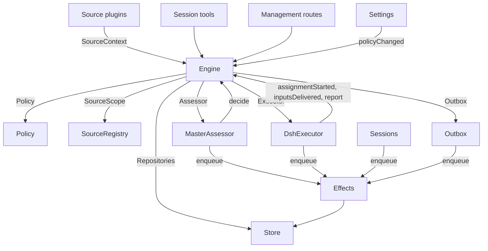

# 007 架构 {#_007-architecture}

<UpstreamBanner kind="translation" />

这是面向开发者的实现指南。它把 [001 领域模型](./001-domain) 到 [006 部署](./006-deployment) 中的概念对应到类、接口和文件。先读 Runtime 和 Engine，再把模块表和测试表当作代码索引使用。

## 核心类与胶水代码 {#core-classes-and-glue}

核心类拥有领域概念和外部边界，并把它们藏在小接口后面。胶水代码把工具参数、HTTP 请求、Source（来源）的 payload 和 DeepSeek Harness 事件翻译成对这些类的调用，再把结果变成卡片、视图和消息。

`Runtime`（`src/app/runtime.ts`）构造整个应用，提供依赖，并负责启动和关闭。`Engine` 自己构造它的内部部件。Executor（执行器）和 Assessor 会回调 Engine，所以 Runtime 交给它们的是 getter，而不要求按循环顺序构造。

### Runtime {#runtime}

`Runtime` 是组合根，不包含任何领域规则。它的构造函数锁定状态目录、打开 Store 并构建各个组件。如果构造失败，它会关闭 Store 并释放锁。

启动时先注册管理路由并运行 Setup。Setup 完成后，它安装 Session 和 Executor 的 hook，确保主 Session 存在，启动 Policy（策略）同步，恢复被中断的 Assignment（派工），并启动 pass 和 effect。`ready` 标志启动完成。

关闭时，它取消各个回合，等待 pass、effect 和 agent 结束，恢复进程环境，关闭 Store 并释放锁。Source 插件通过窄接口 `SourceHost` 把 Runtime 作为 `orchestrator` 服务注入。

| 部件 | 模块 | 职责 |
| --- | --- | --- |
| Setup | `src/app/setup.ts` | 按 worker shell 运行 CLI 的方式探测这些 CLI，解析出仓库和账号；写入并应用 worker 的环境和命令 shim；保存初始化问题。Settings 通过它检查被修改的账号，也通过它重启，重启时会再次运行初始化 |
| Passes | `src/app/passes.ts` | 一次只跑一轮，每两秒一轮，命令请求时也会跑：先处理到期的 effect，再调用 `Engine.evaluateDue`；Source 的 Trigger（触发）经由它到达 Engine |
| Outbox | `src/app/outbox.ts` | Engine 的 `Outbox` 端口，也是回执的唯一写入者：`send` 在一个事务里保存消息的回执并把它的 `reply` effect 入队，该 effect 的 handler 通过 `SourceRegistry.send` 发出消息；Source 关闭期间消息会等待，会话已不存在或不再被监听时消息会被丢弃 |
| Notices | `src/app/notices.ts` | 把领域事件和 worker 活动转换成发给主 Session 的消息。`eventNotice` 处理领域通知；`reportRelay` 立即转发问题，把普通进展留在其 Ticket（工单）上，并转发其他报告；`followupRelay` 指出拥有某个人工跟进的 Ticket。回合进行中到达的转发会在下一步通过 DeepSeek Harness 的 inbox 一并送达 |

### Engine {#engine}

`Engine`（`src/core/engine.ts`）是 Trigger、Thread（线程）、Decision（决定）、Ticket 和 Assignment 的唯一写入者。它从 `src/core/ports.ts` 接收这些端口：`Repositories`、一个返回当前 Policy 的 getter、`SourceScope`、`Assessor`、`Executor` 和 `Outbox`。可选依赖是 `prepareTicket`、`now` 和 `emit`。

Engine 的所有方法都是同步的。每条命令在一个事务里修改它涉及的聚合。`evaluateDue` 对它修改的每个 Eval（评估）或 Ticket 各用一个事务。端口在事务内把外部工作入队，适配器在提交之后执行。无效请求抛出 `UserError`。

Engine 对外只有一个入口，内部委托给五个部件。每条命令的事务由它掌管。跨部件的命令，例如 `attach`、`evaluateDue` 和 `policyChanged`，会依次调用这些部件。

每个部件都继承 `EnginePart`（`src/core/part.ts`），由它提供选项和共享读取。部件之间的依赖是单向的：

| 部件 | 职责 | 依赖 |
| --- | --- | --- |
| `Intake` | Source 的 Trigger：连同其去向只存储一次，记录到它所在的 Thread 及其关联上，扇出给订阅的 Ticket；除非它是到达了某个 Ticket 的人的消息，否则在它的主 Thread 上排入 Eval | Tickets |
| `Evals` | Thread 的 Eval：分批；准入给出的强度、行为人和依据，以及给出它们的那条 Trigger（`primary`）；从候选送达起算的截止时间及其因暂停而产生的顺延；过期 Eval 的重新排队；候选、重放和交回；Policy 变更时的重新排队；以及每个 Eval 最终的 Decision：accept、stop、ignore 或 unavailable | Tickets |
| `Tickets` | Ticket 的生命周期：由 accept 创建，连同其 Mandate（授权）、Subscription（订阅）和第一个 Assignment；它跟随的 Thread 及这些 Thread 的关闭（`followsDone`）；挂靠的 Thread 和为获取上下文而跟随的 Thread；Input（输入）和备注；恢复，以及恢复时拒收的消息；重试、重启、停止和结束；它放弃的 Subscription；以及把 Policy 变更通知给受影响的 Ticket | Replies |
| `Assignments` | Executor 及其 worker 上报的内容：某个 Assignment 已启动，Input 已送达或未能送达，某次重启中断了它，以及 worker 的 Report（报告）和其中要问人的问题 | Tickets, Replies |
| `Replies` | 通过 `Outbox` 写入 Channel（渠道）：确认、回答、结果和待人工决定消息，每种都按允许它的规则写入 | 无 |

命令使用祈使式命名，例如 `stopTicket`；适配器上报的事实使用过去时命名，例如 `assignmentStarted`。查询 `candidate` 使用名词。

调用方只拿到 Engine 中与其角色对应的 `Pick`：`EngineForSources`、`EngineForMainSession`、`EngineForPeople`、`EngineForSettings` 或 `EngineForExecutor`。

| 角色 | 方法 | 作用 |
| --- | --- | --- |
| Sources | `receive(trigger)` | 把一条 Trigger 只存储一次，返回 `stored`、`duplicate`，或在没有 Source 接收它时返回 `filtered`；把它扇出给订阅了其所在 Thread 的 Ticket，其中人的消息会立即恢复已结束的 Ticket（处理已暂停时除外）；并在它的主 Thread 上排入 Eval，除非它是到达了某个 Ticket 的人的消息，这种消息归那个 Ticket |
| Sources | `bindThread(ticketId, thread, own)` | 让一个未结束的 Ticket 跟随该 Source 的某个 Thread，例如某个 pull request 的 Thread；Ticket 自己开启该 Thread 时为 `own`；已关闭的 Thread 再次绑定后重新打开。结束 Ticket 的是这些 Thread 的关闭，而不是 `ready` Report |
| Sources | `threadClosed(thread, outcome, at)` | 某个 Thread 已关闭：跟随它的每个未结束 Ticket 记录这次关闭，并在处理完它跟随的 Thread 后结束（`followsDone`）：它开启的 Thread 都已关闭，或者在它没有开启任何 Thread 时，它跟随的每个 Thread 都已关闭。它按这些关闭中最晚一次的结果以 `merged` 或 `closed` 结束，但有例外：关闭之后恢复的工作尚未报告 `ready`；或者它的 Executor 通过确认或回答，接手了一条人的跟进，而这条跟进是在其最近一次非 `progress` 的 Report 之后、或其最后一个回合结束之后由它决定的；这时，一个 `dropped` Report 会让它按那次关闭的结果结束 |
| 主 Session | `candidate(triggerId)` | 持有某条 Trigger 的 Eval，以其评估者看到的样子返回 |
| 主 Session | `candidateDelivered(evalId)` | 该 Eval 的候选已到达主 Session：它的截止时间从此刻起算 |
| 主 Session | `decide(triggerId, outcome)` | 记录 Eval 的 Decision，或为明确请求记录直接 Decision。accept 以原子方式创建 Ticket、Mandate、Assignment、Subscription 和确认。从卡片上被忽略的推断候选，会在给定理由之前记录 `ignoredFromCard`。当 `followupOwners` 仍拥有一条人工跟进时，只允许 stop |
| 主 Session | `attach(ticketId, triggerId, note?)` | 把一条 Trigger 路由给它指向的 Ticket，由该 Ticket 的 Executor 作为跟进来决定，并结束持有它的 Eval，该 Eval 中的其他 Trigger 等待新的 Eval；已结束的 Ticket 会在其 Mandate 下立即恢复（处理已暂停时除外）。Executor 仍在决定的跟进会被拒绝，路由回交回它的那个 Ticket 的跟进也会被拒绝 |
| 主 Session | `requestStatus(ticketId)` | 向一个正在等待的执行器 Session 询问状态，并返回是否已询问 |
| 主 Session | `note(ticketId, text)` | 把来自其他工作的一条事实作为文本 Input 交给 Ticket 的 Executor，它不授予任何权限 |
| 主 Session, Executor | `reply(request)` | 为其用途所指的 Channel 排入一条消息：`acknowledgement`、`answer`、`result` 或 `attention` |
| People | `stopTicket(ticketId, reason?)` | 人的停止，它撤回 Mandate |
| People | `retryTicket(ticketId)` | 对于在 `failed` 或 `blocked` Report 之后等待人处理、或 Input 投递失败的 Ticket（`canRetry`），结束其停滞的 Assignment 并启动一个新的 |
| People | `reevaluate(triggerId)` | 把一条已存储的 Trigger 排入新的 Eval |
| People | `unsubscribe(thread)` | 放弃某个 Thread 上的所有 Subscription，跟随它的 Ticket 不再跟随它；每个 Ticket 继续决定它在那里收到的跟进 |
| People | `dismiss(decisionId)` | 对一个 `unavailable` Decision 所显示的问题不再提示，这一操作记录在该 Decision 上 |
| Executor | `assignmentStarted(ticketId, assignmentId)` | 一个 Assignment 开始运行；它等待中的 Input 被发出 |
| Executor | `inputsDelivered(ticketId, assignmentId, inputIds)` | Input 已到达该 Assignment 的执行器 Session，每条在那里等待某一步取用 |
| Executor | `inputsRead(ticketId, inputIds)` | 执行器 Session 已把承载这些 Input 的消息纳入其历史（一个 `user/message` Session 事件），其模型由此获得它们；此前领取了它们但被取消或失败的步骤不算。每条在其后出现 Report 或回合结束时即算已读，重启之后同样如此，Ticket 结束也不会让它失效；在开始记录读取之前投递的 Input，在其投递之后出现 Report 或回合结束时算已读 |
| Executor | `turnEnded(ticketId, assignmentId)` | 执行器 Session 的一个回合已结束（Report 之后也一样），前提是没有为它在后台运行的东西，也不在交给人处理的过程中。某一步此前取用的内容，即视为已读（`inputsRead`） |
| Executor | `deliveryFailed(ticketId, assignmentId, error)` | 投递 Input 失败；Ticket 会一直显示该失败，直到某次投递成功、新的 Assignment 启动或 Ticket 结束 |
| Executor | `report(ticketId, report)` | 记录一份 Report 及其中要问人的问题；`dropped` 结束该 Ticket，`ready` 完成不跟随任何 Thread 的 Ticket，并让已处理完所跟随 Thread 的 Ticket 按那些 Thread 的结束方式结束 |
| Executor | `markUnrelated(ticketId, thread, reason)` | 只放弃该 Ticket 对一个它判定为无关的挂靠 Thread 的 Subscription，并带上理由交回该 Ticket 在那里决定的跟进 |
| Executor | `followForContext(ticketId, thread)` | 让一个未结束的 Ticket 为获取上下文订阅一个相关 Thread：其消息会到达该 Ticket，但不赋予跟进强度，也不会恢复它 |
| Executor | `handback(ticketId, triggerId, reason)` | 记录该 Ticket 交回一条到达它的 Trigger，附上其候选携带的理由；如果此前是这个 Ticket 在决定它，且已没有其他 Ticket 在决定它，就把它排入新的 Eval；返回是否已排队。一个 Ticket 对每条 Trigger 只交回一次，并保留其 Subscription |
| Executor | `assignmentInterrupted(ticketId, assignmentId)` | 宿主停止时某个 Assignment 正在运行：工作中途被中断的，或在最近一次 Report 之后收到过 Input 的，会像重试那样重新开始，带上一条恢复说明以及已投递但其执行器 Session 尚未取用的 Input；此后已经报告过的则保留其 Session。DshExecutor 在启动时（`resume`）按 Ticket 从旧到新逐个上报，并把等待中的启动重新排队 |
| Passes | `evaluateDue()` | 处理未暂停时：为有排队 Trigger 等待的 Thread 启动 Eval，每个 Thread 一个，期间排入的 Trigger 合成一批；超过截止时间的 Eval，其 Trigger 会被重新排队，连续两次，第三次则记录为 `unavailable`；并恢复暂停期间被人的消息触及的已结束 Ticket，前提是其 Mandate 仍然成立。候选尚未到达主 Session 的 Eval 不会过期。处理暂停期间没有 Eval 过期；恢复处理后，每个截止时间都顺延暂停的时长 |
| Settings | `policyChanged(from, to, effects)` | 告诉每个受该变更影响的存活 Ticket 受到什么影响（`src/policy.ts` 中的 `policyEffects`：它被接单时依据的规则变了或不再适用，它的请求者可能不再能发起工作，或者不再接受主动工作），并在新版本下重新启动进行中的 Eval |

分批、授权、扇出、恢复和待人工决定的生命周期规则都是 Engine 的私有逻辑。几个共享谓词让这些规则保持一致：

- `waitsForPerson`（`src/core/model.ts`）：最近一个 Assignment 报告了 `blocked` 或 `failed`，且此后没有人的消息到达。此条件成立期间，自动 Input 和失败的启动都保持搁置。
- `followupOwners`：仍对在自己 Thread 上收到的人工跟进负责的 Ticket。这样的 Ticket 可以是存活的，也可以是未被人停止、已结束并等待恢复的。交回该消息即结束这种拥有关系。
- `settled`：某个 Decision 已经解决了该请求；stop、unavailable、routed 以及被拒绝的 stop 这几类 Decision 不算。
- `ticketStage`（`src/core/stage.ts`）：实现 [003 执行](./003-execution) 中的阶段表。

Ticket 结束时，未读的跟进会回到 Eval，除非另一个 Ticket 仍拥有它们，或另一个去向已经解决了它们。已确认、已回答和已交回的消息不在此列。对于没有确认去向的旧记录，由 outbox 回执提供这一事实。最终 Report 也覆盖 Assignment 开始时正在等待的消息，包括恢复它的那条消息。停止某个 Ticket 的那条消息不会被自动重新评估。

发生变更后，Engine 会发出 `src/core/ports.ts` 中 `DomainEvents` 的一个事件：

`trigger.received`、`eval.started`、`decision.recorded`、`ticket.created`、`ticket.resumed`、`ticket.ended`、`assignment.started`、`assignment.ended`、`thread.subscribed`、`thread.unsubscribed`、`trigger.requeued` 或 `policy.changed`。

Runtime 把 `ticket.ended`、`trigger.requeued` 和 `thread.unsubscribed` 转成通知。投递给 Ticket 的人的 `trigger.received` 会变成跟进转发。当 Ticket 以 merged 或 closed 结束时，`pullEndNotices` 用一个稳定的 id 发送一条聊天通知。其他事件目前没有消费者。

### Model {#model}

`src/core/model.ts` 存放领域类型，`src/core/stage.ts` 存放 Ticket 的阶段。Decision 用 `reason` 记录原因，它是一组 `Reason`（`src/core/reasons.ts`）：每个包含一个 `code` 及其 `values`，对于批次中的某一条 Trigger，还带上其 `triggerId`。

核心自己的 code，例如 `timeout`、`policyChanged`、`routed` 和 `startedTicket`，定义在 `REASONS` 里，附带 agent 通过 `reasonText` 读到的英文；准入或 Source 范围会给出它自己的 code，例如 `not_a_member`；`said` 承载评估者或人写下的话。面板按 `reason.<code>` 给每个 code 配上文字，被 Source 过滤掉的 Trigger 也以同样方式记录该 Source 的 code。

Ticket 的每个事实只保存一次。只要没有 `ended`，它就处于未结束状态；`ended` 记录它何时、被谁、因何以及以何种结果结束；它最后说的话是其最近一个 Assignment 的 Report（`latestReport`）；它的执行器 Session 以它命名（`src/executor/dsh.ts` 中的 `workerSessionId`）。

它的字段都有类型：`origin`，即为其 Eval 批次赋予强度的那条可准入 Trigger 以及该批次本身（`triggerId`、`triggerIds`）；`execution`，即 Executor 的选择（`name`、`directory` 和 `assignment`）；`delivery`，即最近一次失败的 Input 投递（`error`、`at`），保留到某次投递成功、新的 Assignment 启动或 Ticket 结束；`follows`，即某个 Source 让它跟随的 Thread，每项为 `{thread, own, closed?}`：Ticket 自己开启该 Thread 时为 `own`，Thread 关闭后带上包含 `at` 和 `outcome` 的 `closed`。只有 Tickets 写入 `follows`；GitHub Source 通过 `pullsOf` 和 `pullOf`（`src/sources/github-pull.ts`）读取其中的 pull request。

承载 Trigger 的 Input 会记录它是否由人写下，`waitsForPerson` 读取这一点。Thread 还在 `context` 中列出仅为获取上下文而跟随它的已订阅 Ticket，并在 `expired` 中计数其排队 Trigger 连续过期的 Eval 次数；Evaluation 记录其 `primary` Trigger，以及其候选何时 `delivered`。

Trigger 的去向记录：它到达的 Ticket（经由扇出或挂靠）、人的重新排队、每个交回它的 Ticket 及其理由，以及每个其 Executor 确认或回答过它的 Ticket。

Mandate 的 `basis`（`MandateBasis`）记录准入是如何放行其 Trigger 的。重新校验会读取接收的 `source`、`scope` 和 `row`，名单中的 `sender`，匹配到的 `rules`，以及 `via`：

| `via` | 准入依据 |
| --- | --- |
| `addressed` | 一个被允许的发送者点名了 agent |
| `followup` | 一条消息到达了有 Ticket 的 Thread |
| `admission` | 准入表的一个单元格；`observation` 标记推断候选 |
| `bot` | 名单中的 bot 产生了一个推断候选 |

Trigger 和 Thread 的 `meta` 属于 Source。核心不解释它们。

### Policy {#policy}

`src/policy.ts` 定义设置 schema、授权和评估规则。`settingsPolicy(settings, scope)` 每次使用时都返回一个新的、无状态的 `Policy`：

- `version`、`paused` 和 `evalTimeoutMs` 描述其当前状态。
- `gate(trigger, thread, tickets)` 返回准入的强度和依据。
- `revalidate(mandate)` 检查一个已有的 Mandate 是否仍然成立。
- `admitsInferred(rules)` 只在 auto 模式且有已启用的匹配规则时允许主动接单。

`assessmentOutcome(assessment, settings, strength)` 把模型的研判转换成 Engine 的结果。它要求每条已启用规则都有判断、方向已确定、有匹配的规则，并且有意图的证据。不在 auto 模式时，推断的 accept 变成一条“本会接单”的记录。

`policyEffects(tickets, old, now, scope)` 找出一次变更影响哪些未结束的 Ticket 以及如何影响。`Engine.policyChanged` 只通知这些 Ticket。`policyVersion` 对规则、接单模式和各 Source 的 Policy 部分（包括 bot 名单）做哈希。

### Store {#store}

`Store`（`src/app/store.ts`）拥有一个 SQLite 数据库。Runtime 在打开它之前先获取目录锁，防止第二个进程迁移或写入同一份状态。

它的接口按用途分组：

- **领域仓储：** `atomic`，以及 `triggers`、`threads`、`tickets` 和 `decisions`，每个都有 `get`、`save` 和列表查询。带索引的工作集是 `threads.active()`、`tickets.open()`、`tickets.active()` 和 `read.subscribedThreads`。
- **读查询：** `read` 通过 `threadTriggers`、`triggerStats`、`search` 和 `droppedReplies` 等方法为视图、工具和 Source 轮询提供数据。这些方法从不写入。
- **Source 元数据：** `threads.describe` 和 `threads.patchMeta` 更新归 Source 所有的 Thread 元数据。
- **设置：** `settings`、`saveSettings`、`blockRevision` 和 `settingsHistory`。设置和 prompt 使用编号的 `Versions`（`src/app/versions.ts`）。
- **Outbox 回执：** `replyStatus` 和 `receipts`，只由 Outbox 写入。回执操作有 `get`、`waiting`、`behind`、`add`、`settle` 和 `withdraw`。`behind` 检查同一 Ticket、同一会话中是否有更早的消息正在等待且失败次数少于三次。被撤回的消息以 `channelGone` 或 `channelIgnored` 了结。读查询通过 `failingReplies`、`droppedReplies` 和 `droppedSince` 暴露失败和被丢弃的回复。
- **带类型的键值记录：** `get`、`set`、`delete` 和 `keys`，使用 `KV` 中的条目。

`afterCommit` 只在事务提交之后执行一个动作，回滚之后从不执行。Runtime 按记录的存储形态读取；schema 11 迁移在启动时转换更早的受支持记录。

### Effects {#effects}

`Effects`（`src/app/effects.ts`）是持久化的副作用队列。命令在其事务内调用 `enqueue(kind, key, payload)`；执行只在提交之后开始。

每个 kind/key 组合只有一行。对同一个等待中的 key 再次入队，会替换其 payload 并使其立即到期，但不改变队列顺序。`handle(kind, run, options)` 为每个 kind 注册一个 handler。它按从旧到新处理到期的行，不超过并发上限。

失败会以指数退避重试。抛出 `Later` 可以推迟工作而不计为一次失败，例如没有可用的 worker 槽位时。`start` 在初始化完成后开始处理，`drain` 在关闭时停止处理并保留待处理的行，`pending`/`idle` 暴露队列状态。

| Kind | Handler | 职责 | 并发 | 重试 |
| --- | --- | --- | --- | --- |
| `assessment` | MasterAssessor | 把 Eval 的候选卡片送入主 Session 的回合，然后告诉 Engine 已送达，由此启动该 Eval 的截止时间 | 4，暂停时为 0 | 2 秒起翻倍，至多 60 秒 |
| `launch` | DshExecutor | 启动一个待处理的 Assignment：准备命令、执行器 Session、派工消息 | 空闲的 worker 槽位数，暂停时为 0 | 模型提供方或网络的暂时性失败会在 5 秒后重跑，每次翻倍至多 300 秒，共三次；其他任何失败，以及准备命令失败，都会让其 Ticket 失败。因暂停或 worker 槽位已满而被搁置的，5 秒后再试 |
| `delivery` | DshExecutor | 把 Ticket 等待中的 Input 按顺序交给其正在运行的 Assignment | 4，暂停时为 0 | 2 秒起翻倍，至多 60 秒；等待 worker 槽位的，2 秒后再试 |
| `relay` | Sessions | 把 worker 的报告或问题，或人的跟进，送入主 Session 的回合 | 1，按队列顺序 | 2 秒起翻倍，至多 60 秒 |
| `notice` | Sessions | 向主 Session 注入一条通知而不唤醒它 | 1，按队列顺序 | 2 秒起翻倍，至多 60 秒 |
| `reply` | Outbox | 通过 Source 为某个 Channel 发送一条消息，排在其 Ticket 发往同一会话、且未失败三次的更早消息之后；撤回消息即取消它 | 1，暂停时为 0 | 5 秒起翻倍，至多 300 秒；Source 已关闭或排在更早消息之后的，5 秒后再试 |

每个 kind 在其名下有一个健康条目。当它的某个 effect 连续失败三次时，该条目报告错误；`delivery` 除外，它的失败显示在对应的 Ticket 上。转发保持其顺序，通知也一样；失败的一条会挡住同类之后的那些。

### Sources {#sources}

Source 通过 `src/sources/kind.ts` 中定义的 `SourceKind` 扩展宿主。一个 kind 声明它的标识、标题、描述、配置 `schema` 和 `fields`、派生的 `facts` 以及 `health` 条目。可选行为包括 `scope`、一个 `channel`（`allowed`、`send`、`link`）、`threadContext`、`find`、`policy`、`environment` 和 `refreshLabels`。

`SourceRegistry`（`registry.ts`）拥有已注册的 kind 和已存储的实例，并实现 Engine 的 `SourceScope`。注册时会在 `HealthBoard` 上认领健康条目；重复认领和保留的 `sync:` 名称会被拒绝。SourceContext 只能通过其注册时认领的条目写入，所以注销之后的上报不起作用。

Registry 的配置方法包括 `kind`、`instances`、`instance`、`validate`、`validatePolicy`、`policyPart`、`channelAllowed`、`declarations`、`environments`、`find` 和 `scope`。`find` 会询问每个支持搜索的 kind。

通用代码通过 registry 访问 Source 的行为。`send(message, commands)` 调用该 kind 的 Channel，返回 `sent`、`gone`，或在该 kind 未安装时返回 `waiting`。`link` 解析其 Channel 链接。`threadContext` 把某个 kind 的读取器与其配置配对，该 kind 没有读取器时什么也不返回。存储的配置无效时，该实例会被禁用。

插件拿到的是 `SourceHost`：registry 和 `context(kind)`。kind 本身使用更窄的 `SourceContext`，由 `src/app/source-context.ts` 中的 `sourceContextOf` 构建。

这个 context 提供部署和命令、初始化就绪状态（`ready`、`configured`、`problem`）、配置、`receive`、`atomic` 以及带类型的 `state`。它还暴露 Thread 读取和元数据写入、Ticket 读取以及绑定/关闭命令、Trigger 读取、经由 Outbox 的 `notify`，以及用于已声明健康条目的 `report`。

### DshExecutor {#dshexecutor}

`DshExecutor`（`src/executor/dsh.ts`）为每个 Ticket 提供一个 Session 和一个目录。`start` 和 `deliver` 把 `launch` 和 `delivery` effect 入队。`stop` 通过 `Store.afterCommit` 取消回合，所以被回滚的结束不会停止 worker。

`prepare(ticket, outcome)` 提供 Engine 的 `prepareTicket` hook：短名称、目录和 `ticketExecution` 派工文本。`workerSessionId(ticket.id)` 推导出 Session id。

`WorkerSlots` 在启动之前，或在唤醒空闲 worker 的投递之前预留容量。人的消息可以超出 `maxWorkers` 多用一个槽位，唤醒优先于启动。`activeCount` 为面板提供负载数据。

提供方和网络的暂时性失败会重试三次。启动使用 effect 的退避；失败的回合会在 15、30 和 60 秒后收到继续消息。`inputMessage` 根据 Ticket 的当前状态渲染每条 Input，`mandateInstructions` 为推断出的工作加上匹配规则的限制。

`install` 订阅 Session 事件；`dispose` 取消订阅。回合结束通常上报 waiting，但在已就绪之后或需要人采取行动期间除外。出错时上报 failed。启动时，`resume` 通过 `assignmentInterrupted` 上报被中断的 Assignment，并把不在等待人处理的待启动任务重新排队，按 Ticket 从旧到新。

### MasterAssessor {#masterassessor}

`MasterAssessor`（`src/app/assessment.ts`）让主 Session 评估主动候选。`request` 把一个 assessment effect 入队；`release` 在其 Eval 结束时丢弃缓存的状态。

它的 `context`、`read` 和 `decide` 方法分别服务于 `orchestrator_eval`、`orchestrator_eval_read` 和 `orchestrator_eval_decide`。它们通过 `SourceRegistry.threadContext` 提供有界的 Thread 上下文、仓库上下文以及决定提交。没有上下文读取器的 kind 只提供 Trigger 和批次。

`assessmentOutcome` 把模型的回答转换给 `Engine.decide` 使用。Evals 会再次对照当前 Policy 检查推断出的接单。

### Settings {#settings}

`Settings`（`src/app/settings.ts`）读写带修订号的设置块。`current` 和 `view` 读取它们；`save(block, value, revision, origin)` 校验一次保存；`pause(paused, origin)` 修改单独的 `paused` 设置。

每次保存都声明其来源：`panel`、`tool` 或 `sync`。只有 `panel` 可以修改执行环境或 `SETUP_FIELDS`（`src/deployment.ts`）中列出的字段。

Policy 版本变化时，会计算 `policyEffects`，记录哪些 Ticket 已被通知，并调用 `Engine.policyChanged`。`syncable` 和 `sync(id)` 刷新某个 Source 的 Policy 部分。`refreshLabels(id)` 刷新显示名称。

### Prompts {#prompts}

`Prompts`（`src/app/prompts.ts`）把配置存储为 `Versions`。`current`、`version` 和 `history` 读取它们；`validate`、`preview` 和 `save(value, baseRevision, source)` 检查并保存它们。`compose` 和 `skills` 构建 Session 文本。

`builtInParts` 列出可覆盖的 key、角色、默认文本和必需的模板占位符。每个覆盖项存储团队的 `text` 和一个 `base`：其原始默认值的 `builtInBase` key。保存时会把该默认值保留在 `KV.prompts.builtIn` 下。之后 `defaultChanged` 会报告发生变化的默认值、可获得时的旧文本，以及被移除的部分。

校验时，省略的 base 从已保存的覆盖项继承，已保存数据中已存在的被移除部分会被丢掉，空白文本或其他未知 key 会被拒绝。这样保存工具就能把它读到的配置原样回写。`environmentSection` 和 `policySection` 只用对象自身的 key，对模板值做一次替换。没有覆盖项的配置使用默认值。

### Sessions {#sessions}

`Sessions`（`src/app/sessions.ts`）为两种角色管理 DeepSeek Harness 的 Session。`ensure` 用其角色的模型创建一个 Session。`install` 跟踪 agent 事件，并为受管 Session 注册 prompt、skill 和工具。

`prompt` 对每个请求 id 只投递一次。`relay` 和 `notify` 把发往主 Session 的消息入队，由 `relay` 和 `notice` effect 处理。`src/app/notices.ts` 定义它们的内容；`delivery` 检查一条消息是否已送达。

每次模型请求都会把 Session 绑定到当前的 prompt 修订。它用过的修订被持久化存储：`promptVersion` 标识当前生效的修订，`mayRead` 限制 worker 可以查看哪些版本。注册信息按 agent 各记录在一个 map 里。

`status` 和 `promptVersion` 服务于 prompt 页面。保存经由 `Prompts.save` 进行，并通知主 Session。`modelRetry` 暴露模型额度重试的状态。

### 胶水代码 {#glue}

| 胶水代码 | 翻译的内容 |
| --- | --- |
| `src/app/runtime.ts` | 组合根：用各部件所需的接口构建它们，注册路由和 Source 宿主，并启动和停止 dsh-superagent |
| `src/app/notices.ts` | 把领域事件和 worker 报告转成发给主 Session 的通知和转发 |
| `src/app/tools/main.ts`, `src/app/tools/executor.ts` | 把主 Session 和执行器 Session 的工具参数转成对核心类的调用，并把结果转成卡片 |
| `src/app/http.ts`, `src/app/views/`, `src/app/api.ts` | 把 HTTP 请求转成调用，把 Store 读取转成面板的视图；`api.ts` 为面板给每条路由定义类型 |
| `src/app/resources.ts`, `src/app/links.ts`, `src/app/cards.ts` | 把资源名转成读取，把来源消息转成链接，把记录转成给模型用的紧凑卡片 |
| `src/sources/github*.ts`, `src/sources/feishu*.ts`, `src/sources/poll.ts` | 把 GitHub 和飞书的 payload 转成 Trigger 和 Thread 事实，把消息转成 CLI 调用 |
| `src/deployment.ts`, `src/setup.ts`, `src/infra/` | 初始化探测和问题、CLI 传输、agent 的进程环境 |

## 依赖规则 {#dependency-rules}

- **显式、窄的依赖。** 每个类接收一个接口，接口写明它用到的东西，多数是其他类的 `Pick` 类型：核心类用 `ExecutorHost`、`AssessorHost`、`SessionsHost`、`SettingsHost`、`SetupHost`、`PassesHost` 和 `OutboxHost`，胶水代码用 `HttpHost`、`MainToolsHost`、`ExecutorToolsHost`、`ResourceHost`、`LinkHost` 和 `SourceContextDeps`，Engine 则以调用它的角色对应的 `Pick` 出现。Runtime 只在这类接口后面传递自身。Source 插件注入 `orchestrator` 服务，其类型把它命名为 `SourceHost`：registry 和 `context(kind)`；它的 kind 的代码只看得到自己的 `SourceContext`。
- **谁可以导入谁。** `src/core` 除了 Node 的哈希之外不导入自身以外的任何东西，也不做 I/O。`src/sources` 不从 `src/app` 导入任何东西。面板从宿主侧只导入类型，以及 `src/admission.ts`、`src/limits.ts`、`src/setup.ts`、`src/navigation.ts`、`src/sources/host.ts`、`src/core/errors.ts`、`src/core/reasons.ts` 中的普通值和 `src/app/api.ts` 的过滤列表。
- **每种状态只有一个写入者。** 每种状态只有一个写入者，其他部分读取它，或请求该写入者去写。

  | 状态 | 写入者 |
  | --- | --- |
  | Trigger、Thread、Decision、Ticket、Assignment | Engine |
  | 某个 Source 的读取位置，以及它保存在其 Thread 上的 meta（`label`、`url`、`facts` 和它自己的 key） | 该 Source，经由 `SourceContext` |
  | 设置及其历史 | Settings |
  | Prompt 版本 | Prompts |
  | Effect 行 | Effects |
  | Outbox 回执 | Outbox：Engine 的消息和 Source 的 `notify` 都经由它的 `send`，它的 `reply` effect 标记这些回执 |
  | 一个健康条目 | 在 `HealthBoard`（`src/infra/health.ts`）上认领它的部件，`HealthBoard` 拒绝第二次认领：`runtime` 归 Runtime，Passes 经由它上报；`evals` 归每轮 pass 之后的 Runtime；`models` 归 Sessions；每个 effect kind 归 Effects；`worker` 归 DshExecutor；某个 Source kind 的条目归 SourceRegistry，代表该 kind 的 Source；`sync:<id>` 归 Settings |

  Source 只通过 `SourceContext.tickets.bindThread` 和 `threadClosed` 改变 Ticket，这两者会调用 Engine。
- **请求与事实。** 请求某件事的方法用祈使动词加宾语命名，例如 `stopTicket` 或 `bindThread`，并且可能被拒绝；记录适配器已做之事的方法用过去时命名，例如 `assignmentStarted` 或 `deliveryFailed`。每个宿主拿到的 Engine 都是它所需的角色类型。
- **带类型的字段，Source 数据归 Source。** 代码读取 Ticket 和 Mandate 的带类型字段。Source 不在 Ticket 上保存任何东西：一个 Ticket 跟随它的哪些 Thread，记在 Ticket 的 `follows` 里；它关于某条 Trigger 或某个 Thread 保存的内容，在它们的 `meta` 里。
- **固定的拒绝。** 人或 agent 可能引发的拒绝，是 `src/core/errors.ts` 中 `USER_ERRORS` 里的一个 `UserError(code, values)`。管理 API 对 `missing` code 返回 404，对其他 code 返回 400，面板用自己的语言为每个 code 配上文字。初始化问题是 `SetupError` code（`src/setup.ts`），固定的健康文本是 `HealthCode`（`src/sources/host.ts`），以同样方式配上文字。
### Source 专属依赖 {#source-specific-dependencies}

一些通用模块仍然直接引用 GitHub 或飞书：

- Outbox 应用飞书聊天的字数上限。
- `src/app/links.ts` 解析飞书消息链接和 `repliedTo`。它和 Runtime 用 `feishuSettings` 读取设置。
- `src/app/resources.ts` 读取 `feishu/` 和 `github/` 原始记录；`src/app/cards.ts` 在 Ticket 卡片中使用 `pullOf`。
- Runtime 为以 merged 或 closed 结束的 Ticket 发送 `pullEndNotices`。
- Executor 工具用 `readPull` 和 `claimPull` 绑定上报的 pull request，使用 Runtime 暴露的 GitHub context。
- MasterAssessor 用 `readRepositoryPath` 读取仓库文件。
- Sessions 和 Prompts 只为 GitHub 和飞书注册内置 skill。迁移会转换它们的 schema 10 记录。
- Setup 只探测 GitHub 和飞书的账号字段（`SETUP_FIELDS`）。只有这两个 Source 会通过 `SourceContext.problem` 收到账号初始化问题。

## 模块 {#modules}

| 路径 | 职责 |
| --- | --- |
| `src/index.ts` | 主插件入口：读取机器设置，启动 Runtime，并把保存 Source 账号时要用的重启交给它 |
| `src/deployment.ts` | 插件的 `Config` 和 `Machine`；`resolveDeployment` 和 `resolveFeishuBot` 从 Source 设置中读出仓库和账号，每个 CLI 都按执行器 shell 运行它的方式运行；`SETUP_FIELDS` 列出初始化要读取的 Source 字段。代码中不出现任何具体的人、账号或组织 |
| `src/setup.ts` | 初始化问题：`SetupError`，带有 code、修复它的位置，以及日志、主 Session 和面板共用的英文文本 |
| `src/policy.ts` | Policy：按块划分的设置 schema、Policy 版本、准入和 Mandate 重新校验 |
| `src/admission.ts` | 准入表的取值、每个单元格的选项和默认值，与面板共用 |
| `src/limits.ts` | 人设置的各项取值的上下限，设置 schema 会检查它们，面板的字段也按它们提供选项 |
| `src/kv.ts` | `KV`：每一族 `kv` 记录及其 key、值的类型和所有者，以及 Store 和 `SourceContext.state` 接收的 `Key` 和 `Family` 类型 |
| `src/navigation.ts` | 在宿主的目录列出某个 DeepSeek Harness Session 后，从面板打开它 |
| `src/core/model.ts` | 领域类型，其中包括带类型的 Ticket 和 `MandateBasis`，以及 `threadKey`、`ticketOutcome`、`reached`、`followupOwners`、`settled`、`waitsForPerson`、`liveTicket`、`runningAssignment`、`latestAssignment` 和 `latestReport` |
| `src/core/ports.ts` | 端口：`Repositories`、`Policy`、`SourceScope`、`Assessor`、`Executor`、`Outbox`，以及领域事件 |
| `src/core/engine.ts` | Engine，即核心的入口，以及角色接口 `EngineForSources`、`EngineForMainSession`、`EngineForPeople`、`EngineForSettings` 和 `EngineForExecutor` |
| `src/core/part.ts` | `EnginePart`，即 Engine 各部件的基类，以及 `EngineOptions` |
| `src/core/intake.ts` | `Intake`：来自 Source 的 Trigger，送往它们的 Ticket，并且除非人的消息到达了某个 Ticket，否则送往 Eval |
| `src/core/evals.ts` | `Evals`：Thread 的 Eval 及其 Decision |
| `src/core/tickets.ts` | `Tickets`：Ticket 生命周期、Ticket 跟随的 Thread、Subscription 和 Input |
| `src/core/assignments.ts` | `Assignments`：Executor 上报的事实及其 worker 的 Report |
| `src/core/replies.ts` | `Replies`：Engine 的 Channel 写入 |
| `src/core/stage.ts` | `ticketStage` 和 `canRetry`：[003 执行](./003-execution) 中的 Ticket 阶段 |
| `src/core/errors.ts` | `UserError` 和 `USER_ERRORS` |
| `src/core/reasons.ts` | `Reason`、`REASONS` 和 `reasonText`：核心记录某个 Decision 或搁置某条 Trigger 的原因，按 code 组织 |
| `src/core/ids.ts` | `key`：由输入推导出的 id，相同输入得到相同 id |
| `src/core/memory.ts` | `MemoryRepositories`：Store 仓储的内存版本，保持 Store 的顺序及其嵌套回滚，用于领域测试 |
| `src/core/index.ts` | 核心的导出 |
| `src/app/runtime.ts` | Runtime，即组合根，以及它的启动和停止 |
| `src/app/setup.ts` | Setup，以及 `setupChanged`：一次保存是否修改了初始化要读取的字段 |
| `src/app/passes.ts` | Passes，即 pass 调度器 |
| `src/app/outbox.ts` | Outbox：Engine 的 `Outbox` 端口、回执，以及发送它们的 `reply` effect |
| `src/app/notices.ts` | 主 Session 的通知和转发：`eventNotice`、`reportRelay`、`resultRelay` 和 `followupRelay` |
| `src/app/store.ts` | Store，以及 `Receipt`，即 outbox 中的一条消息 |
| `src/app/store-read.ts` | `storeReads`：Store 为视图、工具和 Source 轮询提供的读查询，从不写入 |
| `src/app/migration.ts` | schema 11 迁移：从 schema 10 一步升级，把每条已存储记录写成当前形态 |
| `src/app/effects.ts` | Effects |
| `src/app/versions.ts` | `Versions`：以编号快照加一个指向当前快照的指针来保存的记录，用于设置和 prompt |
| `src/app/cache.ts` | `TextCache`：在大小上限内保存在内存中的文本，最久未使用的先被丢弃 |
| `src/app/settings.ts` | Settings |
| `src/app/settings-history.ts` | `policyHistory`：每个已保存的设置修订，以及它相对上一个修订改了什么 |
| `src/app/prompts.ts` | Prompts、`builtInParts`（团队可以覆盖的内置部分），以及 `promptParts`（某个角色 prompt 各节的顺序） |
| `src/app/context.ts` | 从 `prompts/` 读取的内置 prompt 文本，以及 Sessions 读取的转录条目 |
| `src/app/skill-files.ts` | 打包的文本：`promptFile`，它把文件中每行一句的文本合并成段落；以及捆绑的 skill |
| `src/app/sessions.ts` | Sessions |
| `src/app/delivery.ts` | `AgentDelivery`：对每个请求 id 只向 DeepSeek Harness agent 投递一次消息，跨恢复后的 Session 也一样 |
| `src/app/retry-health.ts` | `RetryHealth`：哪些 Session 在等待模型额度重试，用于 `models` 健康条目 |
| `src/app/role-models.ts` | 解析 Eval 和 Executor 的模型，并为新 Session 设置其角色的模型 |
| `src/app/assessment.ts` | MasterAssessor、研判 schema，以及 `orchestrator_eval` 返回的窗口 |
| `src/app/execution-environment.ts` | 执行环境：它的变量、某个 Ticket 的取值、目录根，以及 prompt 中对应一节的各行，由 `src/app/prompts.ts` 填入其模板 |
| `src/app/source-context.ts` | `sourceContextOf`：每个 Source kind 的 `SourceContext` |
| `src/app/links.ts` | `sourceLink`（某条 Trigger 消息所在的页面）和 `candidateCard` |
| `src/app/cards.ts` | 给模型用的 Trigger、Ticket、Thread 和 Decision 紧凑卡片，Ticket 卡片状态的封闭集合 `TICKET_STATES`，以及 `textPage` |
| `src/app/resources.ts` | `RESOURCES` 和 `readResource`：`orchestrator_read` 为每个角色读取的内容 |
| `src/app/tools/tool.ts` | `Tool` 类型、`readTool`、两种角色的 `orchestrator_read`，以及 `AcknowledgementSchema` |
| `src/app/tools/main.ts` | 主 Session 的工具 |
| `src/app/tools/executor.ts` | 执行器 Session 的工具 |
| `src/app/http.ts` | `/orchestrator/api` 路由：同源检查、请求限制，以及每类失败对应一个状态码 |
| `src/app/api.ts` | `Api`：每条路由及其参数、query、body 和响应，以及各列表的过滤条件；它只导入类型，所以面板可以把它打包进去 |
| `src/app/views/text.ts` | 视图文本的两种形式：`preview`（单行纯文本）和 `markdown`（不含 HTML）；以及 `plain` 和 `readable` |
| `src/app/views/records.ts` | 各视图共用的行：Trigger、Ticket、Thread、Decision 和 Channel 链接，以及 `ownersOf`，即在一次请求中读到的跟进拥有者 |
| `src/app/views/tickets.ts` | 按阶段划分的 Ticket 列表、Ticket 页面、Mandate 依据事实，以及 Executor 的负载 |
| `src/app/views/threads.ts` | Thread 列表、Thread 的时间线、搜索和 Decision 列表 |
| `src/app/views/sources.ts` | Source 状态：每个 Source 实例的状态、最近一天的计数，以及当天它过滤和丢弃的内容 |
| `src/app/views/settings.ts` | 设置页的视图：每个块及其修订、每个 Source 的设置及其 kind 的表单，以及执行环境 |
| `src/app/views/overview.ts` | 概览：需要人处理的 Ticket、问题、最近一天的流量，以及 Executor 的负载 |
| `src/executor/dsh.ts` | DshExecutor、`WorkerSlots`、`ticketExecution`、`inputMessage` 和 `mandateInstructions` |
| `src/executor/background.ts` | worker 在 DeepSeek Harness 中的后台工作，即其 Session 拥有的 shell 作业（`ctx.jobs`）和 subagent（`ctx.subagents`）：`runningJobs`、`untilQuiet`、`killJobs`、`collectJobs`、`stopSubagents`、`stopBackground`、`until`，以及 `cancelled`，即因其 subagent 被停止而取消了回合的 worker |
| `src/infra/commands.ts` | `Commands`，即 CLI 传输：`run`；`api` 和 `pages`，限定于配置的仓库并经过校验；以 bot 身份运行的 `lark`；`git`。`CliError` 携带命令输出报告的 code，例如 GitHub 的 HTTP 状态码；什么也没打印的命令失败时只说明它如何结束，从不带上它的参数；`validItems` 跳过并计数列表中格式不对的项 |
| `src/infra/environment.ts` | agent 的进程环境：命令 shim、git 配置和凭据助手、`runAsWorker`，以及对环境和 Ticket 目录的检查 |
| `src/infra/paths.ts` | 包的根目录，即打包文件所在位置 |
| `src/infra/text.ts` | 字数统计和聊天消息上限，`fill` 和 `sameName` |
| `src/infra/health.ts` | `HealthBoard`，每个部件的健康条目，每个条目由其唯一写入者认领 |
| `src/sources/kind.ts` | `SourceKind` 协议 |
| `src/sources/registry.ts` | `SourceRegistry` |
| `src/sources/host.ts` | `SourceHost`、`SourceContext`、`Health`、`health` 以及固定的健康文本 |
| `src/sources/poll.ts` | GitHub 和飞书轮询共用的部分：`POLL_HORIZON_MS`、`polled`、`cursorAt`，以及 `pollThreads`，它把失败作为 `pollError` 保留在对应 Thread 上 |
| `src/sources/github.ts` | GitHub kind 和插件入口，导出为 `./github-watch`：一轮轮询涵盖通知、未结束 Ticket 的 pull request 及其 CI，以及已订阅的 Thread |
| `src/sources/github-trigger.ts` | 把 GitHub 评论、review、Issue 正文和 CI 变化作为 Trigger，以及 GitHub 地址 |
| `src/sources/github-pull.ts` | pull request 规则：Ticket 跟随哪些 pull request（`claimPull`、`observePull`）、它向 Engine 报告的关闭，以及 `pullEndNotices`，即 Ticket 以 merged 或 closed 结束时的聊天通知 |
| `src/sources/github-channel.ts` | GitHub Channel：评论和 review thread 回复，结果为 `sent` 或 `gone` |
| `src/sources/github-read.ts` | CI 快照、仓库读取、`github/` 资源，以及 `githubThreadContext`：按页读取 Issue 或 pull request 的对话 |
| `src/sources/feishu.ts` | 飞书 kind 和插件入口，导出为 `./feishu-watch` |
| `src/sources/feishu-trigger.ts` | 把飞书消息作为 Trigger，实时事件、历史页和话题页都按同一规则处理 |
| `src/sources/feishu-loops.ts` | 飞书循环：事件消费者、历史恢复、群名，以及对已订阅话题的轮询 |
| `src/sources/feishu-channel.ts` | 飞书 Channel：话题回复，结果为 `sent` 或 `gone` |
| `src/sources/feishu-read.ts` | 对某条 Trigger 的消息及其根消息、父消息和话题的 `feishu/` 读取，以及 `feishuThreadContext`，它把这些连同图片一起交给研判 |
| `src/sources/admission-context.ts` | 研判起始的有界窗口：经由其 kind 读取的 Trigger 所在 Thread 的前几页，以及该 Trigger 周围的消息 |
| `src/sources/feishu-image.ts` | 把飞书消息中的图片作为附件读取，供进行研判的 Session 使用 |
| `src/client/index.tsx` | 客户端插件入口：侧边栏入口、主面板，以及 DeepSeek Harness Plugin Manager 中的页面 |
| `src/client/app.tsx` | 面板：页头、搜索、术语表、标签页，以及当前路由的页面 |
| `src/client/provider.tsx` | 每个页面从其宿主读取的内容：文案、调用、导航、通知、状态轮询，以及 `restart`，它在 dsh-superagent 重启期间快速读取状态 |
| `src/client/api.ts` | 管理 API 的调用和轮询，类型来自 `src/app/api.ts`，以及 Eval 状态的 Decision 过滤条件 |
| `src/client/route.ts` | 标签页、设置分组、`parseRoute` 读取的带类型路由，以及记住上次打开的设置分组的路由记忆 |
| `src/client/overview.tsx` | 概览 |
| `src/client/source.tsx`, `trigger.tsx`, `eval.tsx`, `execution.tsx` | 每个阶段一个文件：它的状态，以及有设置时它的设置 |
| `src/client/thread.tsx`, `ticket.tsx` | 记录页：带时间线的 Thread，以及带授权、Input 和 Assignment 的 Ticket |
| `src/client/settings.tsx` | 设置标签页：分组导航和当前显示的分组 |
| `src/client/settings-kit.tsx` | 设置块的构件：各阶段分组共用的设置、`useBlockDraft`、字段（其中包括 Source kind 的字段），以及保存历史 |
| `src/client/prompts.tsx` | Prompts 设置：页面拥有它读到的视图，编辑器拥有草稿，Edit、Full prompt 和 History 标签页基于它们渲染；内置部分的编辑器会显示已变化的默认值，并保留或丢弃覆盖项 |
| `src/client/prompt-config.ts` | 按节组织的 prompt 配置，按 prompt 视图给出的团队节、skill 名称、内置部分（`part/<key>`，带 `withOverride`）和部分标题组织，以及完整 prompt 的逐行 diff，均为纯函数 |
| `src/client/deployment.tsx` | 部署设置，也显示在 DeepSeek Harness 的 Plugin Manager 中 |
| `src/client/draft.tsx` | 设置草稿：`draftReducer`、草稿的状态及其与较新已保存修订的合并，`saveBarText`（保存栏的文字），以及保存栏 |
| `src/client/controls.tsx` | DeepSeek Harness 控件的本地副本，沿用其标记、键盘行为和设计 token，因为打包产物不导入 `@deepseek-ai/dsh-client-ui-primitives`；它们不读取 context |
| `src/client/widgets.tsx` | 各页面共用的小组件，会读取面板的 context：分节、页头、加载状态、时间、链接、需确认的操作、初始化检查和 Markdown |
| `src/client/rows.tsx` | 各页面共用的行：Ticket、Thread 和 Decision，Thread 的 chip，以及连续自动消息的折叠 |
| `src/client/markdown.ts` | 报告和问题使用的 Markdown 子集，以及消息中的裸地址，解析为块和行内部分 |
| `src/client/text.ts` | 按 key 取的文案，以及领域取值、原因、发送者和时间的措辞 |
| `src/client/marks.ts` | 视图所分类状态的标记：Ticket 或 Thread 的阶段、Source 的状态和 Decision 的结果，每种都有圆点、图标、色调和标签 |
| `src/client/locales.ts` | 两种语言的全部文案，以及 [001 领域模型](./001-domain) 的术语表 |
| `src/client/client.css`, `css.d.ts` | 面板的样式表，以文本形式加载 |

`src/sources/github.ts` 和 `src/sources/feishu.ts` 也是两个 Source 插件的入口，由 `tsdown.config.ts` 构建，并在 `package.json` 中导出为 `./github-watch` 和 `./feishu-watch`。打包产物的 `cordis.patch.yml` 插入这三个插件，其中飞书默认禁用。

## 测试 {#tests}

| 测试 | 覆盖范围 |
| --- | --- |
| `tests/core-engine.spec.ts` | 基于内存仓储的领域规则：接收、Eval、扇出、恢复和停止、被中断的 Assignment、暂停、Policy 变更、报告和结果、挂靠、回复、失败的投递以及不再提示的问题 |
| `tests/stage.spec.ts` | Ticket 阶段，逐行检查 |
| `tests/policy.spec.ts` | Source 范围、准入、准入表、Mandate 重新校验、Policy 版本、设置迁移和研判结果 |
| `tests/registry.spec.ts` | `SourceRegistry`：实例、校验、Policy 部分、Channel 和 Thread 上下文 |
| `tests/sources.spec.ts` | 基于 `SourceContext` 的飞书和 GitHub Source：转换、轮询和读取位置、pull request 规则、健康状态 |
| `tests/commands.spec.ts` | 以部署账号身份进行的 CLI 调用、Channel 的应答，以及限定于仓库的 GitHub 调用 |
| `tests/feishu-read.spec.ts`, `tests/github-read.spec.ts` | 飞书和 GitHub 的读取 |
| `tests/admission-context.spec.ts`, `tests/feishu-image.spec.ts` | 研判的 Thread 窗口，以及飞书图片读取 |
| `tests/assessment.spec.ts` | MasterAssessor 为每个 Eval 保留什么，以及何时释放 |
| `tests/background.spec.ts` | 等待 worker 的 shell 作业和 subagent：唤醒它的结束，以及停止的宿主 |
| `tests/bundle-patch.spec.ts` | 按 DeepSeek Harness 的读取方式读取打包产物的 patch，以及它定义的执行器 Session 的 agent 预设 |
| `tests/effects.spec.ts` | effect 队列：合并、上限、带退避的重试、健康状态和关闭 |
| `tests/passes.spec.ts` | Passes：一次只跑一轮，一轮进行中被请求的 pass 在它之后合并为一轮运行，以及失败的 pass 上报的 runtime 健康状态 |
| `tests/outbox.spec.ts` | 运行中 Runtime 上的 Outbox：处理暂停或其 Source 未安装时消息会等待 |
| `tests/cache.spec.ts` | `TextCache` |
| `tests/queue.spec.ts` | Runtime 经由 effect 队列完成的工作，以及早期版本存储的内容 |
| `tests/followups.spec.ts` | 人在 Ticket 的 Thread 上的跟进：发给主 Session 的通知、处理它的工具、一阵连续消息的开销；worker 的交回和上下文跟随，以及主 Session 的备注 |
| `tests/health.spec.ts` | 每个部件一个健康条目，各自在自己的下一次成功时清除 |
| `tests/delivery.spec.ts` | `AgentDelivery` |
| `tests/retry-health.spec.ts`, `tests/role-models.spec.ts` | 模型额度重试，以及两种角色的模型 |
| `tests/runtime.spec.ts` | 在模拟的 DeepSeek Harness 宿主上，通过工具和 HTTP 测试整个应用 |
| `tests/tools.spec.ts` | Session 的工具：`orchestrator_read` 为每个角色读取的内容，以及其他主 Session 工具的结构和检查 |
| `tests/runtime-concurrency.spec.ts` | 相互重叠的工作：pass 期间到来的 Trigger，投递和启动期间发生变化的 Ticket |
| `tests/http.spec.ts` | 同源和回环检查、每类失败的状态码、body 上限、路径参数和 query |
| `tests/settings.spec.ts` | 与模型或账号检查竞争的设置保存、被一次保存抢先的 Policy 同步，以及对暂停、同步和设置块的拒绝 |
| `tests/views.spec.ts` | 管理视图从 Store 推导出的内容，例如一条被丢弃的消息属于哪个 Thread |
| `tests/timeline.spec.ts` | Thread 的分页，以及一条 Trigger 按时间再按 id 排列的相邻消息，所有接收到的 Trigger 的时间都是同一种形式 |
| `tests/migration.spec.ts` | schema 11 迁移：每条已存储记录都变为当前形态，以及对更早 schema 的拒绝 |
| `tests/store.spec.ts` | 仓储及其工作集（SQLite 与内存表现一致）、kv 区域（`KV` 的每个 key 只在 `src/kv.ts` 和迁移中出现）、设置历史和查询 |
| `tests/prompts.spec.ts` | Prompt 的校验、组装和版本 |
| `tests/cards.spec.ts` | 内置文本必须陈述的规则，逐文件检查 |
| `tests/model-surface.spec.ts` | 模型读到的一切：工具、prompt、skill 和输入，对照工具 schema、执行环境和术语表检查，并限定每个角色的大小预算 |
| `tests/deployment.spec.ts`, `tests/environment.spec.ts`, `tests/index.spec.ts` | 插件配置和初始化、agent 的进程环境、插件入口 |
| `tests/service-script.spec.ts` | 用假的 `ps`、`tmux` 和 `dsh` 测试 `scripts/dsh-superagent` |
| `tests/client.spec.tsx`, `tests/navigation.spec.ts`, `tests/controls.spec.tsx` | 客户端插件的注册和轮询、Session 导航和路由记忆、本地控件，以及面板的导入（无循环） |
| `tests/panel-overview.spec.tsx`, `panel-source.spec.tsx`, `panel-trigger.spec.tsx`, `panel-eval.spec.tsx`, `panel-execution.spec.tsx` | 面板的每个页面，对接按路由应答的假管理 API |
| `tests/panel-settings.spec.tsx`, `panel-prompts.spec.tsx`, `panel-deployment.spec.tsx`, `panel-panel.spec.tsx` | 设置分组、草稿和历史，prompt，部署页面，以及面板的搜索、术语表和路由记忆 |
| `tests/draft.spec.ts`, `tests/prompt-config.spec.ts`, `tests/markdown.spec.ts`, `tests/marks.spec.ts` | 草稿状态、合并和保存栏的文字；按节组织的 prompt 配置和逐行 diff；Markdown 子集及其链接；视图所分类的每种状态的标记 |
| `tests/locales.spec.ts`, `tests/styles.spec.ts` | 两种语言的文案、样式表 |
| `tests/class-docs.spec.ts` | `src` 中的每个类前面都有 JSDoc 块 |
| `tests/docs.spec.ts` | 编号文档只链接到更早的文档，每个本地链接都能解析，没有文档含合并冲突标记，并且本文档的表格列出了每个模块和每个测试 |

`tests/fixtures/` 存放多个测试共用的内容：`host.ts`，模拟的 DeepSeek Harness 宿主；`panel-server.ts` 和 `panel.tsx`，假管理 API 以及包裹页面的面板；`deployment.ts`，一个已解析的部署；`git.ts`，测试启动的每个 git 所用的环境，其中不出现任何仓库名；以及 `async.ts`。

## 持久化 {#persistence}

一个 SQLite 文件 `<stateDir>/orchestrator.sqlite`，只有 Store 会打开它。

| 表 | 内容 | 写入者 |
| --- | --- | --- |
| `trigger` | 每条 Trigger，其时间 `at` 统一采用 `Date#toISOString` 给出的形式，在 Engine 接收它时设置，所以时间可以按文本比较 | Engine |
| `disposition` | 每条 Trigger 的去向：带 Source 原因 code 的 `filtered`，它的 Eval 和 Decision，它到达的 Ticket（经由扇出或挂靠），是否被重新排队，交回它的 Ticket 及其理由，以及其 Executor 确认或回答过它的 Ticket | Engine |
| `trigger_thread` | 每条 Trigger 在哪些 Thread 上，连同其时间以及是否由人写下，这样读取一个 Thread 的 Trigger 时无需扫描所有 Trigger，并按时间再按 id 排序：Thread 时间线的一页从一个 `<at>\|<id>` 游标继续，时间相同的 Trigger 不会被跳过 | Store，随每条 Trigger 写入 |
| `thread` | Thread：Subscription、为获取上下文而跟随它的 Ticket、排队的 Trigger、进行中的 Eval、过期次数和 `meta`；生成列 `active`（有 Trigger 排队或有 Eval 运行时设置）和 `subscribed`（有 Ticket 订阅它时为其 Source） | Engine；`meta` 由 Source 写入 |
| `ticket` | Ticket 及其 Mandate、origin、execution、Assignment、Channel、Input 和它跟随的 Thread；生成列 `open`（尚未结束时设置）和 `active`（有 Input 未投递，或最近的 Assignment 处于 pending 或 running 时设置） | Engine |
| `decision` | Decision，按 Thread 组织 | Engine |
| `effect` | effect 队列：按 kind 和 key 存放 payload、其顺序、失败次数及最近一次错误，以及到期时间 | Effects；schema 11 迁移会把早期版本为主 Session 保存的内容排入队列 |
| `outbox` | 发往 Channel 的每条消息的回执，按 id 存放，带有它所属的 Ticket 和它的 `status`（`pending`、`sent` 或 `dropped`），保留下来以保证同一个 id 永远不会被排队两次；对于被丢弃的消息，记录何时以及为何丢弃，即生成列 `dropped`、丢弃时间和一个原因 code。等待中的消息有一个 `reply` effect，由它记录尝试次数 | Outbox |
| `kv` | 其他所有记录，按 key 存放 | 命名它的部件 |

生成列由所在行的 JSON 计算得出，不在其集合内时为空，每个生成列都在其集合上有索引，所以一轮 pass 只读取活跃的工作。早于某个列的数据库会在 Store 打开它时补上该列。

`KV`（`src/kv.ts`）定义每条键值记录的所有者、key 和类型。所有读写方都使用这些条目；只有迁移代码会提到旧的 key。

| 记录 | Key 或内容 |
| --- | --- |
| Schema | 当前 schema 版本 |
| 设置版本 | `settings-revision`、`settings-version:<n>`、`settings-block-revision:<block>`；快照包含来源、Policy 版本和受影响的 Ticket |
| Prompt 版本 | `prompt-revision`、`prompt-version:<n>` |
| 主 Session | `master-id` |
| Session 的 prompt 历史 | `session-prompts:<session id>` |
| Source 状态 | 读取位置，例如 `github-cursor:<number>`、PR 的 CI 指纹和已见过的飞书话题消息；key 以 kind 开头，或以 `thread-` 加 Thread key 开头 |
| 显示名称 | `source-labels:<source id>` |

"不再提示"保存在其 Decision 上。Input 文本在读取时根据 Ticket 渲染，所以二者都不需要单独的键值记录。

读缓存使用有界的内存 `TextCache` 实例，重启后丢失。正在分页浏览某条原始 Source 记录或 prompt 预览的 Session，重启后必须从 offset 0 重新读取。intake 之后解析出的飞书链接也以同样方式缓存；基于链接的搜索只有在当前进程生命周期内读过该链接之后才能找到它们。

目前没有任何东西删除旧记录，所以以下内容会无限增长：`trigger`、`disposition` 和 `decision` 行；已结束的 Ticket 及其 Thread；outbox 的回执；以及 `kv` 中每个已保存的设置修订和 prompt 版本、每个 Session 工作时用过的 prompt 修订，以及 Source 按 Thread、按 Issue 或 pull request 保存的记录。

`SCHEMA_VERSION` 只增不减。更新版本的数据库会拒绝启动；`src/app/migration.ts` 在启动时把预发布的 schema 10 数据库升级一次，并拒绝更早的版本。

## 面向模型的接口 {#model-facing-interfaces}

### 主 Session 工具 {#main-session-tools}

主 Session 有 14 个应用工具：

| 用途 | 工具 |
| --- | --- |
| 读取和路由 | `orchestrator_read`, `orchestrator_route` |
| 管理 Ticket | `orchestrator_ticket_retry`, `orchestrator_ticket_request_status`, `orchestrator_ticket_note` |
| 重新评估 | `orchestrator_trigger_requeue` |
| 评估主动工作 | `orchestrator_eval`, `orchestrator_eval_read`, `orchestrator_eval_decide` |
| 沟通和取消订阅 | `orchestrator_reply`, `orchestrator_thread_unsubscribe` |
| 配置 | `orchestrator_settings_save`, `orchestrator_policy_sync`, `orchestrator_prompts_save` |

`orchestrator_route` 按顺序接受 1–20 个决定。每个 accept、attach、stop 或 ignore 都作为一条独立的 Engine 命令运行。它也允许直接从卡片上忽略一个推断候选。`orchestrator_ticket_note` 把一条事实作为上下文发送，而不是作为授权。

设置保存选择 `policy`、`eval`、`executor`、`pause` 或 `source`；最后一种还要指明其 Source id。带 `preview: true` 的 prompt 保存只组装文本，不保存。

主 Session 还有 DeepSeek Harness 的 `skill`、`bash`、`read`、`read_image`、`job_output`、`job_list` 和 `job_kill`。避免读代码是一条 prompt 规则，而不是工具限制。

### 预设与等待上限 {#presets-and-wait-limits}

新的主 Session 使用 `dsh-superagent-router`（`ROUTER_PRESET`）。Shell 命令和作业等待在 5 秒后返回。如果 Web UI 在第一个回合之前选择了其他预设，`Sessions` 会恢复这个预设，worker 则恢复 `WORKER_PRESET`。

`src/app/sessions.ts` 中的 `noWait` 守卫会拒绝以下主 Session 操作：在命令位置调用 `sleep` 的 shell 命令、shell `timeoutMs` 超过 30 秒，以及超过 5 秒的 `job_output` 等待。报告和作业结果会自动到达，所以等待只会推迟新到的候选。

使用 `standard` 的已有主 Session 也需要为前台命令和作业等待显式设置超时；否则该预设的默认值会让一步分别卡住 60 秒和 30 秒。宿主通过 `presetForSession` 确定当前预设，退而求其次使用 Session 投影或 header，读不到值时假定为 `standard`。

### Executor 工具 {#executor-tools}

每个 Executor 有六个应用工具：

| 工具 | 用途 |
| --- | --- |
| `orchestrator_read` | 读取自己的 Ticket 可用的资源 |
| `orchestrator_ack` | 确认一个请求 |
| `orchestrator_report` | 报告进展或结果，并按 pull request 规则绑定一个 pull request |
| `orchestrator_thread_unrelated` | 放弃一个无关的挂靠 Thread，交回其拥有的跟进，并告诉主 Session 原因 |
| `orchestrator_thread_follow` | 为获取上下文订阅一个相关 Thread，并告诉主 Session |
| `orchestrator_trigger_handback` | 交回一条消息（只能一次），附上由其候选携带的理由 |

如果另一个 Ticket 仍拥有该消息，或这个 Ticket 从未拥有它，交回会返回 `queued: false`。例如，某条 bot 消息已独立进入 Eval。

worker 预设定义在 `cordis.patch.yml` 中，通过 `WORKER_PRESET` 选择。`src/app/sessions.ts` 中的 `WORK_TOOLS` 保留可用的文件、搜索、shell、作业、web、skill、todo 和 subagent 工具。worker 拿不到这些工具：向人提问或展示、修改 profile、在 worker 槽位之外调度工作、启动其他 Session 或向其发消息，以及编辑外部文档。Ticket 结束后，工具调用会被拒绝。

### 结果结构与研判上下文 {#result-shapes-and-assessment-context}

路由结果使用 `{decision?, reason, ticket?}`。`orchestrator_route` 返回 `{results}`，保持条目顺序，并为每个条目加上其 `trigger_id` 和 `kind`。无效或被拒绝的条目返回 `refused` 和原因，不会中断整个批次。

设置和 prompt 的保存返回已保存的配置。Policy 同步返回 Source、允许名单的大小，以及 `added` 和 `removed` 的名称。

`orchestrator_eval` 返回的是上下文而不是指令。研判指令位于 `runtime/admission`（`prompts/admission.md`），规则位于 `runtime/policy`。它的上下文包括：

- Trigger 文本，最多 4,000 个字符，带图片 id 和批次中的其他 Trigger。
- 最多八个 `related_tickets`（未结束的在前）和 `tickets_total`。
- 该 Eval 的 `policy_version`。
- 一个 Thread 窗口：前五条消息，以及 Trigger 前后各五条。消息使用 `{id, from, at, text}`，通常限制为 400 个字符，紧邻前后各两条为 1,200 个字符。被截断的消息带 `chars`；图片引用使用 `images`。
- 其他已加载的消息，以 50 个字符的 `{id, from, preview}` 存根表示。`orchestrator_eval_read` 按 id 展开它们。

Ticket 卡片使用 `src/app/cards.ts` 中的封闭集合 `TICKET_STATES`：一个未结束的阶段，例如 `person/review` 或 `working/queued`，或一个已结束的结果。无论通过 accept、研判还是 `orchestrator_ack` 提交，确认都限制在 100 个词以内。

### 读取资源 {#read-resources}

`src/app/resources.ts` 中的 `RESOURCES` 定义资源，并生成工具的 `resource` 描述。

| 资源 | 内容 |
| --- | --- |
| `tickets`, `triggers`, `threads`, `decisions` | 以 `{items, next_offset}` 分页的列表；活动列表最新的在前 |
| `decision/<id>` | 一个 Decision |
| `thread/<key>` | 标签、Ticket、近期的 Decision 和一页 Trigger |
| `trigger/<id>` | 消息文本、被回复的 Trigger 和相邻消息，不含 CI 运行 |
| `ticket/<id>` | 相关 id、来源批次的 Trigger、Thread，以及 Assignment 和 Input 的第一页 |
| Ticket 子资源 | `/assignments`, `/inputs`, `/assignment`, `/result`, `/report/<assignment id>`, `/transcript`, `/message/<n>`, `/input/<id>` |
| `settings`, `settings/<block>` | 修订和摘要，或一个可直接保存的完整块 |
| `prompts`, `prompts/<revision>`, `prompts/current`, `prompts/defaults`, `prompt-preview/<id>` | Prompt 配置和组装后的文本 |
| `models`, `models/<provider>` | 可用的模型 |
| `feishu/<trigger id>/…`, `github/…` | 原始 Source 记录，在 Source 的 skill 中说明 |

Ticket 的 Thread 中，仅为上下文的跟随标记为 `context`，Source 绑定标记为 `bound`。Assignment 页面最新的在前，并包含报告预览。列表用 `next_offset` 继续翻页。`/input/<id>` 接受 Input 的名称或 id。`settings` 完整包含小的块，并对 Policy 和 Source 块给出摘要。

Source 资源包括消息邻域、`github/pulls/<n>/thread/<comment id>` 和 `github/commits/<sha>/checks`。

原始记录中的消息统一以一种紧凑结构读取，即 `{id, from, at, text, reply_to?, path?, line?, url?}`，而不是 GitHub 或飞书记录它们的方式。

执行器 Session 只能读取它自己的 Ticket、它的 Thread、到达它或其请求所持有的 Trigger、它工作时用过的 prompt 版本以及原始记录；它的页面会略去它无法读取的东西的 id，包括 Decision 和其他 Ticket。

页面显示的每个 id 都可以通过上述某个资源读取，所以 Session 可以从一个对象走到下一个；没有任何资源按其读取的哈希，例如 Eval 的 id 或 Policy 版本，不会出现在页面上。

文本页默认 4,000 个 UTF-16 码元，最多 8,000；列表默认 20 项，最多 50 项。

早期版本的名称 `event/`、`task/` 和 `observation/` 仍然可以解析。

### 投递给 Session 的消息 {#messages-delivered-to-sessions}

这些消息会被送入主 Session 的回合：

| 消息 | 内容 |
| --- | --- |
| 候选 | 批次 Trigger 卡片、Thread、`related_tickets`、`tickets_total`、`delivered_to`、从 Issue/PR 链接引用的 Ticket、`handed_back` 理由，以及下一步操作 |
| `follow_up` | 一条消息（以其 Executor 看到的样子）、`replies_to`、接收它的 Ticket，以及提醒：由 Executor 决定它，主 Session 只能停止工作 |
| `worker_report` | Ticket 卡片、起始 Trigger、状态和最多 600 个字符的摘要；被截断时带 `chars` 和读取指针 |
| `worker_attention` | 携带问题的 Ticket 卡片 |

其他通知会被注入而不唤醒主 Session：`ticket_ended`、`settings_saved`、prompt 保存、Trigger 重新排队、被放弃的 Subscription 和上下文跟随。设置通知会指明块、变更的路径和 `read: settings/<block>`。主 Session 自己执行的保存、重新排队、取消订阅或挂靠，不会再收到多余的通知。

worker 以内联方式收到派工和 Input。第一条消息包含标题、最多 1,500 个字符的派工文本和来源 Trigger 卡片。Input 携带一张最多 600 个字符的 Trigger 卡片和 `replies_to`，或者是纯 Input 文本。只有被截断的内容才会出现读取指针。

### 仅面板可用的操作 {#panel-only-actions}

以下操作没有对应工具：对 unavailable Decision 不再提示、重新运行初始化、刷新 Source 显示名称，以及把一条归 Executor 所有的人工跟进送去 Eval。最后一项被 `orchestrator_trigger_requeue` 刻意拒绝。其他面板操作都有对应的工具。

大部分内置指令位于 `prompts/*.md`，每行一句，由 `promptFile` 合并。Source 的 skill 位于 `skills/dsh-superagent-*/SKILL.md`。工具描述和固定通知（例如重启恢复说明）保留在代码中。研判指令只位于 `prompts/admission.md`。

`tests/model-surface.spec.ts` 检查这些面向模型的内容是否发生漂移。[004 Prompt](./004-prompts) 说明团队可编辑的部分。

## 配置重载 {#configuration-reload}

除 `stateDir` 之外，每个插件配置 key 都是可热更新的。面板的部署设置和 DeepSeek Harness 的 Plugin Manager 通过 DeepSeek Harness 的配置表单编辑它们；宿主写入 `cordis.patch.yml` 并就地更新取值，dsh-superagent 在每次用到某个上限时才读取它，所以修改无需重启即可生效。

如果一次设置保存修改了初始化要读取的 Source 字段（例如某个账号的 CLI），或者在初始化等待期间发生任何保存，dsh-superagent 都会重启。重启期间 DeepSeek Harness 的设置服务不提供该条目，所以 dsh-superagent 在自身重启后会请求它重新读取该条目，打开着的表单随即恢复可编辑。

## 用真实数据审查改动 {#reviewing-a-change-against-real-data}

把 `DSH_HOME` 指向一个临时目录，并在那里创建一个新的 profile。从备份复制数据库，禁用所有 Source，暂停处理，并删除主 Session id。为 GitHub 和飞书 CLI 提供只读的替身。

## 待解决问题 {#open-questions}

- 信任：哪些 Trigger 字段可信，例如 Source 给出的行为人和 Thread 成员关系；哪些不可信，例如正文和引用。
- 部署隔离：让 agent 的 profile 运行在它自己的、版本固定的 DeepSeek Harness 安装上，这样在其他地方升级 DeepSeek Harness 不会把它弄坏。
